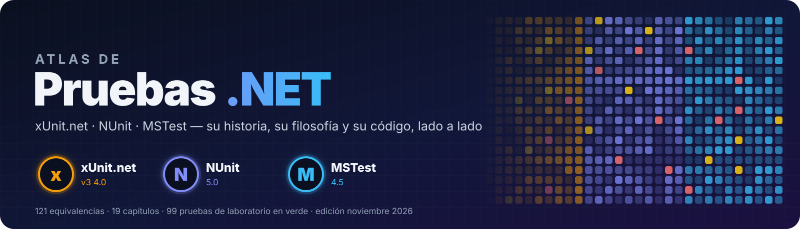
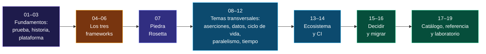
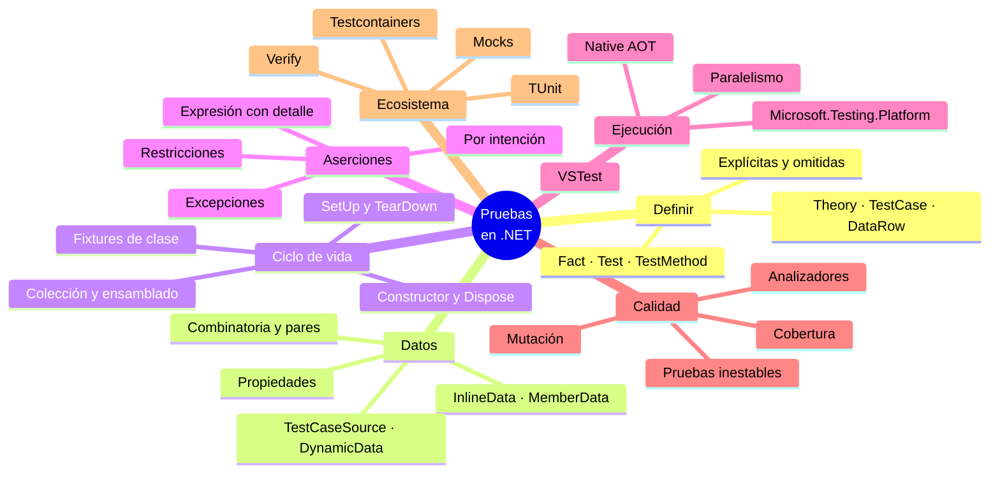
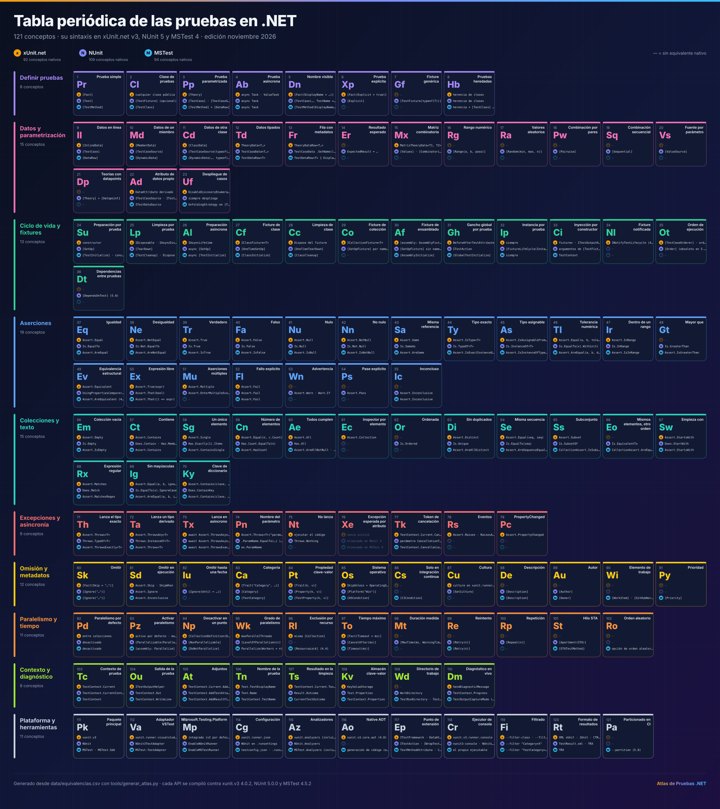
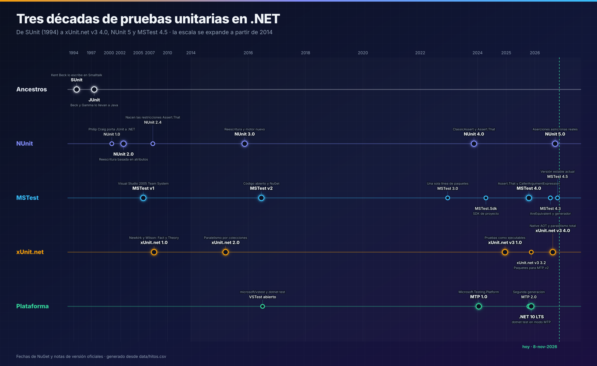

<p align="center">
  
</p>

<p align="center">
  
  
  
  
  
  
  
  
</p>

<p align="center">
  <b>Atlas de Pruebas .NET</b> es una guía técnica en español sobre los tres grandes frameworks de pruebas de .NET:<br>
  <b>xUnit.net</b>, <b>NUnit</b> y <b>MSTest</b>. Su historia, su filosofía, su sintaxis lado a lado, su plataforma de ejecución, sus trampas<br>
  y sus versiones de 2026, con <b>cada ejemplo compilado y ejecutado</b> contra los paquetes reales, verificado al <b>8 de noviembre de 2026</b>.
</p>

---

## Contenido

- [¿Qué son xUnit.net, NUnit y MSTest?](#qué-son-xunitnet-nunit-y-mstest)
- [Estado actual](#estado-actual)
- [Cómo usar este atlas](#cómo-usar-este-atlas)
- [La misma prueba en tres lenguas](#la-misma-prueba-en-tres-lenguas)
- [El universo de las pruebas en un mapa](#el-universo-de-las-pruebas-en-un-mapa)
- [Tabla periódica de las pruebas](#tabla-periódica-de-las-pruebas)
- [Índice de capítulos](#índice-de-capítulos)
- [Tres décadas en una línea](#tres-décadas-en-una-línea)
- [Diez diferencias que debes conocer](#diez-diferencias-que-debes-conocer)
- [Las pruebas de .NET en cifras](#las-pruebas-de-net-en-cifras)
- [Qué cambió en 2025–2026](#qué-cambió-en-20252026)
- [Plazos que no puedes ignorar](#plazos-que-no-puedes-ignorar)
- [El laboratorio](#el-laboratorio)
- [Estructura del repositorio](#estructura-del-repositorio)
- [Convenciones](#convenciones)
- [Metodología y fuentes](#metodología-y-fuentes)

---

## ¿Qué son xUnit.net, NUnit y MSTest?

Son los tres frameworks con los que se escriben y ejecutan pruebas automatizadas en .NET. Los tres descienden de la familia **xUnit** que inició Kent Beck con SUnit, y los tres
resuelven lo mismo —descubrir pruebas, prepararlas, afirmar resultados, ejecutarlas e informar—, pero con **filosofías distintas**:

| | Framework | Desde | Filosofía | Versión al 8-nov-2026 |
|:---:|---|---|---|---|
|  | [**xUnit.net**](docs/04-xunit.md) | 2007 | **Minimalista y opinado**: una instancia por prueba, sin `[SetUp]`, paralelo por defecto | `xunit.v3` **4.0.2** |
|  | [**NUnit**](docs/05-nunit.md) | 2000 | **Rico en funciones**: restricciones componibles y un atributo para cada necesidad | `NUnit` **5.0.0** |
|  | [**MSTest**](docs/06-mstest.md) | 2005 | **Baterías y analizadores incluidos**: el laboratorio de la plataforma de pruebas de Microsoft | `MSTest` **4.5.2** |

> [!IMPORTANT]
> **La conclusión más importante del atlas:** en 2026 los tres son excelentes, se mantienen activamente y comparten la misma plataforma de ejecución. La mejor elección suele ser
> **la que ya usa tu equipo**; lo que sí rinde siempre es adoptar Microsoft.Testing.Platform, los analizadores y buenas prácticas. Ver [15 · Guías de decisión](docs/15-guias-de-decision.md).

---

## Estado actual

| | Paquete | Versión | Publicada | Plataforma | Destinos | Estado |
|---|---|---|---|---|---|---|
| 🟢 | `xunit.v3` | **4.0.2** | 9-oct-2026 (4.0.0: 14-ago) | MTP v2 integrada | .NET 8+ · .NET Framework 4.7.2+ | Estable · Native AOT · 4.0.3 el 9-nov |
| 🟢 | `NUnit` | **5.0.0** | 27-sep-2026 | VSTest · MTP (`NUnit3TestAdapter` 6.3.1) | .NET 8+ · .NET Framework 4.6.2+ | Estable · versión mayor nueva |
| 🟢 | `MSTest` / `MSTest.Sdk` | **4.5.2** | 27-oct-2026 | MTP 2.5.2 por defecto | .NET 8+ · .NET Framework 4.6.2+ | Estable |
| 🟣 | MSTest 5 | — | En desarrollo | MTP 3 | .NET 10+ · .NET Framework 4.6.2+ | *Changelog* público, sin publicar |
| 🟠 | `xunit` (v2) | 2.9.3 | 8-ene-2025 | VSTest | .NET Standard · .NET Framework | Congelado: migra a `xunit.v3` |
| 🔵 | `Microsoft.Testing.Platform` | **2.5.2** | 27-oct-2026 | — | — | Plataforma de futuro |
| 🔵 | `Microsoft.NET.Test.Sdk` (VSTest) | 18.11.0 | 13-oct-2026 | — | — | Mantenida |

---

## Cómo usar este atlas

| Si eres… | Empieza por | Sigue con | Termina en |
|---|---|---|---|
| **Nuevo en pruebas** | [01 · Anatomía de una prueba](docs/01-anatomia-de-una-prueba.md) | El capítulo de tu framework ([04](docs/04-xunit.md) · [05](docs/05-nunit.md) · [06](docs/06-mstest.md)) | [18 · Referencia rápida](docs/18-referencia-rapida-y-glosario.md) |
| **Experto en un framework que llega a otro** | [07 · Piedra Rosetta](docs/07-piedra-rosetta.md) | [17 · Catálogo A–Z](docs/17-catalogo-a-z.md) | [16 · Migración](docs/16-migracion.md#8-entre-frameworks) |
| **Quien elige framework para un proyecto** | [15 · Guías de decisión](docs/15-guias-de-decision.md) | [07 · Piedra Rosetta](docs/07-piedra-rosetta.md#12-puntuación-por-dimensiones) | [19 · Laboratorio](docs/19-laboratorio.md) |
| **Responsable de CI/CD** | [03 · Plataformas de ejecución](docs/03-plataformas-de-ejecucion.md) | [14 · CI, cobertura y reportes](docs/14-ci-cobertura-y-reportes.md) | [11 · Paralelismo](docs/11-paralelismo-y-aislamiento.md) |
| **Quien actualiza versiones** | [16 · Migración](docs/16-migracion.md) | [02 · Historia](docs/02-historia-y-linaje.md#7-cronología-completa) | El capítulo de tu framework |
| **Quien sufre pruebas inestables** | [11 · Paralelismo y aislamiento](docs/11-paralelismo-y-aislamiento.md) | [12 · Asincronía y tiempo](docs/12-asincronia-tiempo-y-cancelacion.md) | [10 · Ciclo de vida](docs/10-ciclo-de-vida-y-fixtures.md) |



---

## La misma prueba en tres lenguas

Un cupón del 10 % sobre dos libros de 450 MXN deja el total en 810 MXN. Las tres versiones están en el [laboratorio](docs/19-laboratorio.md) y se ejecutan en cada `dotnet test`:

<table>
<tr>
<th>xUnit.net v3</th>
<th>NUnit 5</th>
<th>MSTest 4</th>
</tr>
<tr>
<td>

```csharp xunit
public class CuponTests
{
    private readonly Carrito _carrito = new();

    [Fact]
    public void Descuenta_sobre_el_subtotal()
    {
        _carrito.Agregar(Catalogo.Libro, 2);
        _carrito.AplicarCupon(new("ATLAS10", 10m));

        Assert.Equal(
            new Dinero(810m),
            _carrito.Total);
    }
}
```

</td>
<td>

```csharp nunit
public class CuponTests
{
    private Carrito _carrito = null!;

    [SetUp]
    public void Preparar() => _carrito = new();

    [Test]
    public void Descuenta_sobre_el_subtotal()
    {
        _carrito.Agregar(Catalogo.Libro, 2);
        _carrito.AplicarCupon(new("ATLAS10", 10m));

        Assert.That(
            _carrito.Total,
            Is.EqualTo(new Dinero(810m)));
    }
}
```

</td>
<td>

```csharp mstest
[TestClass]
public sealed class CuponTests
{
    private readonly Carrito _carrito = new();

    [TestMethod]
    public void Descuenta_sobre_el_subtotal()
    {
        _carrito.Agregar(Catalogo.Libro, 2);
        _carrito.AplicarCupon(new("ATLAS10", 10m));

        Assert.AreEqual(
            new Dinero(810m),
            _carrito.Total);
    }
}
```

</td>
</tr>
</table>

Tres detalles que el ojo pasa por alto y que el [capítulo 07](docs/07-piedra-rosetta.md#10-diferencias-que-muerden) explica: NUnit **comparte la instancia** de la clase entre
pruebas (por eso usa `[SetUp]`), pone el valor **real primero**, y solo MSTest **exige** un atributo en la clase.

---

## El universo de las pruebas en un mapa



---

## Tabla periódica de las pruebas

Los 121 conceptos del [catálogo](docs/17-catalogo-a-z.md), agrupados en diez familias, con su sintaxis en los tres frameworks. Cada API se compiló contra `xunit.v3` 4.0.2,
`NUnit` 5.0.0 y `MSTest` 4.5.2. Haz clic para ver el póster a tamaño completo.

<p align="center">
  <a href="assets/atlas-pruebas-tabla-periodica.svg">
    
  </a>
</p>

> [!TIP]
> El póster, el [catálogo A–Z](docs/17-catalogo-a-z.md), la línea de tiempo y el banner se generan desde [`data/equivalencias.csv`](data/equivalencias.csv) y
> [`data/hitos.csv`](data/hitos.csv) con `python3 tools/generar_atlas.py`. Para corregir una entrada, edita una fila y vuelve a ejecutar el script.

---

## Índice de capítulos

| # | Capítulo | Lo que encontrarás | Protagonistas |
|---|---|---|---|
| 01 | [Anatomía de una prueba](docs/01-anatomia-de-una-prueba.md) | Qué es una prueba unitaria, AAA, FIRST, dobles de Meszaros, formas de la suite, mensajes de fallo reales | AAA, FIRST |
| 02 | [Historia y linaje](docs/02-historia-y-linaje.md) | SUnit, JUnit, NUnit, MSTest, xUnit.net; cronología verificada en NuGet; correcciones al README anterior | Beck, Newkirk, Wilson |
| 03 | [**Plataformas de ejecución**](docs/03-plataformas-de-ejecucion.md) | VSTest frente a Microsoft.Testing.Platform, `dotnet test` en .NET 10, opciones, códigos de salida, extensiones | MTP, `global.json` |
| 04 | [**xUnit.net v3**](docs/04-xunit.md) | Hechos y teorías, fuentes de datos, fixtures, `TestContext`, paralelismo total, Native AOT, novedades de la 4.0 | `[Fact]`, `TestContext` |
| 05 | [**NUnit 5**](docs/05-nunit.md) | Restricciones, combinatoria, `[SetUpFixture]`, control de ejecución, todo lo que cambió en NUnit 5 | `Assert.That`, `[TestCase]` |
| 06 | [**MSTest 4**](docs/06-mstest.md) | `MSTest.Sdk`, aserciones renovadas, cuatro niveles de ciclo de vida, condiciones, `[ResourceLock]`, MSTest 5 | `[TestMethod]`, `MSTest.Sdk` |
| 07 | [**Piedra Rosetta**](docs/07-piedra-rosetta.md) | Equivalencias en todas las dimensiones, 14 diferencias que muerden, puntuación comparada | Los tres |
| 08 | [Aserciones](docs/08-aserciones.md) | Tres estilos, mensajes reales, igualdad y equivalencia comprobadas, excepciones, tolerancias, bibliotecas externas | `Assert.*` |
| 09 | [Pruebas parametrizadas](docs/09-pruebas-parametrizadas.md) | Descubrimiento, nombres, una tabla JSON en tres frameworks, combinatoria, propiedades | `[Theory]`, `[TestCaseSource]` |
| 10 | [Ciclo de vida y fixtures](docs/10-ciclo-de-vida-y-fixtures.md) | El orden demostrado con pruebas, alcances, herencia, contenedores, *builders* | Fixtures |
| 11 | [Paralelismo y aislamiento](docs/11-paralelismo-y-aislamiento.md) | Tres modelos, siete fuentes de no determinismo, pruebas inestables | `[Parallelizable]`, colecciones |
| 12 | [Asincronía, tiempo y cancelación](docs/12-asincronia-tiempo-y-cancelacion.md) | `async` correcto, `TimeProvider` y `FakeTimeProvider`, tiempos máximos cooperativos | `TimeProvider`, tokens |
| 13 | [Dobles de prueba y ecosistema](docs/13-dobles-de-prueba-y-ecosistema.md) | Moq, NSubstitute, FakeItEasy, Bogus, Verify, Testcontainers, Stryker.NET, TUnit | Bibliotecas |
| 14 | [CI, cobertura y reportes](docs/14-ci-cobertura-y-reportes.md) | TRX, JUnit, CTRF, GitHub Actions, Azure Pipelines, la cobertura real del laboratorio | `--report-trx`, `--coverage` |
| 15 | [Guías de decisión](docs/15-guias-de-decision.md) | Árboles para framework, plataforma, aserciones, dobles y estado compartido; escenarios | — |
| 16 | [Migración](docs/16-migracion.md) | NUnit 3→4→5, xUnit.net v2→v3→4.0, MSTest v1→4→5, VSTest→MTP, entre frameworks | — |
| 17 | [Catálogo A–Z](docs/17-catalogo-a-z.md) | 121 conceptos con su sintaxis en los tres frameworks | Todos |
| 18 | [Referencia rápida y glosario](docs/18-referencia-rapida-y-glosario.md) | Plantillas, comandos, filtros, configuración y 50 términos | — |
| 19 | [**Laboratorio**](docs/19-laboratorio.md) | La tienda probada tres veces: escenarios, métricas, hallazgos y ejercicios | 99 pruebas |

---

## Tres décadas en una línea

<p align="center">
  <a href="assets/atlas-pruebas-linea-de-tiempo.svg">
    
  </a>
</p>

| Año | NUnit | MSTest | xUnit.net | Plataforma |
|---|---|---|---|---|
| **2000–2002** | 1.0 (port de JUnit) · **2.0** con atributos | — | — | — |
| **2005–2007** | 2.4: `Assert.That` | **v1** en VS 2005 Team System | **1.0**: `[Fact]`, `[Theory]` | `mstest.exe` |
| **2012** | — | — | — | **VSTest** con adaptadores |
| **2015–2016** | **3.0** | **v2** de código abierto | **2.0**: paralelismo | VSTest abierto, `dotnet test` |
| **2022–2023** | **4.0**: `ClassicAssert` | **3.0** | 2.5: nuevas aserciones | — |
| **2024** | 4.1–4.3 | 3.2–3.7 · `MSTest.Sdk` | **v3 1.0**: ejecutables | **MTP 1.0** |
| **2025** | 4.4 | **4.0**: `Assert.That` | v3 2.0–3.2 | **MTP 2.0** · modo MTP en .NET 10 |
| **2026** | 4.5 · 4.6 · **5.0** 🟢 | 4.1–**4.5** 🟢 | **v3 4.0** 🟢: Native AOT | MTP 2.5 |

Historia completa, con fechas de NuGet y correcciones al README anterior: [02 · Historia y linaje](docs/02-historia-y-linaje.md).

---

## Diez diferencias que debes conocer

| # | Diferencia | xUnit.net v3 | NUnit 5 | MSTest 4 |
|---:|---|---|---|---|
| 1 | Instancia de la clase | Una por prueba | **Una por fixture** | Una por prueba |
| 2 | Preparación | Constructor | `[SetUp]` | `[TestInitialize]` o constructor |
| 3 | Paralelismo por defecto | **Activo** | Inactivo | Inactivo |
| 4 | Orden de argumentos | `(esperado, real)` | **`(real, restricción)`** | `(esperado, real)` |
| 5 | `Assert.Throws<T>` | Tipo exacto | Tipo exacto | **Acepta derivados** |
| 6 | "Equivalente" en colecciones | Ignora el orden | `Is.EquivalentTo` ignora el orden | `AreEquivalent` **respeta** el orden |
| 7 | `[Theory]` | Prueba parametrizada | **Teoría con *datapoints*** | — |
| 8 | Atributo de clase | No | Opcional | **Obligatorio** |
| 9 | `Console.WriteLine` | Solo con `[assembly: CaptureConsole]` | Se captura | Se captura |
| 10 | Plataforma por defecto | MTP | VSTest (MTP con `EnableNUnitRunner`) | MTP con `MSTest.Sdk` |

---

## Las pruebas de .NET en cifras

| Indicador (8-nov-2026) | Valor |
|---|---|
| Años desde NUnit 1.0 | **26** |
| Frameworks principales mantenidos | **3** (+ TUnit como recién llegado) |
| Versiones mayores publicadas en 2026 | **2**: xUnit.net v3 4.0 y NUnit 5.0 |
| Versiones menores de MSTest en 2026 | **5** (4.1 a 4.5) |
| Reglas de análisis de MSTest | **más de 80** (`MSTEST0001`–`MSTEST0090`) |
| Formatos de informe nativos de xUnit.net | **7** (TRX, JUnit, CTRF, HTML, Markdown, NUnit XML, xUnit XML) |
| Conceptos en el catálogo de este atlas | **121** · nativos: NUnit 109, MSTest 94, xUnit.net 92 |
| Pruebas del laboratorio | **99** (33 × 3), cobertura del dominio **93,7 %** de líneas |

---

## Qué cambió en 2025–2026

| Área | Novedad | Framework | Estado |
|---|---|---|---|
| Plataforma | **Modo MTP de `dotnet test`** con `global.json` | SDK de .NET 10 | 🟢 |
| Plataforma | Microsoft.Testing.Platform **2.0** y sucesivas hasta 2.5.2 | Los tres | 🟢 |
| Aserciones | **`Assert.That(() => …)`** con el valor de cada subexpresión; `CallerArgumentExpression` en todas | MSTest 4.0 | 🟢 |
| Aserciones | `AreEquivalent`, `AreSequenceEqual`, `ContainsAll`, `AreAll*` | MSTest 4.3 | 🟢 |
| Aserciones | **Aserciones asíncronas reales** (`await Assert.ThrowsAsync`) | NUnit 5.0 | 🟢 |
| Aserciones | `Throws.ArgumentException.ParamName` · restricciones genéricas | NUnit 5.0 | 🟢 |
| Ejecución | **Native AOT** y **paralelismo total** | xUnit.net v3 4.0 | 🟢 |
| Ejecución | **`[ResourceLock]`**, `TestTempDirectory`, OpenTelemetry | MSTest 4.4 | 🟢 |
| Ciclo de vida | Fixtures notificadas y *orderers* de clase y método | xUnit.net v3 4.0 | 🟢 |
| Control | **`[DependsOnTest]`**, `[Repeat(RequiredPassPercentage)]`, `[MaxTime(WarningTime)]` | NUnit 5.0 | 🟢 |
| Ecosistema | FluentAssertions 8 pasa a **licencia comercial**; nace AwesomeAssertions | — | ⚠️ |
| Ecosistema | **TUnit 1.0**: framework basado en generación de código | TUnit | 🟢 |
| Plataforma | `--partition`, `[ExpectedDuration]`, solo .NET 10+ | MSTest 5 | 🟣 |

---

## Plazos que no puedes ignorar

| Fecha | Qué ocurre | Acción |
|---|---|---|
| **10-nov-2026** | Fin de soporte de **.NET 8** y **.NET 9** | Llevar los proyectos de prueba a `net10.0` |
| **nov-2026** | Disponibilidad general prevista de **.NET 11** | Evaluar; `DOTNET_TEST_RUNNER` sustituye a la sección de `global.json` |
| **Ya** | `xunit` v2 congelado en 2.9.3 | Migrar a `xunit.v3` ([guía](docs/16-migracion.md#4-xunitnet-v2--v3)) |
| **Ya** | NUnit 5 exige `await` en `Assert.ThrowsAsync` | Instalar `NUnit.Analyzers` 4.14+ **antes** de actualizar |
| **Próximamente** | MSTest 5 abandona .NET 8 y 9 | Preparar `net10.0` y quitar `[DataTestMethod]` |
| **14-nov-2028** | Fin de soporte de **.NET 10** (LTS) | Planificar el siguiente LTS |

> [!WARNING]
> Una prueba no caduca, pero **su runtime sí**. Un proyecto de pruebas en `net8.0` deja de recibir parches de seguridad el 10 de noviembre de 2026, y las próximas versiones de
> los frameworks dejarán de admitirlo.

---

## El laboratorio

El repositorio no es solo documentación: contiene una pequeña tienda (`src/Tienda.Dominio`) probada **tres veces** con los mismos 33 escenarios.

```bash
dotnet test                       # 99 pruebas · xUnit.net v3 + NUnit 5 + MSTest 4 · modo MTP
python3 tools/verificar_ejemplos.py   # compila y ejecuta cada bloque de código del atlas
python3 tools/generar_atlas.py        # regenera catálogo, póster, línea de tiempo y banner
```

```text
  …/Tienda.Tests.MSTest.dll (net10.0|arm64) correcto (482ms)
  …/Tienda.Tests.NUnit.dll (net10.0|arm64) correcto (563ms)
  …/Tienda.Tests.XUnit.dll (net10.0|arm64) correcto (559ms)
  total: 99
  error: 0
  correcto: 99
```

Escenarios, métricas comparadas, diez hallazgos del laboratorio y ejercicios: [19 · Laboratorio](docs/19-laboratorio.md).

---

## Estructura del repositorio

```text
.
├── README.md                         ← estás aquí (portada e índice)
├── docs/                             ← 19 capítulos
│   ├── 01 … 03                       ← fundamentos: prueba, historia, plataforma
│   ├── 04-xunit.md · 05-nunit.md · 06-mstest.md
│   ├── 07-piedra-rosetta.md          ← el capítulo comparativo central
│   ├── 08 … 14                       ← temas transversales, ecosistema y CI
│   ├── 15 · 16                       ← decidir y migrar
│   ├── 17-catalogo-a-z.md            ← generado desde data/equivalencias.csv
│   ├── 18-referencia-rapida-y-glosario.md
│   └── 19-laboratorio.md
├── data/
│   ├── equivalencias.csv             ← fuente única del catálogo y de la tabla periódica
│   └── hitos.csv                     ← fuente de la línea de tiempo
├── tools/
│   ├── generar_atlas.py              ← catálogo, póster, línea de tiempo y banner (Python 3, sin dependencias)
│   └── verificar_ejemplos.py         ← compila y ejecuta cada ejemplo con el framework que declara
├── assets/
│   ├── atlas-pruebas-*.svg           ← banner, tabla periódica y línea de tiempo
│   └── logos/                        ← xunit.svg · nunit.svg · mstest.svg
├── src/Tienda.Dominio/               ← laboratorio: el código bajo prueba
├── tests/                            ← laboratorio: la misma suite en tres frameworks
├── .github/workflows/atlas.yml       ← CI: laboratorio en 3 SO + verificación de ejemplos
├── global.json · Directory.Build.props · Directory.Packages.props · UnitTestingFrameworks.slnx
└── LICENSE                           ← Boost Software License 1.0
```

---

## Convenciones

| Símbolo | Significado |
|---|---|
| 🟢 | Estable |
| 🟣 | En desarrollo o vista previa |
| 🟠 | Congelado o a punto de perder soporte |
| 🔵 | Infraestructura (plataforma, SDK) |
| ⚠️ | Cambio de licencia o de comportamiento |
| `—` | Sin equivalente nativo |
| `(4.0)`, `(5.0)` | Versión del framework en que apareció la característica |

Colores de los diagramas y del póster: **ámbar** = xUnit.net · **índigo** = NUnit · **celeste** = MSTest · **verde** = plataforma y resultados correctos.

Los bloques de código de los capítulos llevan una marca para el verificador (`xunit`, `nunit`, `mstest`, `dominio`, `omitir`); GitHub la ignora al mostrar el código.

---

## Metodología y fuentes

- **Fecha de corte:** 8 de noviembre de 2026. Versiones: `xunit.v3` 4.0.2, `NUnit` 5.0.0, `MSTest` 4.5.2, Microsoft.Testing.Platform 2.5.2, SDK de .NET 10.0.403.
  `xunit.v3` 4.0.3 se publicó el 9 de noviembre y no cambia ningún ejemplo. MSTest 5 se describe según su *changelog* público, sin publicar.
- **Ejemplos verificados:** **90 de los 104** bloques `csharp` del atlas se compilan con `TreatWarningsAsErrors` —es decir, **pasando todos los analizadores** de cada framework— y
  sus pruebas se **ejecutan**: **255 pruebas**, todas en verde. Los 14 bloques restantes están marcados `omitir` porque muestran sintaxis histórica (NUnit 3, MSTest 3, xUnit.net v2)
  o dependen de paquetes externos (Moq, Verify, Testcontainers…). Los mensajes de fallo citados son salida real.
- **Comportamientos comprobados empíricamente:** el orden del ciclo de vida, la semántica de "equivalencia" de cada framework, los filtros de línea de comandos, los códigos de salida
  de MTP y la cobertura del laboratorio se midieron, no se supusieron.
- **Fuentes:** historial de versiones de [nuget.org](https://www.nuget.org); notas de versión de [xUnit.net](https://xunit.net/releases/v3/4.0.0), [NUnit](https://docs.nunit.org/articles/nunit/release-notes/framework.html)
  y [MSTest](https://github.com/microsoft/testfx/blob/main/docs/Changelog.md); documentación de [Microsoft Learn](https://learn.microsoft.com/dotnet/core/testing/) sobre MTP,
  `dotnet test` y MSTest; *xUnit Test Patterns* de Gerard Meszaros.
- **Correcciones respecto al README anterior:** este atlas sustituye al README en inglés. Se corrigieron fechas de la línea de tiempo (xUnit.net 2.0 fue en 2015, no en 2016; MSTest v2
  en 2016, no en 2021), se actualizaron las versiones de junio de 2026 y se precisó qué plataformas soporta cada framework. Detalle en
  [02 · Historia y linaje](docs/02-historia-y-linaje.md#9-correcciones-a-la-versión-anterior-de-este-readme).
- **Límites:** las puntuaciones del [capítulo 07](docs/07-piedra-rosetta.md#12-puntuación-por-dimensiones) son editoriales. Este atlas no es documentación oficial de Microsoft,
  de la .NET Foundation ni de los proyectos citados.
- **Contribuir:** abre un *issue* o *pull request*. Para el catálogo, edita `data/equivalencias.csv` y ejecuta el generador; para los ejemplos, ejecuta el verificador.

---

<p align="center">
  Hecho con 💜 para la comunidad hispanohablante · Licencia <a href="LICENSE">Boost Software License 1.0</a> ·
  <a href="https://xunit.net">xunit.net</a> · <a href="https://nunit.org">nunit.org</a> · <a href="https://learn.microsoft.com/dotnet/core/testing/unit-testing-mstest-intro">MSTest</a>
</p>
