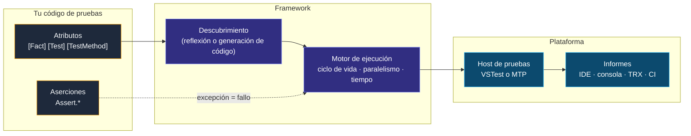
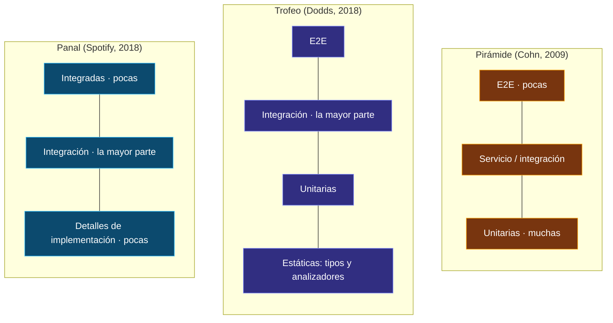

<div align="center">

# 01 · Anatomía de una prueba unitaria

**Qué es una prueba, qué hace un framework por ti y qué vocabulario comparten xUnit.net, NUnit y MSTest**

[🏠 Índice](../README.md) · [02 · Historia y linaje ➡](02-historia-y-linaje.md)

</div>

---

## Contenido

1. [Qué es (y qué no es) una prueba unitaria](#1-qué-es-y-qué-no-es-una-prueba-unitaria)
2. [Lo que hace un framework de pruebas](#2-lo-que-hace-un-framework-de-pruebas)
3. [La misma prueba en tres dialectos](#3-la-misma-prueba-en-tres-dialectos)
4. [Preparar, actuar, afirmar](#4-preparar-actuar-afirmar)
5. [Las propiedades FIRST](#5-las-propiedades-first)
6. [Escuelas: solitaria frente a sociable](#6-escuelas-solitaria-frente-a-sociable)
7. [Dobles de prueba: la taxonomía de Meszaros](#7-dobles-de-prueba-la-taxonomía-de-meszaros)
8. [Formas de la suite: pirámide, trofeo y panal](#8-formas-de-la-suite-pirámide-trofeo-y-panal)
9. [Nombrar pruebas](#9-nombrar-pruebas)
10. [Anatomía de un fallo](#10-anatomía-de-un-fallo)
11. [Antipatrones](#11-antipatrones)
12. [Referencias](#12-referencias)

---

## 1. Qué es (y qué no es) una prueba unitaria

Una **prueba unitaria** es código que ejecuta una porción pequeña de tu programa —la *unidad*— con entradas conocidas y comprueba que el resultado es el esperado. La definición
parece sencilla, pero la palabra *unidad* ha generado décadas de debate. En este atlas usamos el criterio práctico de Michael Feathers (2005): una prueba **no es unitaria** si…

| …toca | Por qué importa |
|---|---|
| una base de datos | Es lenta, comparte estado y puede no estar disponible |
| la red | Introduce latencia y fallos ajenos a tu código |
| el sistema de archivos | Depende de permisos, rutas y del sistema operativo |
| no puede ejecutarse a la vez que las demás | Revela estado compartido oculto |
| exige configurar el entorno (variables, archivos `.config`) | Rompe la reproducibilidad |

Esas pruebas no son *malas*: son **pruebas de integración**, y también se escriben con xUnit.net, NUnit o MSTest. Lo que cambia es su costo y su propósito. El nombre "framework de pruebas
unitarias" es histórico: los tres frameworks de este atlas son, en realidad, **motores generales de ejecución de pruebas automatizadas**.

> [!NOTE]
> El código de este capítulo usa la biblioteca de dominio del [laboratorio](19-laboratorio.md): `Dinero`, `Carrito`, `Producto`, `CalculadoraDeEnvio` y `ServicioDePedidos`,
> en [`src/Tienda.Dominio`](../src/Tienda.Dominio). Cada bloque de código se compila y ejecuta con `python3 tools/verificar_ejemplos.py`.

---

## 2. Lo que hace un framework de pruebas

Sin framework podrías escribir un `Main` que llame a tus métodos y lance excepciones. Un framework te da cinco cosas que ese `Main` no tiene:

| Responsabilidad | Pregunta que responde | Cómo lo expresa cada framework |
|---|---|---|
| **Descubrimiento** | ¿Qué métodos son pruebas? | Atributos: `[Fact]`, `[Test]`, `[TestMethod]` |
| **Ciclo de vida** | ¿Qué se prepara antes y se limpia después? | Constructores, `[SetUp]`, `[TestInitialize]`, fixtures |
| **Aserciones** | ¿Cómo digo qué es correcto y cómo me explican el fallo? | `Assert.Equal`, `Assert.That`, `Assert.AreEqual` |
| **Ejecución** | ¿En qué orden, en qué hilo, en paralelo o no, con qué tiempo máximo? | Colecciones, `[Parallelizable]`, `[Parallelize]` |
| **Informe** | ¿Cómo se comunica el resultado al IDE, a la consola y al CI? | VSTest o Microsoft.Testing.Platform, TRX, JUnit XML |



Un detalle que lo explica casi todo: **una aserción que falla es una excepción**. `Assert.Equal` lanza `EqualException` (xUnit.net), `Assert.That` lanza `AssertionException`
(NUnit) y `Assert.AreEqual` lanza `AssertFailedException` (MSTest). El motor captura la excepción, la convierte en un resultado "fallido" y continúa con la siguiente prueba. Por eso
cualquier excepción no esperada también hace fallar la prueba, y por eso un `try`/`catch` mal puesto puede *tragarse* un fallo.

---

## 3. La misma prueba en tres dialectos

Este es el concepto central del atlas: los tres frameworks expresan **las mismas ideas** con vocabulario distinto. La misma prueba —sumar dos importes en la misma moneda— en los tres:

**xUnit.net v3**

```csharp xunit
public class DineroTests
{
    [Fact]
    public void Sumar_misma_moneda_suma_los_montos()
    {
        var total = new Dinero(10.50m) + new Dinero(4.25m);

        Assert.Equal(new Dinero(14.75m), total);
    }
}
```

**NUnit 5**

```csharp nunit
[TestFixture]
public class DineroTests
{
    [Test]
    public void Sumar_misma_moneda_suma_los_montos()
    {
        var total = new Dinero(10.50m) + new Dinero(4.25m);

        Assert.That(total, Is.EqualTo(new Dinero(14.75m)));
    }
}
```

**MSTest 4**

```csharp mstest
[TestClass]
public sealed class DineroTests
{
    [TestMethod]
    public void Sumar_misma_moneda_suma_los_montos()
    {
        var total = new Dinero(10.50m) + new Dinero(4.25m);

        Assert.AreEqual(new Dinero(14.75m), total);
    }
}
```

| Diferencia visible | xUnit.net | NUnit | MSTest |
|---|---|---|---|
| Marca de la clase | Ninguna | `[TestFixture]`, opcional | `[TestClass]`, obligatoria |
| Marca del método | `[Fact]` | `[Test]` | `[TestMethod]` |
| Estilo de aserción | Método por intención | Restricción (`Is.EqualTo`) | Método por intención |
| Orden de argumentos | `(esperado, real)` | `(real, restricción)` | `(esperado, real)` |

> [!TIP]
> El orden de los argumentos importa más de lo que parece: si los inviertes, la prueba sigue funcionando pero el mensaje de fallo miente ("esperaba 3, obtuvo 5" cuando era al revés).
> Los analizadores de los tres frameworks (`xUnit2000`, `NUnit2005`/`NUnit2007`, `MSTEST0017`) detectan constantes en la posición equivocada.

---

## 4. Preparar, actuar, afirmar

El patrón **AAA** (*Arrange, Act, Assert*), descrito por Bill Wake en 2001, divide cada prueba en tres bloques separados por una línea en blanco. Su equivalente en BDD es
*Given / When / Then*.

```csharp xunit
public class CarritoAaaTests
{
    [Fact]
    public void Un_cupon_del_10_por_ciento_descuenta_sobre_el_subtotal()
    {
        // Preparar (Arrange): el mundo antes de la acción
        var carrito = new Carrito();
        carrito.Agregar(Catalogo.Libro, 2);

        // Actuar (Act): una sola acción, la que se prueba
        carrito.AplicarCupon(new Cupon("ATLAS10", 10m));

        // Afirmar (Assert): el estado observable después
        Assert.Equal(new Dinero(810m), carrito.Total);
    }
}
```

| Regla | Motivo |
|---|---|
| **Una sola acción** | Si hay dos, no sabrás cuál rompió la prueba |
| **Preparación mínima** | Todo lo que aparece en *Arrange* debería ser relevante para el resultado |
| **Afirmar un solo comportamiento** | Varias aserciones están bien si describen *una* consecuencia (subtotal y total del mismo descuento) |
| **Sin lógica** | Nada de `if`, `for` ni `switch` en la prueba: la lógica en una prueba también necesita pruebas |

---

## 5. Las propiedades FIRST

Tim Ottinger y Brett Schuchert resumieron en *FIRST* lo que distingue una buena prueba unitaria:

| Letra | Propiedad | Se rompe cuando… | Herramienta del framework que ayuda |
|---|---|---|---|
| **F** | *Fast*, rápida | Toca disco, red o duerme con `Thread.Sleep` | Tiempo máximo, `TimeProvider` falso ([capítulo 12](12-asincronia-tiempo-y-cancelacion.md)) |
| **I** | *Isolated*, aislada | Comparte estado mutable con otras pruebas | Instancia por prueba, fixtures ([capítulo 10](10-ciclo-de-vida-y-fixtures.md)) |
| **R** | *Repeatable*, repetible | Depende de la hora, la cultura, el azar o el orden | `FakeTimeProvider`, `[SetCulture]`, orden aleatorio ([capítulo 11](11-paralelismo-y-aislamiento.md)) |
| **S** | *Self-validating*, autoverificable | Hay que leer la salida para saber si pasó | Aserciones, nunca `Console.WriteLine` como verificación |
| **T** | *Timely*, oportuna | Se escribe meses después del código | Ciclo TDD: rojo, verde, refactorizar |

La propiedad que más se viola en la práctica es la **R**. Una prueba que a veces falla (*flaky*) es peor que no tener prueba: entrena al equipo a ignorar el rojo.

---

## 6. Escuelas: solitaria frente a sociable

Hay dos tradiciones sobre qué debe aislar una prueba unitaria, y los tres frameworks sirven a ambas:

| | Escuela clásica (Detroit, "sociable") | Escuela de los *mocks* (Londres, "solitaria") |
|---|---|---|
| **Unidad** | Un comportamiento, aunque involucre varias clases | Una clase |
| **Dependencias** | Reales, salvo las lentas o no deterministas | Sustituidas por dobles |
| **Verifica** | Estado final | Interacciones (qué se llamó, con qué) |
| **Ventaja** | Resiste refactorizaciones internas | Localiza el fallo con precisión |
| **Riesgo** | Un fallo puede romper muchas pruebas | Pruebas acopladas a la implementación |
| **Referentes** | Kent Beck, Martin Fowler | Steve Freeman y Nat Pryce (*GOOS*) |

El laboratorio sigue la escuela clásica: `ServicioDePedidos` se prueba con el `RepositorioEnMemoria` real y solo se sustituyen el reloj (no determinista) y el notificador (efecto externo).

---

## 7. Dobles de prueba: la taxonomía de Meszaros

Gerard Meszaros (*xUnit Test Patterns*, 2007) bautizó a los sustitutos de dependencias como **dobles de prueba**, por analogía con los dobles de cine. El libro, por cierto, es el
origen del término "familia xUnit".

| Doble | Qué hace | Ejemplo en el laboratorio |
|---|---|---|
| **Dummy** | Se pasa pero nunca se usa | Un `string` de correo en una prueba que falla antes de notificar |
| **Stub** | Devuelve respuestas preparadas | Un repositorio que siempre devuelve el mismo pedido |
| **Spy** | Registra cómo se le llamó, para verificarlo después | `NotificadorEspia`, con su lista `Enviados` |
| **Mock** | Lleva expectativas y falla si no se cumplen | `Mock<INotificador>` con `Verify` en Moq |
| **Fake** | Implementación funcional pero simplificada | `RepositorioEnMemoria`, `FakeTimeProvider` |

```csharp xunit
public class NotificacionTests
{
    [Fact]
    public async Task Confirmar_notifica_al_cliente()
    {
        var espia = new NotificadorEspia();                               // spy
        var reloj = new Microsoft.Extensions.Time.Testing.FakeTimeProvider(); // fake
        var servicio = new ServicioDePedidos(new RepositorioEnMemoria(), espia, reloj);
        var carrito = new Carrito();
        carrito.Agregar(Catalogo.Taza);

        await servicio.ConfirmarAsync(carrito, "ana@ejemplo.mx", TestContext.Current.CancellationToken);

        Assert.Equal("ana@ejemplo.mx", Assert.Single(espia.Enviados).Destinatario);
    }
}
```

Las bibliotecas de *mocks* (Moq, NSubstitute, FakeItEasy) generan estos dobles en tiempo de ejecución; se comparan en el [capítulo 13](13-dobles-de-prueba-y-ecosistema.md).

---

## 8. Formas de la suite: pirámide, trofeo y panal



Ninguna forma es universal: una biblioteca de cálculo vive en la base de la pirámide; un microservicio que sobre todo traduce HTTP a SQL encaja mejor en el panal. Lo que sí es universal
es la **economía**: cuanto más arriba, más lenta, más frágil y más cara de diagnosticar. Los tres frameworks ejecutan todas las capas; [Testcontainers](13-dobles-de-prueba-y-ecosistema.md#7-pruebas-de-integración)
y `WebApplicationFactory` llevan la integración al mismo `dotnet test`.

---

## 9. Nombrar pruebas

El nombre es lo primero que lees cuando una prueba falla en el CI. Las convenciones más usadas:

| Convención | Ejemplo | Comentario |
|---|---|---|
| `Metodo_Escenario_Resultado` (Roy Osherove) | `Agregar_SuperaMaximo_Lanza` | Acoplada al nombre del método |
| Frase en lenguaje natural | `No_se_superan_las_unidades_maximas_por_producto` | La que usa este atlas: describe el comportamiento |
| *Given/When/Then* | `Dado_un_carrito_lleno_cuando_agrego_entonces_falla` | Útil con BDD |
| Clase por escenario | `CuandoElCarritoTieneCupon.ElTotalIncluyeElDescuento` | Agrupa por contexto |

Los tres frameworks permiten además un **nombre visible** distinto del nombre del método (`DisplayName`, `TestName`, `[TestMethod(DisplayName = "…")]`), y xUnit.net v3 4.0 añadió la opción
`RemoveAsyncSuffix` para quitar el sufijo `Async` de los nombres mostrados.

---

## 10. Anatomía de un fallo

Una prueba vale lo que vale su mensaje de error. Compara el mismo fallo —esperábamos `810.00 MXN`, el total es `900.00 MXN`— en los tres frameworks:

```text
xUnit.net v3 4.0.2
    Fallos.Igualdad [FAIL]
      Assert.Equal() Failure: Values differ
      Expected: 810.00 MXN
      Actual:   900.00 MXN

NUnit 5.0.0
con errores Igualdad (4ms)
    Assert.That(c.Total, Is.EqualTo(new Dinero(810m)))
    Expected: 810.00 MXN
    But was:  900.00 MXN

MSTest 4.5.2 (mensajes localizados según la cultura del sistema)
con errores Igualdad (16ms)
  Assertion failed. Se esperaba que los valores fueran iguales.
  expected: 810.00 MXN
  actual:   900.00 MXN
  Assert.AreEqual(new Dinero(810m), c.Total)
```

Es salida real, capturada al ejecutar una prueba que falla a propósito en cada framework. Fíjate en la tendencia: NUnit (desde la versión 4) y MSTest (desde la 4) usan
`CallerArgumentExpression` para **reproducir el código fuente de la aserción** en el mensaje. Es una de las mejoras más útiles de la última década y se analiza en el
[capítulo 08](08-aserciones.md).

> [!IMPORTANT]
> Los tres mensajes usan `ToString()` del valor. `Dinero` lo redefine (`810.00 MXN`); sin ese `ToString`, un `record struct` igualmente mostraría sus propiedades, pero una clase
> normal mostraría solo su nombre de tipo. **Redefinir `ToString` en tus objetos de dominio mejora todos tus mensajes de error.**

---

## 11. Antipatrones

| Antipatrón | Síntoma | Remedio |
|---|---|---|
| **Prueba mentirosa** | Pasa siempre, incluso si rompes el código | Verla fallar al menos una vez (rojo antes de verde) |
| **`Thread.Sleep`** | Lenta e inestable | `FakeTimeProvider`, `await` con tiempo máximo |
| **Estado estático compartido** | Falla solo en paralelo o en cierto orden | Instancia por prueba; analizadores `MSTEST0074`–`MSTEST0077` |
| **Lógica condicional** | `if` dentro de la prueba | Dividir en dos pruebas o parametrizar |
| **Probar miembros privados** | Reflexión, `InternalsVisibleTo` abusivo | Probar a través de la API pública |
| **Exceso de *mocks*** | Cada refactorización rompe decenas de pruebas | Verificar estado, no interacciones |
| **Aserción ausente** | La prueba "pasa" porque no comprueba nada | Analizadores y [pruebas de mutación](13-dobles-de-prueba-y-ecosistema.md#8-pruebas-de-mutación) |
| **`try`/`catch` en la prueba** | Se traga la `AssertionException` | `Assert.Throws` |
| **Gigante** | 80 líneas de preparación | *Builders*, *Object Mother*, fixtures |
| **`async void`** | Las excepciones se pierden | Siempre `async Task` |

---

## 12. Referencias

- Kent Beck, *Simple Smalltalk Testing: With Patterns* (1994) y *Test-Driven Development: By Example* (2002).
- Gerard Meszaros, *xUnit Test Patterns: Refactoring Test Code*, Addison-Wesley (2007).
- Michael Feathers, *A Set of Unit Testing Rules* (2005) y *Working Effectively with Legacy Code* (2004).
- Martin Fowler, [*UnitTest*](https://martinfowler.com/bliki/UnitTest.html) y [*Mocks Aren't Stubs*](https://martinfowler.com/articles/mocksArentStubs.html).
- Vladimir Khorikov, *Unit Testing Principles, Practices, and Patterns*, Manning (2020).
- Microsoft Learn, [*Unit testing best practices for .NET*](https://learn.microsoft.com/dotnet/core/testing/unit-testing-best-practices).

---

<div align="center">

[🏠 Índice](../README.md) · [02 · Historia y linaje ➡](02-historia-y-linaje.md)

</div>
