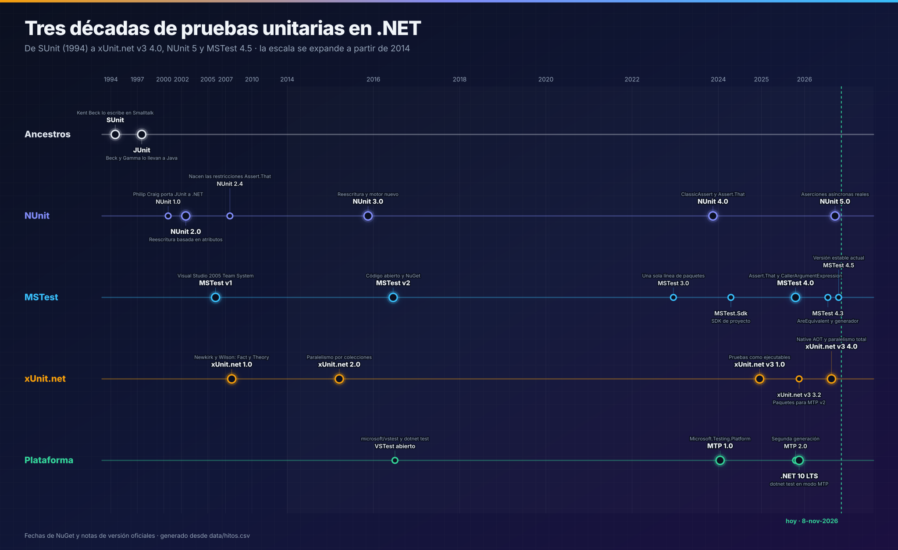
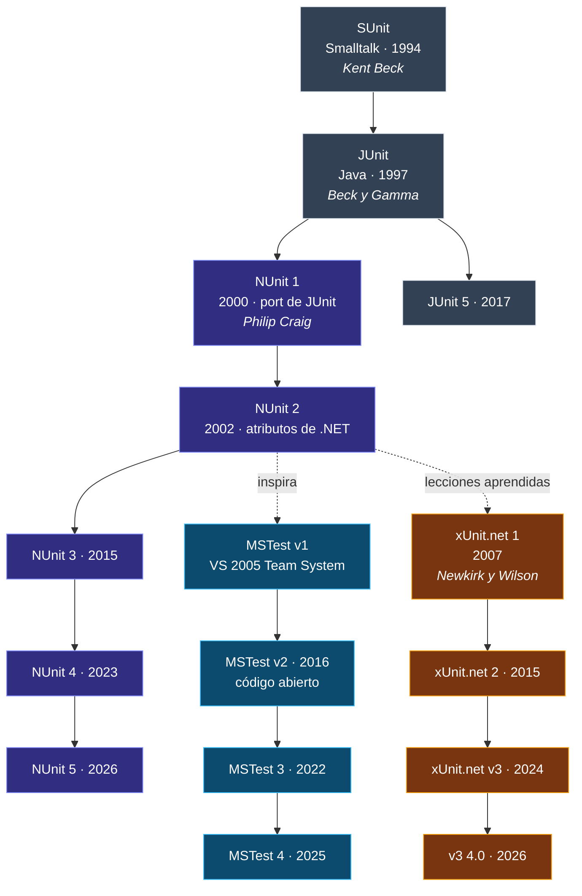
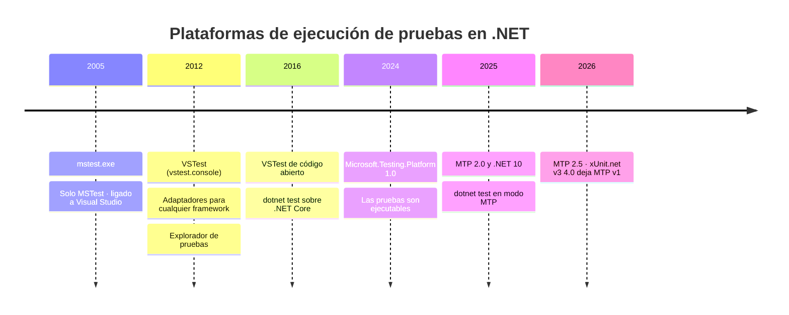
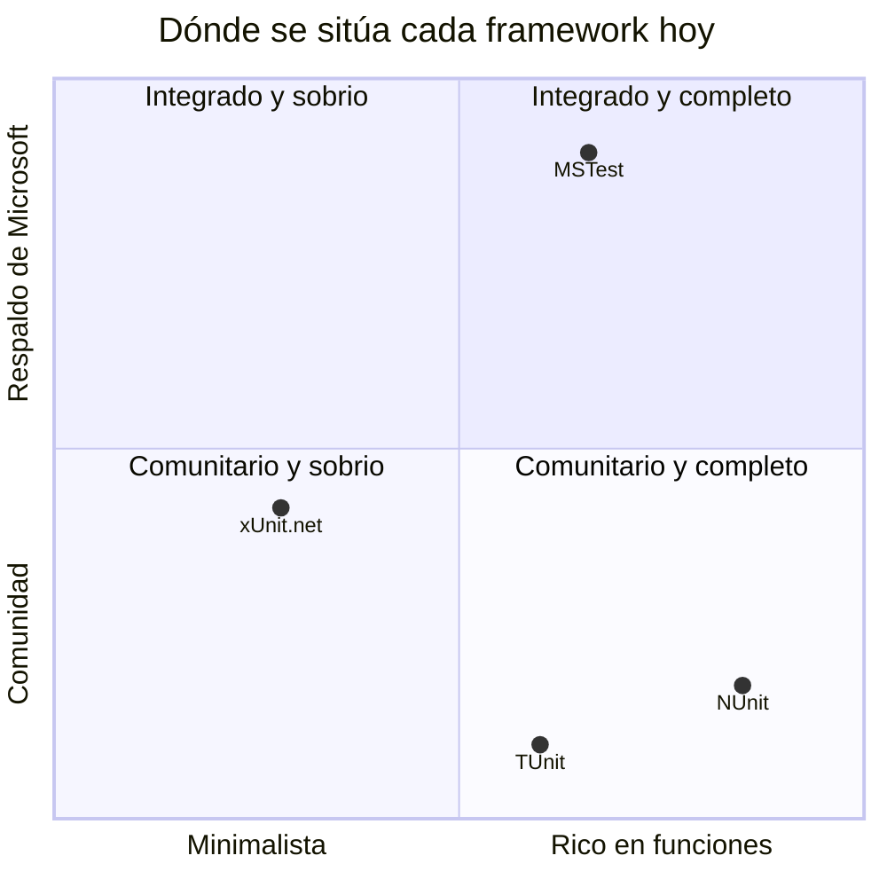

# 02 · Historia y linaje

**De SUnit a xUnit.net v3 4.0, NUnit 5 y MSTest 4.5: tres décadas, tres filosofías y una familia**

[⬅ 01 · Anatomía de una prueba](01-anatomia-de-una-prueba.md) · [🏠 Índice](../README.md) · [03 · Plataformas de ejecución ➡](03-plataformas-de-ejecucion.md)

  

---

## Contenido

1. [El árbol genealógico](#1-el-árbol-genealógico)
2. [Los ancestros: SUnit y JUnit](#2-los-ancestros-sunit-y-junit)
3. [NUnit: el primogénito (2000)](#3-nunit-el-primogénito-2000)
4. [MSTest: el framework de la casa (2005)](#4-mstest-el-framework-de-la-casa-2005)
5. [xUnit.net: la reforma (2007)](#5-xunitnet-la-reforma-2007)
6. [La plataforma: de `mstest.exe` a Microsoft.Testing.Platform](#6-la-plataforma-de-mstestexe-a-microsofttestingplatform)
7. [Cronología completa](#7-cronología-completa)
8. [Cuatro eras](#8-cuatro-eras)
9. [Correcciones a la versión anterior de este README](#9-correcciones-a-la-versión-anterior-de-este-readme)
10. [Referencias](#10-referencias)

---

## 1. El árbol genealógico

Los tres frameworks de este atlas pertenecen a la **familia xUnit**: el nombre que Gerard Meszaros dio a todos los descendientes de SUnit que comparten cuatro piezas —*test case*,
*fixture*, *assertion* y *runner*—. "xUnit" es la familia; **xUnit.net** es uno de sus miembros, y el más joven de los tres.

Una curiosidad que ordena todo el relato: **James Newkirk** fue uno de los autores de NUnit 2 y luego, ya en Microsoft, cofundó xUnit.net. xUnit.net es, literalmente, lo que
uno de los padres de NUnit haría distinto si empezara de cero.

---

## 2. Los ancestros: SUnit y JUnit

| | SUnit | JUnit |
|---|---|---|
| **Año** | Principios de los noventa; artículo canónico de 1994 | 1997 |
| **Autores** | Kent Beck | Kent Beck y Erich Gamma |
| **Lenguaje** | Smalltalk | Java |
| **Idea clave** | Las pruebas son objetos; un `TestCase` con `setUp` y `tearDown` | Llevar SUnit a Java; nace en un vuelo camino de OOPSLA |
| **Descubrimiento** | Por convención de nombres | Métodos que empiezan por `test` (hasta JUnit 4, en 2006, que adoptó anotaciones) |

Lo que heredan los tres frameworks de .NET:

- Una **clase** agrupa pruebas relacionadas.
- Un **método** es una prueba.
- Un **fallo** es una excepción.
- Una **fixture** prepara el contexto.
- Un **runner** las descubre, las ejecuta y las informa.

Lo que .NET aportó desde el principio, y Java solo copió años después, fueron los **atributos**: metadatos en el código que hacen innecesarias las convenciones de nombres.

---

## 3. NUnit: el primogénito (2000)

| Versión | Año | Qué cambió |
|---|---|---|
| **1.x** | 2000 | Philip Craig porta JUnit a .NET casi línea a línea |
| **2.0** | 2002 | Reescritura idiomática con **atributos** (`[TestFixture]`, `[Test]`). Equipo: James Newkirk, Michael Two, Alexei Vorontsov, Charlie Poole y Philip Craig |
| **2.4** | 2007 | Modelo de **restricciones**: `Assert.That(x, Is.EqualTo(y))` |
| **2.5** | 2009 | Pruebas parametrizadas con `[TestCase]` y `[TestCaseSource]` |
| **3.0** | nov-2015 | Reescritura: motor separado, **paralelismo**, `async`, .NET Core más tarde |
| **3.12** | may-2019 | Mejor soporte de .NET Core |
| **3.13** | ene-2021 | Última línea larga de NUnit 3; 3.14 (nov-2023) prepara la transición |
| **4.0** | nov-2023 | Las aserciones clásicas pasan a `ClassicAssert` (`NUnit.Framework.Legacy`); se exige .NET Framework 4.6.2 o .NET 6; mensajes con `CallerArgumentExpression` |
| **4.1** | feb-2024 | `TestCaseData<T…>` genérico |
| **4.2** | ago-2024 | `Assert.EnterMultipleScope()` |
| **4.3** | dic-2024 | Mejoras de restricciones y rendimiento |
| **4.4–4.6** | ago-2025 a may-2026 | Sobrecargas con `Action`/`Func`, que en 4.6 causaron ambigüedades con `TestDelegate` |
| **5.0** 🟢 | **27-sep-2026** | **Aserciones asíncronas reales**, delegados estándar, restricciones genéricas, `[DependsOnTest]`, solo `net462`, `net8.0` y `net10.0` |

**Filosofía.** NUnit es el framework **más rico en funciones**: tiene un atributo para casi todo (`[Repeat]`, `[Retry]`, `[Combinatorial]`, `[Pairwise]`, `[Random]`,
`[MaxTime]`…) y un lenguaje de restricciones expresivo. Su lema implícito es "si un equipo lo necesita, que el framework lo traiga". Lo mantiene una comunidad de voluntarios;
Rob Prouse, Terje Sandstrom, Manfred Brands, Mikkel Nylander Bundgaard y Steven Weerdenburg figuran entre los nombres más activos de la etapa reciente.

> [!NOTE]
> NUnit 5 es una versión mayor "pequeña", según su propio equipo: casi todos sus cambios incompatibles terminan trabajo empezado en la serie 4 o convierten errores de ejecución en
> errores de compilación. Detalles en [05 · NUnit](05-nunit.md#9-nunit-5-qué-cambió) y en [16 · Migración](16-migracion.md).

---

## 4. MSTest: el framework de la casa (2005)

| Versión | Año | Qué cambió |
|---|---|---|
| **v1** | nov-2005 | Llega con **Visual Studio 2005 Team System**: `Microsoft.VisualStudio.QualityTools.UnitTestFramework.dll`, `mstest.exe`, archivos `.vsmdi` y `.testsettings`. Se instalaba con Visual Studio, no con NuGet |
| **VS 2012** | 2012 | Aparece la plataforma **VSTest** con adaptadores: el Explorador de pruebas ya ejecuta NUnit y xUnit.net |
| **v2** | 2016 | **Código abierto** en GitHub (`microsoft/testfx`) y distribución por NuGet (`MSTest.TestFramework`, `MSTest.TestAdapter`) |
| **2.0** | sep-2019 | Madurez sobre .NET Core |
| **3.0** | dic-2022 | Línea unificada; se retiran destinos antiguos |
| **3.2** | ene-2024 | Primer *runner* sobre **Microsoft.Testing.Platform** |
| **3.3** | abr-2024 | **`MSTest.Sdk`**: un SDK de proyecto MSBuild para pruebas |
| **3.6–3.11** | 2024–2025 | `TestContext` por constructor, `Assert.Throws`, `[Retry]`, `[OSCondition]`, decenas de analizadores |
| **4.0** | 7-oct-2025 | Desaparecen `[ExpectedException]` y `Assert.ThrowsException`; llegan `Assert.That` y los mensajes con `CallerArgumentExpression` |
| **4.1–4.4** | feb a sep-2026 | `IsExactInstanceOfType`, `TestContext.Current` (experimental), `Assert.AreEquivalent`, `[ResourceLock]`, generador de código por reflexión, OpenTelemetry |
| **4.5** 🟢 | **oct-2026** | Diagnóstico de fallos opcional, automatización de UI en Windows, nombres de datos más claros. Versión estable actual: **4.5.2** |
| **5.0** 🟣 | en desarrollo | Solo .NET 10 y 11 en .NET moderno; `--partition`; `[ExpectedDuration]`; se elimina `[DataTestMethod]` |

**Filosofía.** MSTest fue durante una década "el que venía con Visual Studio": cómodo para empezar, criticado por lento, cerrado y atado al IDE. La reconstrucción como v2 en 2016 lo
convirtió en otro framework abierto, y desde 2024 es el **vehículo principal de innovación de la plataforma de pruebas de Microsoft**: Microsoft.Testing.Platform, `MSTest.Sdk`,
analizadores, generación de código para Native AOT y telemetría nacen aquí primero. Su lema actual podría ser "baterías incluidas, analizadores incluidos".

> [!WARNING]
> Mucha documentación en línea sigue mostrando MSTest v1 (`[ExpectedException]`, `.testsettings`, `[DeploymentItem]` con rutas absolutas). **Si un ejemplo usa
> `Microsoft.VisualStudio.QualityTools.UnitTestFramework`, tiene más de diez años.**

---

## 5. xUnit.net: la reforma (2007)

James Newkirk y Brad Wilson publicaron xUnit.net en 2007 con un ensayo titulado *Why did we build xUnit 1.0?*. Sus decisiones eran **sustracciones deliberadas**:

| Decisión de diseño | Lo que eliminó | Por qué |
|---|---|---|
| **Una instancia por prueba** | Estado compartido accidental entre pruebas | El aislamiento debe ser el comportamiento por defecto |
| **Sin `[SetUp]` ni `[TearDown]`** | Métodos "mágicos" de preparación | El constructor y `IDisposable` ya existen en el lenguaje |
| **Sin `[ExpectedException]`** | La excepción esperada "en cualquier línea" | `Assert.Throws` señala la línea exacta |
| **`[Fact]` y `[Theory]`** | `[Test]` para todo | Distingue un hecho invariable de una propiedad que vale para muchos datos |
| **Menos atributos** | `[Category]`, `[Description]`, `[Ignore]`… | Un `[Trait]` genérico y la opción `Skip` |
| **Extensibilidad por composición** | Herencia de clases base del framework | Atributos de datos, *orderers* y frameworks propios |

| Versión | Año | Qué cambió |
|---|---|---|
| **1.0** | 2007 | CodePlex; `[Fact]`, `[Theory]` (en `xunit.extensions`) |
| **1.9** | ene-2012 | Última línea de la serie 1 |
| **2.0** | mar-2015 | **Paralelismo por defecto** entre colecciones; `async`; el equipo de .NET lo adopta para .NET Core |
| **2.4** | jul-2018 | Larga estabilidad; `xunit.analyzers` |
| **2.5–2.9** | jul-2023 a ene-2025 | Renovación de aserciones (`Assert.Equivalent`, `Assert.Multiple`), mensajes con diferencias marcadas |
| **v3 1.0** | 16-dic-2024 | **Paquete nuevo `xunit.v3`**: las pruebas son ejecutables, `TestContext.Current`, `Assert.Skip`, `[Fact(Explicit = true)]`, fixtures de ensamblado, Microsoft.Testing.Platform |
| **v3 2.0–3.2** | 2025 | Mejoras de MTP, CTRF, paquetes `mtp-v2` |
| **v3 4.0** 🟢 | **14-ago-2026** | **Native AOT**, **paralelismo total** opcional, *orderers* de clase y método, fixtures notificadas, consola como herramienta global; MTP v1 y Mono dejan de tener soporte oficial |

**Filosofía.** xUnit.net es el framework **más opinado**: prefiere quitar una función a dejar que se use mal, y empuja a escribir pruebas como código C# normal. Lo dirigen Brad Wilson
(su mantenedor principal desde hace años) y la .NET Foundation. Que su numeración tenga dos capas —**v3** es la generación, **4.0** la versión del paquete `xunit.v3`— confunde a
muchos: "xUnit.net v3 4.0.2" significa "la tercera generación del framework, en su versión 4.0.2".

> [!IMPORTANT]
> **xUnit.net v2 (paquete `xunit`) está congelado en 2.9.3** (enero de 2025) y solo recibe correcciones críticas. Los proyectos nuevos deben usar `xunit.v3`. Ver
> [16 · Migración](16-migracion.md#4-xunitnet-v2--v3).

---

## 6. La plataforma: de `mstest.exe` a Microsoft.Testing.Platform

El framework define *cómo se escribe* una prueba; la **plataforma** define *cómo se ejecuta y se informa*. Esa capa ha tenido tres generaciones:

El [capítulo 03](03-plataformas-de-ejecucion.md) explica en detalle VSTest y Microsoft.Testing.Platform (MTP), y por qué el cambio a MTP es la transformación más profunda del
ecosistema de pruebas de .NET desde 2012.

---

## 7. Cronología completa

| Fecha | Framework | Hito | Fuente |
|---|---|---|---|
| 1994 | SUnit | Kent Beck publica *Simple Smalltalk Testing: With Patterns* | Beck |
| 1997 | JUnit | Beck y Gamma crean JUnit | junit.org |
| 2000 | NUnit 1 | Port de JUnit a .NET | nunit.org |
| 2002 | NUnit 2.0 | Atributos de .NET | nunit.org |
| nov-2005 | MSTest v1 | Visual Studio 2005 Team System | Microsoft |
| 2007 | NUnit 2.4 | Restricciones `Assert.That` | nunit.org |
| 2007 | xUnit.net 1.0 | Newkirk y Wilson | xunit.net |
| 2012 | VSTest | Explorador de pruebas con adaptadores (VS 2012) | Microsoft |
| 16-mar-2015 | xUnit.net 2.0 | Paralelismo por defecto | NuGet |
| 16-nov-2015 | NUnit 3.0 | Reescritura | NuGet |
| 2016 | MSTest v2 | Código abierto y NuGet | Microsoft |
| 15-may-2019 | NUnit 3.12 | — | NuGet |
| 3-sep-2019 | MSTest 2.0 | — | NuGet |
| 6-dic-2022 | MSTest 3.0 | — | NuGet |
| 6-jul-2023 | xUnit.net 2.5 | Renovación de aserciones | NuGet |
| 26-nov-2023 | NUnit 4.0 | `ClassicAssert` | GitHub |
| 24-ene-2024 | Microsoft.Testing.Platform 1.0 | Con MSTest 3.2 | NuGet |
| 3-abr-2024 | MSTest.Sdk 3.3 | SDK de proyecto | NuGet |
| 16-dic-2024 | xUnit.net v3 1.0 | Paquete `xunit.v3` | NuGet |
| 8-ene-2025 | xUnit.net 2.9.3 | Última versión de v2 | NuGet |
| 14-ene-2025 | FluentAssertions 8.0 | Cambio a licencia comercial; nace el *fork* AwesomeAssertions | NuGet |
| 7-oct-2025 | MSTest 4.0 · MTP 2.0 | Segunda generación de la plataforma | NuGet |
| 5-nov-2025 | TUnit 1.0 | Framework basado en generación de código | NuGet |
| nov-2025 | .NET 10 LTS | `dotnet test` con modo MTP nativo | Microsoft |
| 18-feb-2026 | NUnit 4.5 | — | NuGet |
| 19-may-2026 | NUnit 4.6.1 | Última de la serie 4 | NuGet |
| 8-jul-2026 | MSTest 4.3 | `Assert.AreEquivalent`, generador por reflexión | NuGet |
| 14-ago-2026 | xUnit.net v3 4.0 | Native AOT y paralelismo total | xunit.net |
| 2-sep-2026 | MSTest 4.4 | `[ResourceLock]`, `TestTempDirectory`, OpenTelemetry | NuGet |
| 27-sep-2026 | NUnit 5.0 | Aserciones asíncronas reales | NuGet |
| 27-oct-2026 | MSTest 4.5.2 · MTP 2.5.2 | Versión estable actual | NuGet |
| 9-nov-2026 | xUnit.net v3 4.0.3 | Corrección; publicada al cierre de esta edición | NuGet |

---

## 8. Cuatro eras

| Era | Años | Rasgo dominante | Lo que dejó |
|---|---|---|---|
| **Fundación** | 2000–2007 | Portar JUnit y adaptarlo a los atributos de .NET | `[Test]`, `[SetUp]`, `Assert.AreEqual` |
| **Divergencia** | 2007–2015 | Tres filosofías: riqueza (NUnit), integración (MSTest), minimalismo (xUnit.net) | `Assert.That`, `[Fact]`/`[Theory]`, VSTest |
| **Apertura** | 2015–2023 | Código abierto, .NET Core, paralelismo y `async` | Los tres en GitHub y NuGet; `dotnet test` |
| **Plataforma** | 2024–hoy | Pruebas como ejecutables, MTP, analizadores, Native AOT, mensajes con código fuente | `xunit.v3`, `MSTest.Sdk`, NUnit 5, `dotnet test` en modo MTP |

> [!NOTE]
> xUnit.net aparece a media altura porque, aunque es un proyecto comunitario de la .NET Foundation, el propio equipo de .NET lo usa en sus repositorios (`dotnet/runtime`,
> `dotnet/aspnetcore`), y Microsoft participa en su integración con MTP. El gráfico es interpretativo, no una medición.

---

## 9. Correcciones a la versión anterior de este README

El README anterior de este repositorio tenía una línea de tiempo con varias imprecisiones. Este atlas las corrige:

| Afirmación anterior | Corrección | Evidencia |
|---|---|---|
| "2016 · xUnit 2.0" | xUnit.net 2.0 se publicó el **16 de marzo de 2015** | Fecha de `xunit` 2.0.0 en NuGet |
| "2021 · MSTest v2 · soporte de .NET 5" | MSTest v2 se presentó en **2016**; en 2021 se publicó la 2.2 | `MSTest.TestFramework` 1.1.11 (feb-2017) y 2.2.1 (mar-2021) en NuGet |
| "2022 · xUnit updates: enhanced assertions and .NET 6" | La renovación de aserciones llegó con **xUnit.net 2.5, en julio de 2023** | `xunit` 2.5.0 en NuGet |
| "NUnit … 4.6.1 · MSTest 4.1.0" (estado de junio de 2026) | Al 8 de noviembre de 2026: **NUnit 5.0.0**, **MSTest 4.5.2**, **xunit.v3 4.0.2** (4.0.3 al día siguiente) | NuGet |
| "MSTest: Data-driven testing con CSV y XML" | `[DataSource]` con CSV/XML solo existe en **.NET Framework**; en .NET moderno se usa `[DynamicData]` | Documentación de MSTest |
| "xUnit: .NET Core, .NET 5+" | xUnit.net v3 exige **.NET 8 o posterior**, o .NET Framework 4.7.2 | xunit.net |

---

## 10. Referencias

- Kent Beck, [*Simple Smalltalk Testing: With Patterns*](https://web.archive.org/web/20150315073817/http://www.xprogramming.com/testfram.htm).
- James Newkirk y Brad Wilson, [*Why did we build xUnit 1.0?*](https://xunit.net/docs/why-did-we-build-xunit-1.0).
- [Notas de versión de xUnit.net v3 4.0.0](https://xunit.net/releases/v3/4.0.0).
- [Notas de versión de NUnit](https://docs.nunit.org/articles/nunit/release-notes/framework.html) y [NUnit 5: cambios incompatibles](https://docs.nunit.org/articles/nunit/V5BreakingChanges.html).
- [Changelog de MSTest](https://github.com/microsoft/testfx/blob/main/docs/Changelog.md) y [de Microsoft.Testing.Platform](https://github.com/microsoft/testfx/blob/main/docs/Changelog-Platform.md).
- Historial de versiones de cada paquete en [nuget.org](https://www.nuget.org).

---

[⬅ 01 · Anatomía de una prueba](01-anatomia-de-una-prueba.md) · [🏠 Índice](../README.md) · [03 · Plataformas de ejecución ➡](03-plataformas-de-ejecucion.md)

