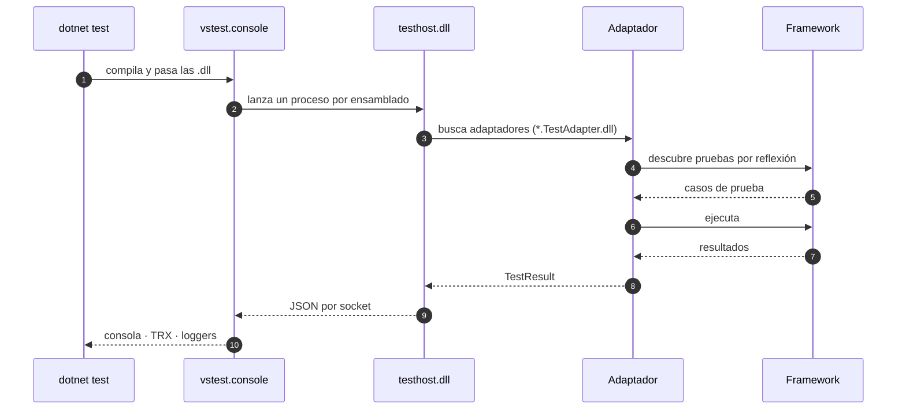
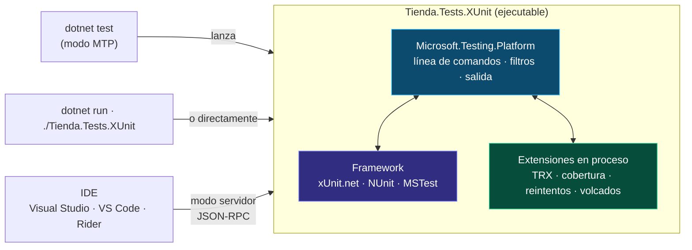

<div align="center">

# 03 · Plataformas de ejecución

**VSTest y Microsoft.Testing.Platform: quién descubre, ejecuta e informa tus pruebas, y cómo `dotnet test` cambió en .NET 10**

[⬅ 02 · Historia y linaje](02-historia-y-linaje.md) · [🏠 Índice](../README.md) · [04 · xUnit.net ➡](04-xunit.md)

</div>

---

## Contenido

1. [Framework, adaptador y plataforma](#1-framework-adaptador-y-plataforma)
2. [VSTest: la arquitectura clásica](#2-vstest-la-arquitectura-clásica)
3. [Microsoft.Testing.Platform: las pruebas son programas](#3-microsofttestingplatform-las-pruebas-son-programas)
4. [Comparación punto por punto](#4-comparación-punto-por-punto)
5. [Activar MTP en cada framework](#5-activar-mtp-en-cada-framework)
6. [`dotnet test` en .NET 10: dos modos](#6-dotnet-test-en-net-10-dos-modos)
7. [Opciones de línea de comandos](#7-opciones-de-línea-de-comandos)
8. [Códigos de salida](#8-códigos-de-salida)
9. [Extensiones de MTP](#9-extensiones-de-mtp)
10. [Archivos de configuración](#10-archivos-de-configuración)
11. [IDE y editores](#11-ide-y-editores)
12. [Referencias](#12-referencias)

---

## 1. Framework, adaptador y plataforma

Cuando pulsas "Ejecutar pruebas" intervienen tres capas que conviene no confundir:

| Capa | Responsabilidad | Ejemplos |
|---|---|---|
| **Framework** | Define atributos, aserciones y ciclo de vida; ejecuta cada prueba | `xunit.v3`, `NUnit`, `MSTest.TestFramework` |
| **Adaptador / *runner*** | Traduce entre el framework y la plataforma | `xunit.runner.visualstudio`, `NUnit3TestAdapter`, `MSTest.TestAdapter` |
| **Plataforma** | Lanza procesos, filtra, recopila resultados, genera informes y habla con el IDE y el CI | **VSTest** o **Microsoft.Testing.Platform** (MTP) |

Durante doce años (2012–2024) la plataforma fue VSTest. Desde 2024 existe una alternativa, MTP, y en noviembre de 2026 los tres frameworks la soportan: **xUnit.net v3 la usa por
defecto**, **MSTest la activa por defecto con `MSTest.Sdk`** y **NUnit la ofrece con una propiedad**. El [laboratorio](19-laboratorio.md) de este repositorio ejecuta los tres
proyectos sobre MTP.

---

## 2. VSTest: la arquitectura clásica



Rasgos de VSTest:

- Las pruebas son **bibliotecas** (`.dll`). No se ejecutan solas: necesitan `vstest.console` y `testhost`, que llegan con el paquete **`Microsoft.NET.Test.Sdk`**.
- Varios procesos se comunican por *sockets* con un protocolo JSON.
- Los adaptadores se localizan por convención de nombre de archivo.
- Se configura con **`.runsettings`** (XML) y se extiende con *data collectors* (cobertura, volcados) y *loggers*.
- Es maduro y universal: lo entienden Visual Studio, Azure DevOps, Rider, VS Code y cualquier sistema de CI.

Su costo es la **complejidad**: varios procesos, *sockets*, rutas de búsqueda de adaptadores y una lógica de configuración difícil de depurar. Y no admite Native AOT, porque depende de
cargar ensamblados por reflexión.

---

## 3. Microsoft.Testing.Platform: las pruebas son programas

**Microsoft.Testing.Platform** (MTP), publicada como 1.0 en enero de 2024, invierte la relación: el proyecto de pruebas **es un ejecutable** que contiene la plataforma y el
framework. `dotnet test` solo lo compila y lo lanza.



| Ventaja | Consecuencia práctica |
|---|---|
| **Un solo proceso** | Arranque más rápido; depurar es pulsar F5 sobre el proyecto de pruebas |
| **Ejecutable portable** | Puedes publicar las pruebas y ejecutarlas en otra máquina sin el SDK |
| **Sin reflexión obligatoria** | Admite Native AOT (MSTest con generación de código, xUnit.net v3 4.0) |
| **Extensiones como paquetes NuGet** | Cada proyecto declara qué informes y diagnósticos necesita |
| **Política de cero pruebas** | Una ejecución que no encuentra pruebas **falla** (código 8), en lugar de pasar en verde |
| **Mismo comportamiento en local y en CI** | Las opciones son argumentos del programa, no del orquestador |

> [!NOTE]
> MTP 2.0 (octubre de 2025) cambió la API de extensiones y el protocolo. Al 8 de noviembre de 2026 la versión estable es **2.5.2**. xUnit.net v3 4.0 **dejó de soportar
> oficialmente MTP v1**; si ves `Testing with VSTest target is no longer supported by Microsoft.Testing.Platform on .NET 10 SDK and later`, falta el modo MTP en `global.json`
> ([sección 6](#6-dotnet-test-en-net-10-dos-modos)).

---

## 4. Comparación punto por punto

| | VSTest | Microsoft.Testing.Platform |
|---|---|---|
| **Tipo de proyecto** | Biblioteca | Ejecutable (`OutputType=Exe`) |
| **Paquete de infraestructura** | `Microsoft.NET.Test.Sdk` (18.11.0) | `Microsoft.Testing.Platform` (2.5.2), traído por el framework |
| **Procesos** | `dotnet test` → `vstest.console` → `testhost` | Uno: el propio ejecutable |
| **Configuración** | `.runsettings` (XML) | `testconfig.json` (+ `.runsettings` para compatibilidad) |
| **Informes** | *Loggers*: `--logger trx` | Extensiones: `--report-trx` |
| **Cobertura** | *Data collector*: `--collect "Code Coverage"` | Extensión: `--coverage` |
| **Filtro** | `--filter "FullyQualifiedName~X"` | Depende del framework ([sección 7](#7-opciones-de-línea-de-comandos)) |
| **Native AOT** | ❌ | ✅ |
| **Ejecutar sin SDK** | ❌ | ✅ |
| **Cero pruebas** | Éxito silencioso | Error (código 8) salvo `--zero-tests-policy` |
| **Estado en 2026** | Mantenido, sin nuevas funciones importantes | Plataforma de futuro; donde llega la innovación |

---

## 5. Activar MTP en cada framework

### xUnit.net v3

MTP viene **integrado y activo**. Desde la 4.0, el paquete `xunit.v3` usa MTP v2; existen variantes `xunit.v3.mtp-off` (sin MTP) y `xunit.v3.core.aot` (Native AOT).

```xml
<Project Sdk="Microsoft.NET.Sdk">
  <PropertyGroup>
    <OutputType>Exe</OutputType>
  </PropertyGroup>
  <ItemGroup>
    <PackageReference Include="xunit.v3" Version="4.0.2" />
    <!-- Solo si también quieres VSTest (Explorador de pruebas clásico, Azure DevOps con VSTest@3) -->
    <PackageReference Include="xunit.runner.visualstudio" Version="4.0.1" />
  </ItemGroup>
</Project>
```

### NUnit 5

El adaptador (`NUnit3TestAdapter` 5.0 o posterior) incluye un *runner* de MTP que se activa con `EnableNUnitRunner`:

```xml
<Project Sdk="Microsoft.NET.Sdk">
  <PropertyGroup>
    <OutputType>Exe</OutputType>
    <EnableNUnitRunner>true</EnableNUnitRunner>
  </PropertyGroup>
  <ItemGroup>
    <PackageReference Include="NUnit" Version="5.0.0" />
    <PackageReference Include="NUnit3TestAdapter" Version="6.3.1" />
    <PackageReference Include="NUnit.Analyzers" Version="4.15.0" PrivateAssets="all" />
  </ItemGroup>
</Project>
```

> [!TIP]
> El adaptador de NUnit conserva el nombre `NUnit3TestAdapter` por compatibilidad, pero su versión 6.x es la que corresponde a NUnit 4 y 5. El nombre no indica la versión del framework.

### MSTest 4

Con **`MSTest.Sdk`**, MTP está activo por defecto y el SDK añade framework, adaptador, analizadores y las extensiones de TRX y cobertura:

```xml
<Project Sdk="MSTest.Sdk/4.5.2">
  <!-- Nada más: TargetFramework, OutputType y paquetes los aporta el SDK -->
</Project>
```

Sin el SDK, el metapaquete `MSTest` también activa MTP (`EnableMSTestRunner`). Para volver a VSTest con `MSTest.Sdk` existe `<UseVSTest>true</UseVSTest>`.

---

## 6. `dotnet test` en .NET 10: dos modos

El SDK de .NET 10 introdujo un **modo MTP nativo** para `dotnet test`. Se activa en `global.json`, como en este repositorio:

```json
{
  "sdk": { "version": "10.0.100", "rollForward": "latestFeature" },
  "test": { "runner": "Microsoft.Testing.Platform" }
}
```

A partir de .NET 11 Preview 6 también se puede usar la variable de entorno `DOTNET_TEST_RUNNER=Microsoft.Testing.Platform`, que tiene prioridad sobre `global.json`.

| | Modo VSTest (por defecto) | Modo MTP (`global.json`) |
|---|---|---|
| Proyectos compatibles | VSTest; MTP solo vía puente con `TestingPlatformDotnetTestSupport` | Solo MTP; un proyecto solo VSTest produce error |
| Separador `--` | Obligatorio para argumentos de MTP | Opcional |
| Solución o proyecto | `dotnet test MiSolucion.sln` | `dotnet test --solution MiSolucion.sln` · `--project X.csproj` |
| Binarios | `dotnet test Pruebas.dll` | `dotnet test --test-modules "**/bin/**/*.Tests.dll"` |
| Paralelismo entre proyectos | Por proyecto | `--max-parallel-test-modules` |

```bash
# Todo el repositorio (los tres frameworks, 99 pruebas)
dotnet test

# Un proyecto concreto
dotnet test --project tests/Tienda.Tests.NUnit

# El ejecutable directamente, sin dotnet test
dotnet run --project tests/Tienda.Tests.MSTest
./tests/Tienda.Tests.XUnit/bin/Debug/net10.0/Tienda.Tests.XUnit
```

### Soluciones con frameworks mezclados

Cada framework acepta **sus propias opciones**, y un proyecto rechaza las que no reconoce: `--filter-trait` es de xUnit.net y MSTest no lo entiende. La documentación oficial recomienda
enrutar argumentos por proyecto con la propiedad `TestingPlatformCommandLineArguments` y una condición:

```xml
<!-- Directory.Build.props -->
<PropertyGroup>
  <TestingPlatformCommandLineArguments Condition="'$(UsingMSTestSdk)' == 'true'"
    >$(TestingPlatformCommandLineArguments) $(MSTestArgs)</TestingPlatformCommandLineArguments>
  <TestingPlatformCommandLineArguments Condition="'$(XunitTestProject)' == 'true'"
    >$(TestingPlatformCommandLineArguments) $(XunitArgs)</TestingPlatformCommandLineArguments>
</PropertyGroup>
```

`UsingMSTestSdk` lo define `MSTest.Sdk`, y `XunitTestProject` lo definen los paquetes de xUnit.net v3 desde la 4.0, precisamente para escenarios con varios frameworks.

---

## 7. Opciones de línea de comandos

Opciones **comunes** a los tres frameworks (las aporta MTP), comprobadas con `--help` en el laboratorio:

| Opción | Qué hace |
|---|---|
| `--list-tests` | Lista las pruebas sin ejecutarlas |
| `--filter-uid` | Ejecuta pruebas por identificador único |
| `--minimum-expected-tests N` | Falla (código 9) si se ejecutan menos de N pruebas |
| `--zero-tests-policy` | Decide qué hacer si no se ejecuta ninguna prueba |
| `--timeout 30m` | Tiempo máximo global de la sesión |
| `--results-directory` | Carpeta de resultados |
| `--show-slowest-tests N` | Muestra las N pruebas más lentas |
| `--show-flaky-tests` | Muestra las que fallaron al menos una vez (con reintentos) |
| `--diagnostic` | Registro detallado de la plataforma |
| `--config-file` | Usa otro `testconfig.json` |
| `--debug` | Espera a que se asocie un depurador |

Opciones **propias de cada framework**:

| Necesidad | xUnit.net v3 4.0 | NUnit 5 (adaptador 6.3) | MSTest 4.5 |
|---|---|---|---|
| Filtrar por categoría | `--filter-trait "Category=Lenta"` | `--filter "TestCategory=Lenta"` | `--filter "TestCategory=Lenta"` |
| Filtrar por clase | `--filter-class "*CarritoTests"` | `--filter "FullyQualifiedName~CarritoTests"` | `--filter "ClassName~CarritoTests"` |
| Lenguaje de consulta | `--filter-query "/*/*/CarritoTests/*"` | — | — |
| Sintaxis VSTest | `--filter` | `--filter` | `--filter` |
| Informe TRX | `--report-xunit-trx` | con `Microsoft.Testing.Extensions.TrxReport` | `--report-trx` (incluido en `MSTest.Sdk`) |
| Otros informes | `--report-xunit-junit`, `-ctrf`, `-html`, `-markdown`, `-nunit`, `-xml` | — | — |
| Cobertura | extensión | extensión | `--coverage` (incluido en `MSTest.Sdk`) |
| Paralelismo | `--parallel all`, `--max-threads 4` | `.runsettings` | `testconfig.json` |
| Cultura | `--culture es-MX` | `[SetCulture]` | — |
| Detener al primer fallo | `--stop-on-fail` | — | `--maximum-failed-tests 1` |
| Semilla aleatoria | `--seed` | `.runsettings` | — |

> [!TIP]
> xUnit.net trae **sus propios generadores de informes** (TRX, JUnit, CTRF, HTML, Markdown, NUnit XML y xUnit XML) sin paquetes adicionales: es la opción más completa en informes.

---

## 8. Códigos de salida

Un ejecutable MTP comunica el resultado con su código de salida. Los más importantes para el CI:

| Código | Significado |
|---:|---|
| `0` | Todas las pruebas elegidas pasaron |
| `1` | Error desconocido |
| `2` | Al menos una prueba falló |
| `3` | Sesión abortada (por ejemplo, <kbd>Ctrl</kbd>+<kbd>C</kbd>) |
| `4` | Configuración de extensiones inválida |
| `5` | Argumentos de línea de comandos inválidos |
| `7` | El proceso terminó de forma inesperada (probable *crash*) |
| `8` | **No se ejecutó ninguna prueba** |
| `9` | Menos pruebas que `--minimum-expected-tests` |
| `10` | El adaptador falló por un problema de infraestructura |
| `13` | Se alcanzó `--maximum-failed-tests` |
| `14` | La cobertura no alcanzó el umbral configurado |

El código 8 es una red de seguridad valiosa. Este es un ejemplo real del laboratorio, con un filtro que no coincide con nada:

```text
$ dotnet test --project tests/Tienda.Tests.XUnit --filter-trait "Category=nada"
  correcto: 0
  omitido: 0
  duración: 671ms
Serie de pruebas completada con código de salida incorrecto: 8 (consulte: https://aka.ms/testingplatform/exitcodes)
```

Con VSTest, el mismo error tipográfico en un filtro de CI habría dado **verde** sin ejecutar nada.

---

## 9. Extensiones de MTP

Las funciones que en VSTest eran *loggers* y *data collectors* son, en MTP, **paquetes NuGet** que se referencian en el proyecto de pruebas:

| Paquete | Opción | Qué aporta |
|---|---|---|
| `Microsoft.Testing.Extensions.TrxReport` | `--report-trx` | Informe TRX para Azure DevOps y Visual Studio |
| `Microsoft.Testing.Extensions.CodeCoverage` (18.12.0) | `--coverage` | Cobertura de Microsoft en formatos `coverage`, Cobertura y XML |
| `Microsoft.Testing.Extensions.CrashDump` | `--crashdump` | Volcado de memoria si el proceso se cae |
| `Microsoft.Testing.Extensions.HangDump` | `--hangdump --hangdump-timeout 10m` | Volcado si una prueba se cuelga |
| `Microsoft.Testing.Extensions.Retry` | `--retry-failed-tests 2` | Reintenta las pruebas fallidas |
| `Microsoft.Testing.Extensions.HotReload` | — | Vuelve a ejecutar con Hot Reload sin recompilar |
| `Microsoft.Testing.Extensions.AzureDevOpsReport` | — | Anota los fallos en la interfaz de Azure Pipelines |
| `Microsoft.Testing.Extensions.OpenTelemetry` | — | Trazas y métricas de la sesión de pruebas |

```xml
<ItemGroup>
  <PackageReference Include="Microsoft.Testing.Extensions.TrxReport" />
  <PackageReference Include="Microsoft.Testing.Extensions.HangDump" />
</ItemGroup>
```

`MSTest.Sdk` agrupa extensiones en **perfiles** (`TestingExtensionsProfile`): el perfil por defecto incluye TRX y cobertura; `AllMicrosoft` añade volcados, reintentos y Hot Reload;
`None` no añade ninguna.

---

## 10. Archivos de configuración

| Archivo | Plataforma o framework | Contenido típico |
|---|---|---|
| `.runsettings` | VSTest (y MTP en modo compatibilidad) | Recolectores, parámetros, sección `<NUnit>`, `<MSTest>`, `<xUnit>` |
| `testconfig.json` | MTP | Opciones de la plataforma y de MSTest (`mstest:parallelism`, tiempos máximos) |
| `xunit.runner.json` | xUnit.net | Paralelismo, cultura, visualización de nombres, *diagnostic messages* |
| `global.json` | SDK de .NET | Versión del SDK y modo de `dotnet test` |
| `Directory.Packages.props` | NuGet | Versiones centralizadas de paquetes (las del laboratorio) |

Ejemplo de `testconfig.json` para MSTest:

```json
{
  "mstest": {
    "parallelism": { "enabled": true, "workers": 4, "scope": "method" },
    "timeout": { "test": 30000, "useCooperativeCancellation": true }
  }
}
```

Ejemplo de `xunit.runner.json`:

```json
{
  "$schema": "https://xunit.net/schema/current/xunit.runner.schema.json",
  "parallelizeTestCollections": true,
  "maxParallelThreads": "2.0x",
  "methodDisplay": "method",
  "methodDisplayOptions": "replaceUnderscoreWithSpace",
  "culture": "es-MX"
}
```

> [!TIP]
> Con `"methodDisplayOptions": "replaceUnderscoreWithSpace"`, una prueba llamada `No_se_aplican_dos_cupones` aparece como "No se aplican dos cupones" en el explorador y en los
> informes: el estilo de nombres de este atlas encaja de forma natural.

---

## 11. IDE y editores

| Herramienta | VSTest | MTP | Notas |
|---|---|---|---|
| **Visual Studio 2026** | ✅ | ✅ | Explorador de pruebas; MTP se detecta automáticamente |
| **VS Code + C# Dev Kit** | ✅ | ✅ | Panel *Testing*; MTP en modo servidor |
| **JetBrains Rider** | ✅ | ✅ | Soporte de MTP desde 2024 |
| **`dotnet test`** | ✅ | ✅ (modo MTP en .NET 10) | — |
| **Azure Pipelines** | `VSTest@3`, `DotNetCoreCLI@2` | `DotNetCoreCLI@2` o `dotnet test` en un *script* | Publica TRX con `PublishTestResults@2` |
| **GitHub Actions** | `dotnet test` | `dotnet test` | Informes en el resumen del *job* ([capítulo 14](14-ci-cobertura-y-reportes.md)) |

---

## 12. Referencias

- Microsoft Learn: [*Microsoft.Testing.Platform overview*](https://learn.microsoft.com/dotnet/core/testing/microsoft-testing-platform-intro),
  [*Testing with dotnet test*](https://learn.microsoft.com/dotnet/core/testing/unit-testing-with-dotnet-test),
  [*MTP exit codes*](https://learn.microsoft.com/dotnet/core/testing/microsoft-testing-platform-troubleshooting#exit-codes) y
  [*Migrating from MTP v1 to v2*](https://learn.microsoft.com/dotnet/core/testing/microsoft-testing-platform-migration-from-v1-to-v2).
- xUnit.net: [*Microsoft Testing Platform*](https://xunit.net/docs/getting-started/v3/microsoft-testing-platform) y [*Running tests in parallel*](https://xunit.net/docs/running-tests-in-parallel).
- NUnit: [*NUnit runner for Microsoft.Testing.Platform*](https://docs.nunit.org/articles/vs-test-adapter/NUnit-And-Microsoft-Test-Platform.html).
- MSTest: [*MSTest SDK*](https://learn.microsoft.com/dotnet/core/testing/unit-testing-mstest-sdk).

---

<div align="center">

[⬅ 02 · Historia y linaje](02-historia-y-linaje.md) · [🏠 Índice](../README.md) · [04 · xUnit.net ➡](04-xunit.md)

</div>
