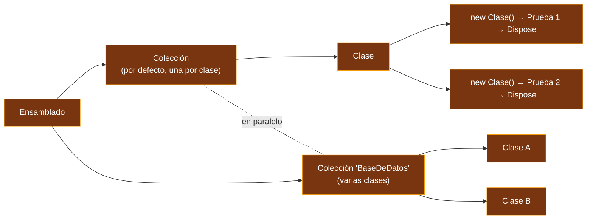
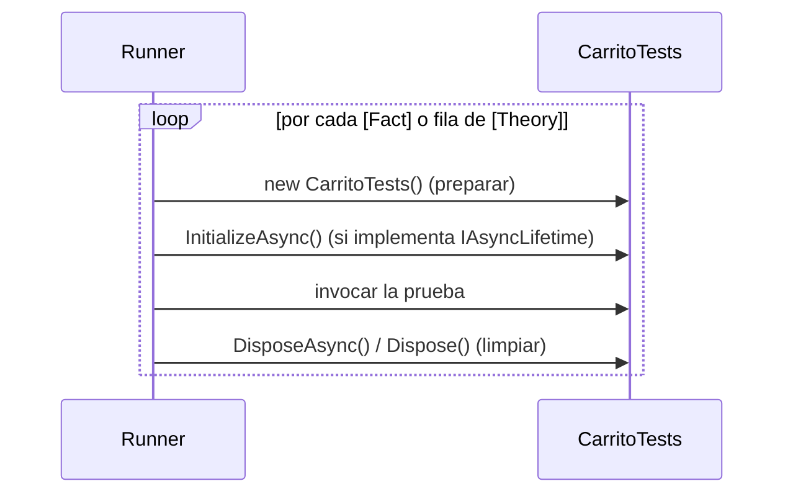

<div align="center">

# 04 · xUnit.net v3

**El framework opinado: hechos y teorías, una instancia por prueba, fixtures por composición, `TestContext`, paralelismo total y Native AOT (versión 4.0)**

[⬅ 03 · Plataformas de ejecución](03-plataformas-de-ejecucion.md) · [🏠 Índice](../README.md) · [05 · NUnit ➡](05-nunit.md)


</div>

<!-- fw=xunit -->

| Ficha | xUnit.net v3 🟢 |
|---|---|
| **Paquete** | `xunit.v3` **4.0.2** (14-ago-2026 la 4.0.0; 4.0.3 publicada el 9-nov-2026) |
| **Adaptador VSTest** | `xunit.runner.visualstudio` 4.0.1 (opcional con MTP) |
| **Analizadores** | `xunit.analyzers` 2.x, incluidos en el paquete |
| **Destinos** | .NET 8 o posterior · .NET Framework 4.7.2 o posterior |
| **Plataforma** | Microsoft.Testing.Platform v2 integrada · VSTest mediante el adaptador |
| **Licencia** | Apache 2.0 · proyecto de la .NET Foundation |
| **Generación anterior** | `xunit` 2.9.3 (congelado desde enero de 2025) |
| **Laboratorio** | [`tests/Tienda.Tests.XUnit`](../tests/Tienda.Tests.XUnit) · 33 pruebas |

---

## Contenido

1. [Filosofía en cinco reglas](#1-filosofía-en-cinco-reglas)
2. [Crear un proyecto](#2-crear-un-proyecto)
3. [Hechos y teorías](#3-hechos-y-teorías)
4. [Fuentes de datos](#4-fuentes-de-datos)
5. [Ciclo de vida: constructor y `Dispose`](#5-ciclo-de-vida-constructor-y-dispose)
6. [Fixtures: clase, colección y ensamblado](#6-fixtures-clase-colección-y-ensamblado)
7. [`TestContext.Current`](#7-testcontextcurrent)
8. [Omitir, explicitar y clasificar](#8-omitir-explicitar-y-clasificar)
9. [Paralelismo](#9-paralelismo)
10. [Extensibilidad](#10-extensibilidad)
11. [Native AOT (4.0)](#11-native-aot-40)
12. [Novedades de la 4.0](#12-novedades-de-la-40)
13. [Analizadores imprescindibles](#13-analizadores-imprescindibles)
14. [Referencias](#14-referencias)

---

## 1. Filosofía en cinco reglas

1. **Una instancia de la clase por cada prueba.** El estado de una prueba nunca contamina la siguiente.
2. **El lenguaje antes que los atributos.** Preparar es el constructor; limpiar es `Dispose`. No hay `[SetUp]` ni `[TearDown]`.
3. **Lo que se comparte, se declara.** Compartir estado exige una *fixture* explícita inyectada por constructor.
4. **Las excepciones se esperan en una línea.** `Assert.Throws`, nunca un atributo.
5. **Paralelo por defecto.** Cada clase es una *colección* y las colecciones se ejecutan en paralelo.



---

## 2. Crear un proyecto

```bash
dotnet new install xunit.v3.templates
dotnet new xunit3 -n Tienda.Tests.XUnit
dotnet test
```

El proyecto del laboratorio, con versiones centralizadas en [`Directory.Packages.props`](../Directory.Packages.props):

```xml
<Project Sdk="Microsoft.NET.Sdk">
  <PropertyGroup>
    <!-- xUnit.net v3: cada proyecto de pruebas es un ejecutable -->
    <OutputType>Exe</OutputType>
  </PropertyGroup>
  <ItemGroup>
    <PackageReference Include="xunit.v3" />
    <PackageReference Include="xunit.runner.visualstudio" />
  </ItemGroup>
  <ItemGroup>
    <Using Include="Xunit" />
  </ItemGroup>
</Project>
```

| Paquete | Para qué |
|---|---|
| `xunit.v3` | Todo lo necesario: núcleo, aserciones, analizadores y MTP v2 |
| `xunit.v3.mtp-off` | Igual, pero sin Microsoft.Testing.Platform (para seguir con VSTest en .NET 10) |
| `xunit.v3.core.aot` | Variante para Native AOT ([sección 11](#11-native-aot-40)) |
| `xunit.v3.assert` | Solo las aserciones, para usarlas en otro framework |
| `xunit.v3.extensibility.core` | Para escribir extensiones sin ser un proyecto de pruebas |
| `xunit-console-tool` | Consola nativa como herramienta global: `dotnet xunit-console` (requiere SDK de .NET 10) |

---

## 3. Hechos y teorías

Un **hecho** (`[Fact]`) es una afirmación que siempre es cierta. Una **teoría** (`[Theory]`) es una afirmación que es cierta **para todo un conjunto de datos**:

```csharp
public class SkuTests
{
    [Fact]
    public void Un_producto_con_sku_invalido_no_se_puede_crear()
    {
        var ex = Assert.Throws<ArgumentException>(() => new Producto("x", "?", new Dinero(1m)));

        Assert.Equal("Sku", ex.ParamName);
    }

    [Theory]
    [InlineData("LIB-0001", true)]
    [InlineData("TAZ-9999", true)]
    [InlineData("lib-0001", false)]
    [InlineData("LIBR-001", false)]
    [InlineData("", false)]
    [InlineData(null, false)]
    public void Valida_el_formato_del_sku(string? sku, bool esperado)
    {
        Assert.Equal(esperado, Tienda.Catalogo.EsSkuValido(sku));
    }
}
```

Cada fila de `[InlineData]` es un **caso de prueba** independiente: aparece por separado en el explorador y puede fallar por separado.

> [!WARNING]
> Los argumentos de un atributo deben ser **constantes**: números, cadenas, `typeof`, enumeraciones y arreglos de ellos. `decimal` **no** es una constante de atributo en C#; por
> eso `[InlineData(2.345, 2.34)]` pasa `double` y xUnit.net lo **convierte** al parámetro `decimal`. Esa conversión es cómoda pero arrastra el error de representación binaria
> de `double`. Para importes, prefiere `TheoryData<decimal, …>`.

---

## 4. Fuentes de datos

| Fuente | Úsala cuando… |
|---|---|
| `[InlineData]` | Los datos son constantes y caben en una línea |
| `[MemberData]` | Los datos se calculan o usan tipos no constantes (`decimal`, objetos) |
| `[ClassData]` | La misma tabla se reutiliza en varias clases |
| `TheoryData<T…>` | Quieres **tipado fuerte**: el compilador revisa cada fila |
| `TheoryDataRow<T…>` | Una fila necesita metadatos: `Skip`, `Label`, `Explicit`, `Timeout`, `Traits` |
| `MatrixTheoryData<T1, T2>` | Quieres el producto cartesiano de dos o más conjuntos |

### `TheoryData` tipado con `[MemberData]`

```csharp
public class EnvioTests
{
    public static TheoryData<decimal, Zona, decimal, decimal> Tarifas => new()
    {
        { 0.5m, Zona.Local, 100m, 49m },
        { 1.1m, Zona.Nacional, 100m, 124m },
        { 2.0m, Zona.Nacional, 999m, 0m },          // envío gratis
        { 2.0m, Zona.Internacional, 5_000m, 374m }, // internacional nunca es gratis
    };

    [Theory]
    [MemberData(nameof(Tarifas))]
    public void Calcula_la_tarifa(decimal peso, Zona zona, decimal subtotal, decimal esperado)
    {
        Assert.Equal(esperado, CalculadoraDeEnvio.Calcular(peso, zona, new Dinero(subtotal)).Monto);
    }
}
```

### Filas con metadatos: `TheoryDataRow`

```csharp
public class EnvioConEtiquetasTests
{
    public static IEnumerable<TheoryDataRow<Zona, decimal>> Bases =>
    [
        new(Zona.Local, 49m) { Label = "local" },
        new(Zona.Nacional, 99m) { Label = "nacional" },
        new(Zona.Internacional, 349m) { Label = "internacional", Traits = new() { ["Category"] = ["Lenta"] } },
    ];

    [Theory]
    [MemberData(nameof(Bases))]
    public void La_tarifa_base_por_un_kilo(Zona zona, decimal esperado)
    {
        Assert.Equal(esperado, CalculadoraDeEnvio.Calcular(1m, zona, new Dinero(1m)).Monto);
    }
}
```

Desde la 4.0, la `Label` de una fila está disponible en `TestContext.Current.Test.TestLabel`, y los nombres de las teorías pueden llevar un **índice numérico** para que se ordenen
bien cuando hay muchas filas.

### Producto cartesiano: `MatrixTheoryData`

```csharp
public class MatrizTests
{
    public static MatrixTheoryData<Zona, int> Combinaciones =>
        new([Zona.Local, Zona.Nacional, Zona.Internacional], [1, 2, 5]);

    [Theory]
    [MemberData(nameof(Combinaciones))]
    public void El_envio_nunca_es_negativo(Zona zona, int kilos)
    {
        var envio = CalculadoraDeEnvio.Calcular(kilos, zona, new Dinero(10m));

        Assert.True(envio.Monto >= 0);   // 3 zonas × 3 pesos = 9 casos
    }
}
```

### Datos de otra clase: `[ClassData]`

```csharp
public sealed class CuponesValidos : TheoryData<string, decimal>
{
    public CuponesValidos()
    {
        Add("ATLAS10", 10m);
        Add("MITAD", 50m);
        Add("GRATIS", 100m);
    }
}

public class CuponTests
{
    [Theory]
    [ClassData(typeof(CuponesValidos))]
    public void Un_cupon_nunca_deja_el_total_negativo(string codigo, decimal porcentaje)
    {
        var carrito = new Carrito();
        carrito.Agregar(Catalogo.Teclado);
        carrito.AplicarCupon(new Cupon(codigo, porcentaje));

        Assert.InRange(carrito.Total.Monto, 0m, carrito.Subtotal.Monto);
    }
}
```

---

## 5. Ciclo de vida: constructor y `Dispose`



```csharp
public sealed class ArchivoTemporalTests : IAsyncLifetime
{
    private readonly string _ruta = Path.Combine(Path.GetTempPath(), $"atlas-{Guid.NewGuid():N}.txt");

    // Preparación asíncrona: se ejecuta después del constructor
    public async ValueTask InitializeAsync() =>
        await File.WriteAllTextAsync(_ruta, "LIB-0001;TAZ-0007", TestContext.Current.CancellationToken);

    [Fact]
    public async Task Lee_los_skus_del_archivo()
    {
        var texto = await File.ReadAllTextAsync(_ruta, TestContext.Current.CancellationToken);

        Assert.All(texto.Split(';'), sku => Assert.True(Tienda.Catalogo.EsSkuValido(sku)));
    }

    // Limpieza asíncrona: siempre se ejecuta, aunque la prueba falle
    public ValueTask DisposeAsync()
    {
        File.Delete(_ruta);
        return ValueTask.CompletedTask;
    }
}
```

> [!NOTE]
> En v3, `IAsyncLifetime` hereda de `IAsyncDisposable` y sus métodos devuelven `ValueTask` (en v2 devolvían `Task`). Es uno de los cambios de migración más frecuentes.

---

## 6. Fixtures: clase, colección y ensamblado

Cuando algo es **caro de crear** (un contenedor de base de datos, un servidor de pruebas), xUnit.net lo comparte mediante *fixtures* que inyecta por constructor:

| Alcance | Declaración | Vida |
|---|---|---|
| **Clase** | `IClassFixture<T>` en la clase de pruebas | Una instancia para todas las pruebas de esa clase |
| **Colección** | `[CollectionDefinition]` + `ICollectionFixture<T>` y `[Collection]` en cada clase | Una instancia para varias clases, que dejan de ejecutarse en paralelo entre sí |
| **Ensamblado** | `[assembly: AssemblyFixture(typeof(T))]` | Una instancia para todo el ensamblado (nuevo en v3) |

### Fixture de clase

```csharp
public sealed class CatalogoFixture : IAsyncLifetime
{
    public RepositorioEnMemoria Repositorio { get; } = new();

    public async ValueTask InitializeAsync() =>
        await Repositorio.GuardarAsync(new Pedido(Guid.Empty, [], Dinero.Cero(), DateTimeOffset.UnixEpoch));

    public ValueTask DisposeAsync() => ValueTask.CompletedTask;
}

public class RepositorioTests(CatalogoFixture fixture, ITestOutputHelper salida) : IClassFixture<CatalogoFixture>
{
    [Fact]
    public async Task La_semilla_existe()
    {
        Assert.NotNull(await fixture.Repositorio.BuscarAsync(Guid.Empty, TestContext.Current.CancellationToken));
        salida.WriteLine($"Pedidos: {fixture.Repositorio.Cantidad}");
    }
}
```

### Fixture de colección

```csharp
public sealed class BaseDeDatosFixture : IDisposable
{
    public RepositorioEnMemoria Repositorio { get; } = new();
    public void Dispose() { }
}

[CollectionDefinition("BaseDeDatos")]
public sealed class ColeccionBaseDeDatos : ICollectionFixture<BaseDeDatosFixture>;

[Collection("BaseDeDatos")]
public class AltasTests(BaseDeDatosFixture db)
{
    [Fact]
    public void Comparte_el_repositorio() => Assert.NotNull(db.Repositorio);
}

[Collection("BaseDeDatos")]
public class BajasTests(BaseDeDatosFixture db)
{
    [Fact]
    public void Es_la_misma_instancia() => Assert.NotNull(db.Repositorio);
}
```

### Fixture de ensamblado (v3)

```csharp
[assembly: AssemblyFixture(typeof(RelojGlobal))]

public sealed class RelojGlobal
{
    public DateTimeOffset Inicio { get; } = DateTimeOffset.UtcNow;
}

public class UsaElRelojGlobalTests(RelojGlobal reloj)
{
    [Fact]
    public void El_reloj_existe() => Assert.True(reloj.Inicio <= DateTimeOffset.UtcNow);
}
```

En .NET 8 o posterior también existe la forma genérica `[assembly: AssemblyFixture<RelojGlobal>]` (4.0).

### Fixtures notificadas (4.0)

Una fixture puede implementar `INotifyTestLifecycle` (o su versión asíncrona) y otras interfaces `INotifyTest*Lifecycle` para enterarse de cada prueba que empieza o termina. El
caso de uso típico: una base de datos compartida como fixture de colección que **se limpia antes de cada prueba**, sin que cada clase lo repita.

---

## 7. `TestContext.Current`

La mayor novedad conceptual de v3 es un **contexto ambiental** accesible desde cualquier punto de la prueba:

| Miembro | Para qué |
|---|---|
| `CancellationToken` | Se cancela si la prueba excede su tiempo máximo o el usuario detiene la ejecución |
| `Test`, `TestMethod`, `TestClass` | Metadatos de lo que se está ejecutando (`TestDisplayName`, `TestLabel`) |
| `TestState` | Resultado de la prueba, visible durante la limpieza |
| `TestOutputHelper` | Salida asociada a la prueba (equivale a inyectar `ITestOutputHelper`) |
| `AddAttachment` | Adjunta texto o binarios al resultado |
| `KeyValueStorage` | Diccionario para compartir datos entre fixture, prueba y extensiones |
| `SendDiagnosticMessage` | Mensajes de diagnóstico visibles con `--xunit-diagnostics` |
| `CancelCurrentTest()` | Cancela la prueba en curso |

```csharp
public class ContextoTests
{
    [Fact]
    public async Task Usa_el_token_y_adjunta_evidencias()
    {
        var ct = TestContext.Current.CancellationToken;
        var repositorio = new RepositorioEnMemoria();

        await repositorio.GuardarAsync(new Pedido(Guid.NewGuid(), [], Dinero.Cero(), DateTimeOffset.UtcNow), ct);

        TestContext.Current.AddAttachment("resumen", $"Pedidos guardados: {repositorio.Cantidad}");
        Assert.Equal(1, repositorio.Cantidad);
    }
}
```

> [!TIP]
> El analizador **xUnit1051** avisa cuando llamas a un método que acepta `CancellationToken` sin pasarle `TestContext.Current.CancellationToken`. Hazle caso: es lo que permite
> que `[Fact(Timeout = …)]` y la cancelación del usuario detengan de verdad una prueba colgada.

---

## 8. Omitir, explicitar y clasificar

```csharp
public class ControlTests
{
    [Fact(Skip = "Pendiente: la API de pagos aún no existe")]
    public void Paga_con_tarjeta() { }

    // Se omite según una propiedad estática evaluada en ejecución (v3)
    [Fact(SkipUnless = nameof(EsLinux), Skip = "Solo en Linux")]
    public void Usa_rutas_de_linux() => Assert.StartsWith("/", Path.GetTempPath());

    public static bool EsLinux => OperatingSystem.IsLinux();

    // Solo se ejecuta si se pide explícitamente (v3)
    [Fact(Explicit = true)]
    public void Prueba_de_carga_manual() { }

    [Fact]
    [Trait("Category", "Lenta")]
    public void Clasificada_como_lenta() { }

    [Fact]
    public void Se_omite_desde_dentro()
    {
        Assert.SkipUnless(Environment.GetEnvironmentVariable("ATLAS_API") is not null, "Falta ATLAS_API");
    }
}
```

| Forma | Momento | Visible como |
|---|---|---|
| `Skip = "…"` | Descubrimiento | Omitida |
| `SkipWhen` / `SkipUnless` + `Skip` | Ejecución, según una propiedad | Omitida u ejecutada |
| `Assert.Skip`, `Assert.SkipWhen`, `Assert.SkipUnless` | Dentro de la prueba | Omitida |
| `Explicit = true` | Descubrimiento | "No ejecutada" salvo `--explicit on` u `only` |
| `[Trait]` | Metadato | Filtrable con `--filter-trait` |

---

## 9. Paralelismo

| Modo (`--parallel` o `parallelMode`) | Qué corre en paralelo | Desde |
|---|---|---|
| `none` | Nada | — |
| `collections` (por defecto) | Colecciones entre sí; dentro de una colección, en serie | 2.0 |
| `all` | **Todas las pruebas**, sin importar colección | **4.0** |

En modo `all` se puede **excluir** del paralelismo una colección, una clase, un método, una fuente de datos o una fila concreta; una vez excluido un nivel, sus niveles inferiores
no pueden volver a activarlo. Para desactivar el paralelismo de una colección:

```csharp
[CollectionDefinition("Secuencial", DisableParallelization = true)]
public sealed class ColeccionSecuencial;

[Collection("Secuencial")]
public class VariablesDeEntornoTests
{
    [Fact]
    public void Modifica_una_variable_global()
    {
        Environment.SetEnvironmentVariable("ATLAS_MODO", "prueba");
        Assert.Equal("prueba", Environment.GetEnvironmentVariable("ATLAS_MODO"));
        Environment.SetEnvironmentVariable("ATLAS_MODO", null);
    }
}
```

Otras perillas, en `xunit.runner.json` o por línea de comandos: `maxParallelThreads` (`default`, `unlimited`, un número o un múltiplo como `2.0x`) y `parallelAlgorithm`
(`conservative` o `aggressive`). Profundizamos en el [capítulo 11](11-paralelismo-y-aislamiento.md).

---

## 10. Extensibilidad

xUnit.net es el framework más extensible de los tres, pero sus puntos de extensión son **composición**, no herencia:

| Punto de extensión | Para qué |
|---|---|
| `DataAttribute` derivado | Leer casos desde JSON, CSV o una base de datos |
| `BeforeAfterTestAttribute` | Código antes y después de cada prueba (síncrono) |
| `ITestCaseOrderer`, `ITestClassOrderer` (4.0), `ITestMethodOrderer` (4.0), `ITestCollectionOrderer` | Orden de ejecución |
| `ITypeActivator` | Crear clases de prueba y, desde 4.0, fixtures (inyección de dependencias) |
| `ITestPipelineStartup` | Código al arrancar y al terminar el proceso de pruebas |
| `ITestFramework` | Reemplazar el framework entero |

Un atributo de datos propio:

```csharp
using System.Reflection;
using Xunit.Sdk;
using Xunit.v3;

[AttributeUsage(AttributeTargets.Method)]
public sealed class ZonasAttribute : DataAttribute
{
    public override ValueTask<IReadOnlyCollection<ITheoryDataRow>> GetData(MethodInfo testMethod, DisposalTracker disposalTracker) =>
        new([.. Enum.GetValues<Zona>().Select(z => new TheoryDataRow<Zona>(z))]);

    public override bool SupportsDiscoveryEnumeration() => true;
}

public class ZonasTests
{
    [Theory]
    [Zonas]
    public void Toda_zona_tiene_tarifa(Zona zona) =>
        Assert.True(CalculadoraDeEnvio.Calcular(1m, zona, new Dinero(1m)).Monto > 0);
}
```

---

## 11. Native AOT (4.0)

La 4.0 permite compilar el proyecto de pruebas con **Native AOT**: el ejecutable no tiene JIT ni reflexión dinámica, arranca en milisegundos y prueba tu código **tal como se
publicará** si tu aplicación también usa AOT.

```xml
<PropertyGroup>
  <OutputType>Exe</OutputType>
  <PublishAot>true</PublishAot>
</PropertyGroup>
<ItemGroup>
  <PackageReference Include="xunit.v3.core.aot" Version="4.0.2" />
</ItemGroup>
```

| | Modo reflexión (`xunit.v3`) | Modo AOT (`xunit.v3.core.aot`) |
|---|---|---|
| Descubrimiento | Reflexión en ejecución | Generadores de código en compilación |
| Arranque | Normal | Muy rápido |
| Mensajes de `Assert.Equal` con objetos complejos | Muestran miembros | No imprimen objetos complejos (sin reflexión) |
| `OverrideMaxObjectDepth` y `OverrideMaxObjectMemberCount` | Funcionan | Sin efecto |
| Extensiones basadas en reflexión | Sí | Deben ser compatibles con AOT |

---

## 12. Novedades de la 4.0

| Área | Novedad |
|---|---|
| **Plataforma** | Native AOT; MTP v2 por defecto; fin del soporte oficial de MTP v1 y de Mono |
| **Paralelismo** | Modo `all` con exclusiones en cinco niveles |
| **Orden** | *Orderers* de clase y de método, además de colección y caso. Orden: colección → clase → método → caso |
| **Fixtures** | Notificaciones del ciclo de vida (`INotifyTest*Lifecycle`); `ITypeActivator` también crea fixtures |
| **Atributos genéricos** | `AssemblyFixtureAttribute<T>`, `TestCaseOrderAttribute<T>`, `CollectionBehaviorAttribute<T>`… (.NET 8+) |
| **Metadatos** | `ITestMetadata.TestLabel` · índice numérico en nombres de teorías · opción `RemoveAsyncSuffix` |
| **Aserciones** | `Assert.All` puede fallar con colecciones vacías · `Assert.OverrideMaxStringLength` y familia, por prueba |
| **Ejecutores** | Consola nativa como herramienta global (`xunit-console-tool`) · espera configurable de hilos en primer plano |
| **Informes** | CTRF alineado con el de MTP |
| **MSBuild** | Propiedades `XunitTestProject` y `XunitTestProjectAOT` |

> [!CAUTION]
> La 4.0 rompe sobre todo **API de extensibilidad**. Si tu proyecto solo usa `[Fact]`, `[Theory]`, fixtures y aserciones, la actualización desde 3.x suele limitarse a cambiar la
> versión del paquete. Si escribiste *orderers* o frameworks propios, lee la guía de la 4.0: el orden ahora tiene alcance por niveles.

---

## 13. Analizadores imprescindibles

| Regla | Detecta |
|---|---|
| `xUnit1004` | Pruebas con `Skip` que llevan demasiado tiempo omitidas |
| `xUnit1012` | `null` pasado a un parámetro no anulable en `[InlineData]` |
| `xUnit1026` | Parámetro de teoría que no se usa |
| `xUnit1030` | `ConfigureAwait(false)` en una prueba |
| `xUnit1031` | Bloqueo con `.Result` o `.Wait()` en una prueba |
| `xUnit1051` | No se pasa `TestContext.Current.CancellationToken` |
| `xUnit2000` | Constante en la posición del valor real |
| `xUnit2013` | `Assert.Equal(0, coleccion.Count)` en lugar de `Assert.Empty` |
| `xUnit2017` | `Assert.True(coleccion.Contains(x))` en lugar de `Assert.Contains` |
| `xUnit2031` | `Where(...)` antes de `Assert.Single` |

---

## 14. Referencias

- [xunit.net](https://xunit.net) · [Notas de la 4.0.0](https://xunit.net/releases/v3/4.0.0) · [*What's new in v3*](https://xunit.net/docs/getting-started/v3/whats-new).
- [*Shared context between tests*](https://xunit.net/docs/shared-context) · [*Running tests in parallel*](https://xunit.net/docs/running-tests-in-parallel).
- [*Testing with Native AOT*](https://xunit.net/docs/getting-started/v3/native-aot) · [Reglas de `xunit.analyzers`](https://xunit.net/xunit.analyzers/rules/).
- Código fuente: [github.com/xunit/xunit](https://github.com/xunit/xunit).

---

<div align="center">

[⬅ 03 · Plataformas de ejecución](03-plataformas-de-ejecucion.md) · [🏠 Índice](../README.md) · [05 · NUnit ➡](05-nunit.md)

</div>
