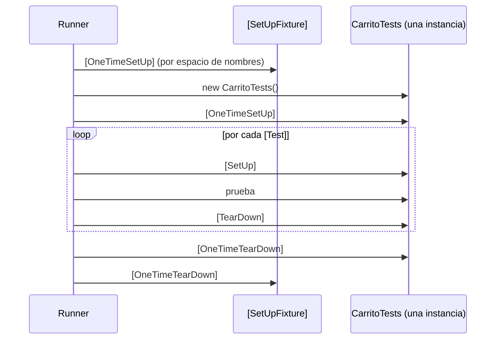

<div align="center">

# 05 · NUnit 5

**El framework más completo: el modelo de restricciones, la familia de atributos de datos, fixtures con estado y todo lo que cambió en NUnit 5**

[⬅ 04 · xUnit.net](04-xunit.md) · [🏠 Índice](../README.md) · [06 · MSTest ➡](06-mstest.md)


</div>

<!-- fw=nunit -->

| Ficha | NUnit 5 🟢 |
|---|---|
| **Paquete** | `NUnit` **5.0.0** (27-sep-2026) |
| **Adaptador** | `NUnit3TestAdapter` **6.3.1** (VSTest y MTP; el nombre es histórico) |
| **Analizadores** | `NUnit.Analyzers` **4.15.0** (paquete aparte, muy recomendado) |
| **Destinos** | `net462`, `net8.0` y `net10.0`: .NET Framework 4.6.2 o posterior, .NET 8 o posterior |
| **Plataforma** | VSTest · MTP con `EnableNUnitRunner` · NUnitLite · consola `nunit3-console` |
| **Licencia** | MIT · proyecto de la .NET Foundation |
| **Serie anterior** | 4.6.1 (19-may-2026) |
| **Laboratorio** | [`tests/Tienda.Tests.NUnit`](../tests/Tienda.Tests.NUnit) · 33 pruebas |

---

## Contenido

1. [Filosofía: un atributo para cada necesidad](#1-filosofía-un-atributo-para-cada-necesidad)
2. [Crear un proyecto](#2-crear-un-proyecto)
3. [El modelo de restricciones](#3-el-modelo-de-restricciones)
4. [Pruebas parametrizadas](#4-pruebas-parametrizadas)
5. [Ciclo de vida y fixtures](#5-ciclo-de-vida-y-fixtures)
6. [`TestContext`](#6-testcontext)
7. [Control de ejecución](#7-control-de-ejecución)
8. [Paralelismo](#8-paralelismo)
9. [NUnit 5: qué cambió](#9-nunit-5-qué-cambió)
10. [Extensibilidad](#10-extensibilidad)
11. [Analizadores imprescindibles](#11-analizadores-imprescindibles)
12. [Referencias](#12-referencias)

---

## 1. Filosofía: un atributo para cada necesidad

NUnit apuesta por la **expresividad**: si un patrón de prueba es común, merece un atributo o una restricción con nombre. Eso lo convierte en el framework con más conceptos
nativos del [catálogo](17-catalogo-a-z.md#cobertura-por-framework) (109 de 121).

| Rasgo | Consecuencia |
|---|---|
| **Una instancia por fixture** (por defecto) | `[SetUp]` reinicia el estado; los campos se comparten entre pruebas de la misma clase |
| **Restricciones componibles** | `Is.Not.Null.And.Property("Total").GreaterThan(0)` se lee como una frase |
| **Combinatoria integrada** | `[Values]`, `[Range]`, `[Random]`, `[Pairwise]` generan casos sin código |
| **Fixtures parametrizadas y genéricas** | Una clase de pruebas se ejecuta para varias monedas o varios tipos |
| **Secuencial por defecto** | El paralelismo se activa con `[Parallelizable]` |

---

## 2. Crear un proyecto

```bash
dotnet new nunit -n Tienda.Tests.NUnit
dotnet add package NUnit --version 5.0.0
dotnet add package NUnit.Analyzers
```

```xml
<Project Sdk="Microsoft.NET.Sdk">
  <PropertyGroup>
    <OutputType>Exe</OutputType>
    <EnableNUnitRunner>true</EnableNUnitRunner>
  </PropertyGroup>
  <ItemGroup>
    <PackageReference Include="NUnit" />
    <PackageReference Include="NUnit3TestAdapter" />
    <PackageReference Include="NUnit.Analyzers" PrivateAssets="all" />
  </ItemGroup>
  <ItemGroup>
    <Using Include="NUnit.Framework" />
  </ItemGroup>
</Project>
```

> [!TIP]
> Con `EnableNUnitRunner` el proyecto es un ejecutable de Microsoft.Testing.Platform y **no necesita** `Microsoft.NET.Test.Sdk`. Si lo quitas, vuelves a VSTest y entonces sí
> hace falta.

---

## 3. El modelo de restricciones

Todo en NUnit gira en torno a `Assert.That(real, restricción)`. Las restricciones se construyen con cuatro "puntos de entrada":

| Entrada | Qué describe | Ejemplos |
|---|---|---|
| `Is` | El valor en sí | `Is.EqualTo(5)`, `Is.Null`, `Is.InRange(1, 9)`, `Is.Empty`, `Is.Ordered` |
| `Has` | Una parte del valor | `Has.Count.EqualTo(3)`, `Has.Member(x)`, `Has.Property("Total")`, `Has.All.Positive` |
| `Does` | Texto y colecciones | `Does.StartWith("Ped")`, `Does.Contain("x")`, `Does.Match("^[A-Z]")`, `Does.ContainKey(k)` |
| `Throws` | Excepciones | `Throws.TypeOf<T>()`, `Throws.ArgumentNullException`, `Throws.Nothing` |

```csharp
public class RestriccionesTests
{
    [Test]
    public void Se_componen_como_frases()
    {
        var carrito = new Carrito();
        carrito.Agregar(Catalogo.Libro, 2);
        carrito.Agregar(Catalogo.Taza, 1);

        Assert.That(carrito.Unidades, Is.EqualTo(3));
        Assert.That(carrito.Total.Monto, Is.GreaterThan(1_000m).And.LessThan(1_100m));
        Assert.That(carrito.Lineas, Has.Count.EqualTo(2));
        Assert.That(carrito.Lineas.Select(l => l.Producto.Sku), Is.Ordered.Or.Not.Ordered);
        Assert.That(carrito.Lineas, Has.All.Property(nameof(LineaDeCarrito.Cantidad)).Positive);
        Assert.That(carrito.Total.ToString(), Does.EndWith("MXN").And.Contain("."));
        var suma = 0.1;
        suma += 0.2;                                         // 0.30000000000000004
        Assert.That(suma, Is.EqualTo(0.3).Within(1e-9));
        Assert.That(Catalogo.Libro.Nombre, Is.EqualTo("c# ATLAS").IgnoreCase);
    }

    [Test]
    public void Excepciones_con_detalle()
    {
        Assert.That(() => new Dinero(-1m), Throws.InstanceOf<ArgumentOutOfRangeException>());
        Assert.That(() => new Producto("x", "?", new Dinero(1m)), Throws.ArgumentException.ParamName.EqualTo("Sku"));
        Assert.That(() => new Dinero(1m) + new Dinero(1m), Throws.Nothing);
    }

    [Test]
    public void Igualdad_por_propiedades()
    {
        // Compara miembro a miembro aunque el tipo no redefina Equals (NUnit 4.1+)
        var a = new { Sku = "LIB-0001", Cantidad = 2 };
        var b = new { Sku = "LIB-0001", Cantidad = 2 };

        Assert.That(a, Is.EqualTo(b).UsingPropertiesComparer());
    }
}
```

### Aserciones clásicas

El estilo `Assert.AreEqual(esperado, real)` de NUnit 2 y 3 sigue existiendo, pero desde NUnit 4 vive en **`ClassicAssert`** (espacio de nombres `NUnit.Framework.Legacy`).
NUnit 5 **devolvió** `StringAssert`, `CollectionAssert`, `FileAssert` y `DirectoryAssert` al espacio `NUnit.Framework`.

```csharp
using NUnit.Framework.Legacy;

// NUnit.Analyzers sugiere migrar cada línea al modelo de restricciones (NUnit2005, NUnit2048, NUnit2049).
// En este repositorio las advertencias son errores, así que el ejemplo las desactiva a propósito.
#pragma warning disable NUnit2005, NUnit2048, NUnit2049
public class ClasicasTests
{
    [Test]
    public void Siguen_disponibles()
    {
        ClassicAssert.AreEqual(3, new Carrito().Unidades + 3);
        CollectionAssert.IsEmpty(new Carrito().Lineas);   // de vuelta en NUnit.Framework en NUnit 5
        StringAssert.StartsWith("LIB", Catalogo.Libro.Sku);
    }
}
```

> [!NOTE]
> El equipo de NUnit recomienda el modelo de restricciones: sus mensajes son mejores, se extiende con restricciones propias y es el que recibe las mejoras (por ejemplo, las
> restricciones genéricas de NUnit 5). `ClassicAssert` existe para que la migración desde NUnit 3 sea un buscar y reemplazar.

### Aserciones múltiples, advertencias y supuestos

```csharp
public class MultiplesTests
{
    [Test]
    public void Informa_todos_los_fallos_juntos()
    {
        var carrito = new Carrito();
        carrito.Agregar(Catalogo.Libro, 2);
        carrito.AplicarCupon(new Cupon("ATLAS10", 10m));

        using (Assert.EnterMultipleScope())   // NUnit 4.2+; equivale a Assert.Multiple(() => …)
        {
            Assert.That(carrito.Subtotal, Is.EqualTo(new Dinero(900m)));
            Assert.That(carrito.Total, Is.EqualTo(new Dinero(810m)));
            Assert.That(carrito.Cupon?.Codigo, Is.EqualTo("ATLAS10"));
        }
    }

    [Test]
    public void Supuestos_y_advertencias()
    {
        // Si el supuesto no se cumple, la prueba queda "Inconclusa", no fallida
        Assume.That(Environment.ProcessorCount, Is.GreaterThan(0));

        // Una advertencia no hace fallar la prueba, pero queda registrada
        Warn.If(Catalogo.Teclado.Precio.Monto > 1_000m, "Producto caro en el catálogo de pruebas");
    }
}
```

---

## 4. Pruebas parametrizadas

NUnit tiene la familia de atributos de datos más amplia de .NET:

| Atributo | Genera |
|---|---|
| `[TestCase(…)]` | Un caso por atributo; admite `ExpectedResult`, `TestName`, `Category`, `Ignore` |
| `[TestCaseSource(nameof(X))]` | Casos desde un miembro estático (`IEnumerable`, `TestCaseData`) |
| `[Values(…)]` en un parámetro | Valores para ese parámetro |
| `[Range(a, b, paso)]` | Valores numéricos en un intervalo |
| `[Random(min, max, n)]` | `n` valores aleatorios (la semilla queda registrada) |
| `[ValueSource(nameof(X))]` | Valores desde un miembro estático |
| `[Combinatorial]` (por defecto) | Producto cartesiano de los parámetros |
| `[Pairwise]` | Cubre cada **par** de valores con menos casos |
| `[Sequential]` | Empareja el primer valor de cada parámetro, luego el segundo… |
| `[Theory]` + `[Datapoint]` | Teoría al estilo de las matemáticas: se prueba con todos los datos compatibles |

### `[TestCase]` con resultado esperado

```csharp
public class SkuTests
{
    [TestCase("LIB-0001", ExpectedResult = true)]
    [TestCase("lib-0001", ExpectedResult = false)]
    [TestCase("LIBR-001", ExpectedResult = false, TestName = "Cuatro letras no es un SKU válido")]
    [TestCase(null, ExpectedResult = false)]
    public bool Valida_el_formato(string? sku) => Tienda.Catalogo.EsSkuValido(sku);
}
```

El método **devuelve** el valor y NUnit lo compara con `ExpectedResult`: la prueba cabe en una línea.

### `TestCaseData` genérico (4.1) con resultado tipado (5.0)

```csharp
public class EnvioTests
{
    private static IEnumerable<TestCaseDataWithReturn<decimal, Zona, decimal, decimal>> Tarifas()
    {
        yield return new TestCaseData<decimal, Zona, decimal>(0.5m, Zona.Local, 100m).Returns(49m);
        yield return new TestCaseData<decimal, Zona, decimal>(1.1m, Zona.Nacional, 100m).Returns(124m);
        yield return new TestCaseData<decimal, Zona, decimal>(2.0m, Zona.Nacional, 999m).Returns(0m).SetName("Envío gratis desde 999");
        yield return new TestCaseData<decimal, Zona, decimal>(2.0m, Zona.Internacional, 5_000m).Returns(374m);
    }

    [TestCaseSource(nameof(Tarifas))]
    public decimal Calcula_la_tarifa(decimal peso, Zona zona, decimal subtotal) =>
        CalculadoraDeEnvio.Calcular(peso, zona, new Dinero(subtotal)).Monto;
}
```

### Combinatoria sin escribir casos

```csharp
public class CombinatoriaTests
{
    [Test, Combinatorial]   // 3 zonas × 4 pesos = 12 casos
    public void El_envio_nunca_es_negativo(
        [Values] Zona zona,
        [Values(0.5, 1.0, 2.5, 10.0)] decimal peso)
    {
        Assert.That(CalculadoraDeEnvio.Calcular(peso, zona, new Dinero(10m)).Monto, Is.Not.Negative);
    }

    [Test, Pairwise]   // cubre cada par de valores con menos casos que el producto cartesiano
    public void Agregar_respeta_el_maximo(
        [Values(1, 5, 10)] int cantidad,
        [Values("LIB-0001", "TAZ-0007")] string sku,
        [Values("MXN", "USD")] string moneda)
    {
        var carrito = new Carrito(moneda);
        var producto = new Producto(sku, "x", new Dinero(10m, moneda));

        carrito.Agregar(producto, cantidad);

        Assert.That(carrito.Unidades, Is.InRange(1, Carrito.MaximoPorProducto));
    }

    [Test]
    public void Cualquier_cantidad_valida_se_acepta([Range(1, 10)] int cantidad)
    {
        var carrito = new Carrito();
        carrito.Agregar(Catalogo.Taza, cantidad);
        Assert.That(carrito.Unidades, Is.EqualTo(cantidad));
    }

    [Test]
    public void Montos_aleatorios_no_negativos([Random(0.0, 10_000.0, 5)] double monto)
    {
        Assert.That(new Dinero((decimal)monto).Monto, Is.GreaterThanOrEqualTo(0m));
    }
}
```

`[Values]` sin argumentos sobre un parámetro `enum` o `bool` genera **todos** sus valores.

### Teorías con *datapoints*

```csharp
public class TeoriaTests
{
    [DatapointSource]
    public static readonly decimal[] Porcentajes = [0m, 10m, 50m, 100m];

    [Theory]
    public void Un_descuento_nunca_aumenta_el_precio(decimal porcentaje)
    {
        Assume.That(porcentaje, Is.InRange(0m, 100m));

        var precio = new Dinero(250m);

        Assert.That(precio.DescontarPorcentaje(porcentaje).Monto, Is.LessThanOrEqualTo(precio.Monto));
    }
}
```

> [!IMPORTANT]
> El `[Theory]` de NUnit **no es** el `[Theory]` de xUnit.net. En NUnit, una teoría recibe todos los *datapoints* compatibles y usa `Assume` para descartar los que no aplican; en
> xUnit.net, `[Theory]` es simplemente "prueba parametrizada".

---

## 5. Ciclo de vida y fixtures



| Atributo | Cuándo | Alcance |
|---|---|---|
| `[SetUp]` / `[TearDown]` | Antes y después de cada prueba | Fixture (y sus clases base) |
| `[OneTimeSetUp]` / `[OneTimeTearDown]` | Una vez por fixture | Fixture |
| `[SetUpFixture]` | Una vez por **espacio de nombres** (o por ensamblado si no tiene) | Todas las fixtures debajo |
| `[FixtureLifeCycle(LifeCycle.InstancePerTestCase)]` | Una instancia por prueba, al estilo xUnit.net | Fixture o ensamblado |

```csharp
// Una instancia por prueba: los campos de solo lectura se reinician solos
[FixtureLifeCycle(LifeCycle.InstancePerTestCase)]
public class CarritoAislado
{
    private readonly Carrito _carrito = new();

    [Test]
    public void Empieza_vacio() => Assert.That(_carrito.EstaVacio);

    [Test]
    public void Acumula_unidades()
    {
        _carrito.Agregar(Catalogo.Taza, 2);
        _carrito.Agregar(Catalogo.Taza, 3);
        Assert.That(_carrito.Unidades, Is.EqualTo(5));
    }
}
```

> [!WARNING]
> Con el ciclo de vida por defecto, **un campo inicializado en la declaración se comparte entre todas las pruebas** de la fixture. `private readonly Carrito _carrito = new();` sin
> `InstancePerTestCase` haría que las pruebas se contaminen entre sí. Por eso el laboratorio de NUnit usa `[SetUp]`.

### Fixtures parametrizadas y genéricas

```csharp
[TestFixture("MXN")]
[TestFixture("USD")]
public class CarritoPorMonedaTests(string moneda)
{
    [Test]
    public void Un_carrito_nuevo_vale_cero_en_su_moneda() =>
        Assert.That(new Carrito(moneda).Total, Is.EqualTo(Dinero.Cero(moneda)));
}

[TestFixture(typeof(int))]
[TestFixture(typeof(decimal))]
public class ListasGenericasTests<T>
{
    [Test]
    public void Una_lista_nueva_esta_vacia() => Assert.That(new List<T>(), Is.Empty);
}
```

### Preparación por espacio de nombres

```csharp
[SetUpFixture]
public class ConfiguracionGlobal
{
    public static DateTimeOffset Inicio { get; private set; }

    [OneTimeSetUp]
    public void Iniciar() => Inicio = DateTimeOffset.UtcNow;

    [OneTimeTearDown]
    public void Terminar() => TestContext.Progress.WriteLine($"Duración: {DateTimeOffset.UtcNow - Inicio}");
}

public class UsaLaConfiguracionGlobalTests
{
    [Test]
    public void El_inicio_ya_ocurrio() => Assert.That(ConfiguracionGlobal.Inicio, Is.LessThanOrEqualTo(DateTimeOffset.UtcNow));
}
```

---

## 6. `TestContext`

| Miembro | Para qué |
|---|---|
| `TestContext.CurrentContext.Test` | Nombre, nombre completo, propiedades, argumentos |
| `TestContext.CurrentContext.Result` | Resultado, visible en `[TearDown]` |
| `TestContext.CurrentContext.WorkDirectory` | Carpeta de trabajo de la ejecución |
| `TestContext.CurrentContext.CancellationToken` | Token que se cancela con `[CancelAfter]` |
| `TestContext.CurrentContext.ActiveTests` | **NUnit 5:** pruebas activas, consultable en `[OneTimeSetUp]` |
| `TestContext.Out` | Salida asociada a la prueba |
| `TestContext.Progress` | Salida inmediata, útil para pruebas largas |
| `TestContext.Parameters` | Parámetros de `.runsettings` o `--test-parameter` |
| `TestContext.AddTestAttachment` | Adjunta archivos al resultado |

```csharp
public class EvidenciasTests
{
    [Test]
    public void Escribe_y_lee_parametros()
    {
        var entorno = TestContext.Parameters.Get("Entorno", "local");

        TestContext.Out.WriteLine($"Ejecutando {TestContext.CurrentContext.Test.Name} en {entorno}");
        Assert.That(entorno, Is.Not.Empty);
    }

    [TearDown]
    public void GuardarEvidenciaSiFallo()
    {
        if (TestContext.CurrentContext.Result.Outcome.Status == NUnit.Framework.Interfaces.TestStatus.Failed)
            TestContext.Progress.WriteLine("Aquí guardaríamos una captura o un volcado.");
    }
}
```

`ActiveTests` (NUnit 5) resuelve un problema clásico: un `[SetUpFixture]` que arranca algo costoso, como una base de datos o un navegador, puede comprobar si alguna de las pruebas
seleccionadas por el filtro lo necesita y, si no, ahorrarse la preparación.

---

## 7. Control de ejecución

```csharp
public class ControlTests
{
    [Test, Ignore("Pendiente de la API de pagos", Until = "2027-01-31")]
    public void Paga_con_tarjeta() { }

    [Test, Explicit("Prueba de carga manual")]
    public void Carga_masiva() { }

    [Test, Category("Lenta"), Property("Componente", "Envíos")]
    public void Clasificada() => Assert.Pass();

    [Test, CancelAfter(2_000)]
    public async Task Respeta_su_tiempo_maximo(CancellationToken ct)
    {
        await Task.Delay(10, ct);
        Assert.That(ct.IsCancellationRequested, Is.False);
    }

    [Test, MaxTime(1_000, WarningTime = 200)]   // NUnit 5: advierte a partir de 200 ms
    public void Rapida() => Assert.That(new Carrito().EstaVacio);

    [Test, Retry(3)]
    public void Reintentada_si_falla_una_asercion() => Assert.That(DateTime.UtcNow.Year, Is.GreaterThan(2000));

    [Test, Repeat(20, RequiredPassPercentage = 90, StopWhenOverallResultDetermined = true)]   // NUnit 5
    public void Pasa_al_menos_el_90_por_ciento() => Assert.That(Random.Shared.Next(100), Is.LessThan(100));

    [Test, Platform(Exclude = "Win")]
    public void No_en_windows() => Assert.That(Path.DirectorySeparatorChar, Is.EqualTo('/'));

    [Test, SetCulture("es-MX")]
    public void Con_cultura_mexicana() => Assert.That(1.5m.ToString("N1"), Is.EqualTo("1.5"));
}
```

| Atributo | Matiz |
|---|---|
| `[Ignore(…, Until = …)]` | Al vencer la fecha, la prueba **vuelve a ejecutarse**: ideal para deuda con fecha |
| `[Explicit]` | No se ejecuta salvo que se seleccione por nombre o filtro |
| `[CancelAfter(ms)]` | Cancela el `CancellationToken` del parámetro o de `TestContext`: **cooperativo** |
| `[Timeout(ms)]` | Interrumpe el hilo; solo funciona en **.NET Framework** (depende de `Thread.Abort`) |
| `[MaxTime(ms)]` | No interrumpe: marca como fallida la prueba que tardó más |
| `[Retry(n)]` | Reintenta si falla una aserción; con `RetryExceptions` también ante excepciones concretas |
| `[Repeat(n)]` | Ejecuta n veces; con `RequiredPassPercentage` (NUnit 5) tolera resultados no deterministas, como un *chatbot* basado en LLM |
| `[Platform]` | NUnit 5 cambió `"NET"` para que signifique .NET moderno ([sección 9](#9-nunit-5-qué-cambió)) |
| `[DependsOnTest]` | NUnit 5: la prueba se ejecuta después de otra de la misma fixture |

---

## 8. Paralelismo

NUnit es **secuencial por defecto**. El paralelismo se declara con `[Parallelizable]` y su alcance:

| `ParallelScope` | Significado |
|---|---|
| `Self` | Esta fixture o prueba puede correr en paralelo con otras |
| `Children` | Sus pruebas pueden correr en paralelo entre sí |
| `Fixtures` | Las fixtures que contiene (por ejemplo, a nivel de ensamblado) |
| `All` | `Self` + `Children` |
| `None` | Equivale a `[NonParallelizable]` |

```csharp
[Parallelizable(ParallelScope.All)]
[FixtureLifeCycle(LifeCycle.InstancePerTestCase)]   // necesario si las pruebas en paralelo usan campos
public class EnvioParaleloTests
{
    private readonly Carrito _carrito = new();

    [TestCase(Zona.Local)]
    [TestCase(Zona.Nacional)]
    [TestCase(Zona.Internacional)]
    public void Cada_zona_en_paralelo(Zona zona)
    {
        _carrito.Agregar(Catalogo.Libro);
        Assert.That(CalculadoraDeEnvio.Calcular(1m, zona, _carrito.Subtotal).Monto, Is.Not.Negative);
    }
}
```

`[assembly: LevelOfParallelism(4)]` limita el número de hilos de trabajo. El [capítulo 11](11-paralelismo-y-aislamiento.md) compara los modelos de los tres frameworks.

---

## 9. NUnit 5: qué cambió

NUnit 5 se describe a sí mismo como "una versión mayor pequeña": casi todos sus cambios terminan trabajo empezado en la serie 4.

### Cambios incompatibles

| Cambio | Antes (4.x) | Ahora (5.0) | Qué hacer |
|---|---|---|---|
| **Aserciones asíncronas reales** | `Assert.ThrowsAsync` bloqueaba el hilo | Devuelven `Task` y **deben esperarse** | `await Assert.ThrowsAsync<T>(…)`; `NUnit.Analyzers` 4.14+ lo corrige |
| **Delegados estándar** | `TestDelegate`, `AsyncTestDelegate`, `ActualValueDelegate<T>` | `Action`, `Func<Task>`, `Func<T>` | Cambiar los usos explícitos; las lambdas no cambian |
| **`Func<T>` como valor real** | `Assert.That(func, Is.Not.Null)` comprobaba el delegado | **Evalúa** el delegado y comprueba el resultado | Convertir a `object` para afirmar sobre el delegado |
| **`Is.SameAs`** | Aceptaba cualquier `object` | Solo tipos por referencia (`T : class?`) | Usar `Is.EqualTo` con tipos por valor |
| **`Has.Attribute<T>()`** | Comprobación en ejecución | `where T : Attribute` | — |
| **Restricciones de tipo genéricas** | `Is.TypeOf<T>()` devolvía una restricción no genérica | Devuelve `ExactTypeConstraint<T>` | Recompilar extensiones |
| **`StringAssert`, `CollectionAssert`…** | En `NUnit.Framework.Legacy` | De vuelta en `NUnit.Framework` | Quitar el `using` de `Legacy` si solo era para ellas |
| **`[Platform("NET")]`** | Significaba .NET Framework | Significa **.NET moderno**; nuevo `"NETFramework"` | Revisar los atributos `Platform` |
| **Destinos** | `net462`, `net6.0` | `net462`, `net8.0`, `net10.0` | Proyectos en .NET 8 o posterior |
| **`[Order]`** | Soportado | **Obsoleto** | Usar `[DependsOnTest]` o eliminar la dependencia de orden |
| **`StopRun(force)`** | Abortaba hilos | Solo parada cooperativa | Afecta a autores de *runners* |

```csharp
public class AsincronasTests
{
    private readonly ServicioDePedidos _servicio =
        new(new RepositorioEnMemoria(), new NotificadorEspia(), TimeProvider.System);

    [Test]
    public async Task ThrowsAsync_se_espera_en_NUnit_5()
    {
        // NUnit 4: var ex = Assert.ThrowsAsync<…>(…);   NUnit 5: hay que esperar
        var ex = await Assert.ThrowsAsync<InvalidOperationException>(
            () => _servicio.ConfirmarAsync(new Carrito(), "x@y.z"));

        Assert.That(ex.Message, Does.Contain("vacío"));
    }
}
```

> [!CAUTION]
> Si actualizas a NUnit 5 **sin** añadir `await`, `Assert.ThrowsAsync` devuelve una `Task` que nadie observa y **la aserción no se evalúa**: la prueba pasa aunque no se lance
> nada. Instala `NUnit.Analyzers` 4.14 o posterior antes de actualizar.

### Novedades

| Novedad | Ejemplo |
|---|---|
| Dependencias entre pruebas | `[Test, DependsOnTest(nameof(Instalar))]` · `[DependsOnFixture(typeof(…))]` |
| `TestContext.CurrentContext.ActiveTests` | Saltar preparaciones costosas no necesarias |
| `TestCaseDataWithReturn<…>` | `.Returns()` tipado en `TestCaseData` genérico |
| `ParamName` en restricciones de excepción | `Throws.ArgumentNullException.ParamName.EqualTo("x")` |
| Umbral de advertencia en `[MaxTime]` | `[MaxTime(2000, WarningTime = 1000)]` |
| Porcentaje de éxito en `[Repeat]` | `RequiredPassPercentage = 90` |
| Compilación específica para .NET 10 | Bloqueos más rápidos con `System.Threading.Lock` |

```csharp
public class InstalacionTests
{
    private static bool s_instalado;

    [Test]
    public void Instalar() => s_instalado = true;

    [Test, DependsOnTest(nameof(Instalar))]
    public void Actualizar() => Assert.That(s_instalado, Is.True);
}
```

---

## 10. Extensibilidad

| Punto de extensión | Para qué |
|---|---|
| Restricción propia (`Constraint`) | Vocabulario de dominio en `Assert.That` |
| `ITestAction` | Código antes y después de pruebas o fixtures, declarado como atributo |
| `IWrapTestMethod`, `IWrapSetUpTearDown` | Envolver la ejecución de un método |
| `ITestBuilder`, `ITestCaseSource` | Generar casos de prueba propios |
| `IApplyToTest`, `IApplyToContext` | Modificar propiedades o el contexto de una prueba |
| NUnitLite | Convertir el proyecto en un ejecutable autónomo, sin adaptador |

```csharp
using NUnit.Framework.Constraints;
using NUnit.Framework.Interfaces;

// Restricción propia: Assert.That(sku, EsSku.Valido)
public sealed class SkuValidoConstraint : Constraint
{
    public override string Description => "un SKU con formato AAA-0000";

    public override ConstraintResult ApplyTo<TActual>(TActual actual) =>
        new(this, actual, actual is string s && Tienda.Catalogo.EsSkuValido(s));
}

public static class EsSku
{
    public static SkuValidoConstraint Valido => new();
}

// Acción de prueba: se ejecuta alrededor de cada prueba marcada
[AttributeUsage(AttributeTargets.Method | AttributeTargets.Class)]
public sealed class CronometrarAttribute : Attribute, ITestAction
{
    private System.Diagnostics.Stopwatch? _reloj;

    public ActionTargets Targets => ActionTargets.Test;

    public void BeforeTest(ITest test) => _reloj = System.Diagnostics.Stopwatch.StartNew();

    public void AfterTest(ITest test) => TestContext.Progress.WriteLine($"{test.Name}: {_reloj?.ElapsedMilliseconds} ms");
}

public class ExtensionesTests
{
    [Test, Cronometrar]
    public void Usa_una_restriccion_de_dominio() => Assert.That(Catalogo.Libro.Sku, EsSku.Valido);
}
```

---

## 11. Analizadores imprescindibles

`NUnit.Analyzers` es un paquete aparte, y **hay que instalarlo**: detecta errores que el compilador no ve.

| Regla | Detecta |
|---|---|
| `NUnit1001` | Argumentos de `[TestCase]` que no coinciden con los parámetros |
| `NUnit1029`/`NUnit1031` | Argumentos de `[TestCaseSource]` o `[Values]` incompatibles |
| `NUnit1032` | Campo `IDisposable` no liberado en `[TearDown]` |
| `NUnit2005`, `NUnit2007` | Valor esperado y real en orden incorrecto |
| `NUnit2045` | Varias aserciones seguidas que deberían ir en un ámbito múltiple |
| `NUnit2050` | Mensajes de aserción con `params` (eliminados en NUnit 4) |
| `NUnit2001`–`NUnit2049` | Conversión de `ClassicAssert` al modelo de restricciones, con corrección automática |
| Reglas de NUnit 5 | `Assert.ThrowsAsync` sin `await` (4.14+); restricciones aplicadas a tipos incompatibles |

---

## 12. Referencias

- [docs.nunit.org](https://docs.nunit.org) · [Notas de versión](https://docs.nunit.org/articles/nunit/release-notes/framework.html).
- [NUnit 5: cambios incompatibles](https://docs.nunit.org/articles/nunit/V5BreakingChanges.html) · [NUnit 5: novedades](https://docs.nunit.org/articles/nunit/V5NewFeatures.html).
- [Guía de migración a NUnit 4](https://docs.nunit.org/articles/nunit/release-notes/Nunit4.0-MigrationGuide.html).
- [Modelo de restricciones](https://docs.nunit.org/articles/nunit/writing-tests/constraints/Constraints.html) · [NUnit.Analyzers](https://docs.nunit.org/articles/nunit-analyzers/NUnit-Analyzers.html).
- Código fuente: [github.com/nunit/nunit](https://github.com/nunit/nunit).

---

<div align="center">

[⬅ 04 · xUnit.net](04-xunit.md) · [🏠 Índice](../README.md) · [06 · MSTest ➡](06-mstest.md)

</div>
