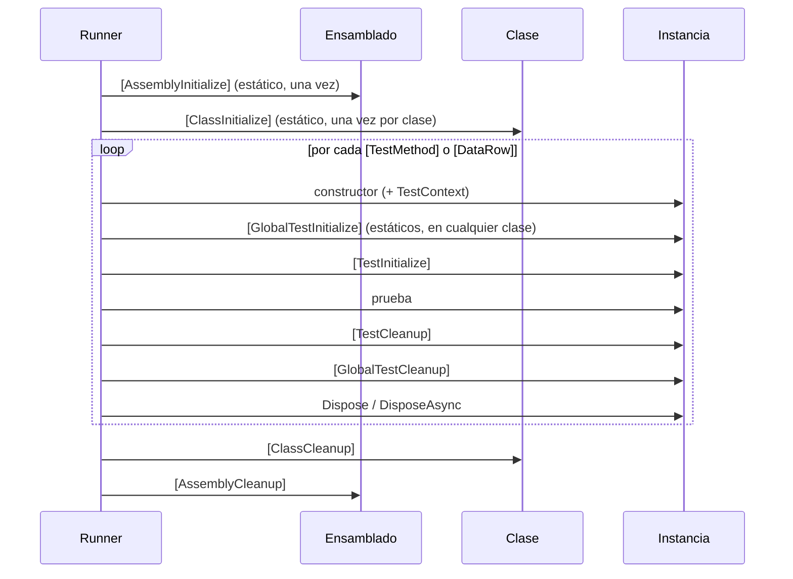

<div align="center">

# 06 · MSTest 4

**Baterías y analizadores incluidos: `MSTest.Sdk`, la API de aserciones renovada, el ciclo de vida de cuatro niveles, condiciones, `[ResourceLock]` y lo que llega con MSTest 5**

[⬅ 05 · NUnit](05-nunit.md) · [🏠 Índice](../README.md) · [07 · Piedra Rosetta ➡](07-piedra-rosetta.md)


</div>

<!-- fw=mstest -->

| Ficha | MSTest 4 🟢 |
|---|---|
| **Paquetes** | `MSTest` / `MSTest.Sdk` **4.5.2** (27-oct-2026) · `MSTest.TestFramework`, `MSTest.TestAdapter`, `MSTest.Analyzers` |
| **Plataforma** | Microsoft.Testing.Platform **2.5.2** (por defecto con `MSTest.Sdk`) · VSTest con `UseVSTest` |
| **Destinos** | .NET 8 o posterior · .NET Framework 4.6.2 o posterior · UWP y WinUI |
| **Licencia** | MIT · repositorio [`microsoft/testfx`](https://github.com/microsoft/testfx) |
| **Próxima versión** | MSTest 5 en desarrollo: solo .NET 10 y 11 en .NET moderno |
| **Laboratorio** | [`tests/Tienda.Tests.MSTest`](../tests/Tienda.Tests.MSTest) · 33 pruebas |

---

## Contenido

1. [Filosofía: el framework de la plataforma](#1-filosofía-el-framework-de-la-plataforma)
2. [Crear un proyecto con `MSTest.Sdk`](#2-crear-un-proyecto-con-mstestsdk)
3. [Clases y métodos de prueba](#3-clases-y-métodos-de-prueba)
4. [La API de aserciones de MSTest 4](#4-la-api-de-aserciones-de-mstest-4)
5. [Pruebas guiadas por datos](#5-pruebas-guiadas-por-datos)
6. [Ciclo de vida en cuatro niveles](#6-ciclo-de-vida-en-cuatro-niveles)
7. [`TestContext`](#7-testcontext)
8. [Condiciones, metadatos y control](#8-condiciones-metadatos-y-control)
9. [Paralelismo](#9-paralelismo)
10. [Analizadores](#10-analizadores)
11. [Novedades de 4.0 a 4.5](#11-novedades-de-40-a-45)
12. [MSTest 5 en el horizonte](#12-mstest-5-en-el-horizonte)
13. [Referencias](#13-referencias)

---

## 1. Filosofía: el framework de la plataforma

MSTest es hoy el **laboratorio de la plataforma de pruebas de Microsoft**. Microsoft.Testing.Platform, el SDK de proyecto, la generación de código para Native AOT, la telemetría
con OpenTelemetry y la mayor colección de analizadores del ecosistema nacen en `microsoft/testfx`.

| Rasgo | Consecuencia |
|---|---|
| **Atributos obligatorios** | `[TestClass]` y `[TestMethod]`: nada se descubre por accidente |
| **Instancia por prueba** | Como xUnit.net; `[TestInitialize]` y el constructor son equivalentes |
| **Ciclo de vida explícito en cuatro niveles** | Ensamblado, clase, global por prueba y prueba |
| **Analizadores incluidos y estrictos** | Desde la 4.0 varias reglas son advertencias por defecto |
| **Secuencial por defecto** | El paralelismo se activa a nivel de ensamblado o de configuración |
| **Integración de primera clase** | Visual Studio, Azure DevOps, TRX y cobertura sin configuración extra |

---

## 2. Crear un proyecto con `MSTest.Sdk`

```bash
dotnet new mstest -n Tienda.Tests.MSTest --sdk
dotnet test
```

```xml
<!-- Versión del SDK fijada en global.json: "msbuild-sdks": { "MSTest.Sdk": "4.5.2" } -->
<Project Sdk="MSTest.Sdk">
  <ItemGroup>
    <ProjectReference Include="../../src/Tienda.Dominio/Tienda.Dominio.csproj" />
  </ItemGroup>
</Project>
```

`MSTest.Sdk` decide por ti el `OutputType`, los paquetes, los `using` implícitos (`Microsoft.VisualStudio.TestTools.UnitTesting`) y las extensiones de la plataforma:

| Propiedad de MSBuild | Valores | Efecto |
|---|---|---|
| `TestingExtensionsProfile` | `Default` · `AllMicrosoft` · `None` | Qué extensiones de MTP se añaden (TRX y cobertura por defecto) |
| `UseVSTest` | `true` | Vuelve a VSTest y añade `Microsoft.NET.Test.Sdk` |
| `EnableAspireTesting` | `true` | Añade utilidades para probar aplicaciones .NET Aspire |
| `EnablePlaywright` | `true` | Añade Playwright para pruebas de navegador |
| `MSTestParallelizeScope` · `MSTestParallelizeWorkers` | `MethodLevel` · número | Paralelismo sin escribir atributos (4.3) |
| `PublishAot` | `true` | Ejecuta las pruebas con Native AOT, mediante generación de código |

---

## 3. Clases y métodos de prueba

```csharp
[TestClass]
public sealed class DineroTests
{
    [TestMethod]
    public void Sumar_misma_moneda_suma_los_montos()
    {
        Assert.AreEqual(new Dinero(14.75m), new Dinero(10.50m) + new Dinero(4.25m));
    }

    [TestMethod(DisplayName = "Sumar monedas distintas lanza MonedaIncompatibleException")]
    public void Sumar_monedas_distintas()
    {
        var ex = Assert.ThrowsExactly<MonedaIncompatibleException>(() => new Dinero(1m, "MXN") + new Dinero(1m, "USD"));

        Assert.AreEqual("USD", ex.Derecha);
    }
}
```

> [!TIP]
> El nombre visible se declara con la propiedad `DisplayName`. El constructor `[TestMethod("…")]` también existe, pero el analizador `MSTEST0056` recomienda la propiedad
> porque deja claro qué es cada argumento.
>
> Las clases de prueba `sealed` son una recomendación habitual en MSTest: dejan claro que no son clases base y evitan que una derivada herede pruebas sin querer. Para heredar
> pruebas, la clase derivada **también** necesita `[TestClass]`; el analizador `MSTEST0069` avisa si falta.

---

## 4. La API de aserciones de MSTest 4

MSTest 4 renovó su API de aserciones: todas usan `CallerArgumentExpression`, hay una `Assert.That` para expresiones libres y decenas de métodos específicos.

```csharp
[TestClass]
public sealed class AsercionesModernasTests
{
    [TestMethod]
    public void Aserciones_de_valores()
    {
        var carrito = new Carrito();
        carrito.Agregar(Catalogo.Libro, 2);
        carrito.Agregar(Catalogo.Taza, 3);

        Assert.AreEqual(5, carrito.Unidades);
        Assert.IsGreaterThan(1_000m, carrito.Total.Monto);           // (umbral, valor)
        Assert.IsInRange(1_200m, 1_300m, carrito.Total.Monto);
        Assert.That(() => carrito.Unidades == 5 && !carrito.EstaVacio);
        var suma = 0.1;
        suma += 0.2;                                               // 0.30000000000000004
        Assert.AreEqual(0.3, suma, delta: 1e-9);
    }

    [TestMethod]
    public void Aserciones_de_colecciones_y_texto()
    {
        int[] cantidades = [1, 2, 3];

        Assert.HasCount(3, cantidades);
        Assert.Contains(2, cantidades);
        Assert.AreAllDistinct(cantidades);                         // 4.3
        Assert.AreSequenceEqual([1, 2, 3], cantidades);            // 4.3
        Assert.AreEquivalent(new[] { 1, 2, 3 }, cantidades);       // 4.3: estructural, ¡el orden cuenta!
        CollectionAssert.AreEquivalent(new[] { 3, 2, 1 }, cantidades); // mismos elementos, cualquier orden
        var unico = Assert.ContainsSingle(new[] { "LIB-0001" });
        Assert.StartsWith("LIB", unico);
        Assert.MatchesRegex(@"^[A-Z]{3}-\d{4}$", unico);
    }

    [TestMethod]
    public void Aserciones_de_tipos_que_devuelven_el_valor()
    {
        object pedido = new Cupon("ATLAS10", 10m);

        var cupon = Assert.IsInstanceOfType<Cupon>(pedido);          // devuelve el valor convertido
        Assert.IsExactInstanceOfType<Cupon>(pedido);                  // 4.1: tipo exacto, no derivados
        Assert.AreEqual(10m, cupon.Porcentaje);
    }

    [TestMethod]
    public async Task Aserciones_de_excepciones()
    {
        Assert.ThrowsExactly<ArgumentOutOfRangeException>(() => new Dinero(-1m));       // tipo exacto
        Assert.Throws<ArgumentException>(() => new Dinero(-1m));                       // tipo o derivado

        var servicio = new ServicioDePedidos(new RepositorioEnMemoria(), new NotificadorEspia(), TimeProvider.System);
        await Assert.ThrowsExactlyAsync<InvalidOperationException>(() => servicio.ConfirmarAsync(new Carrito(), "x@y.z"));
    }
}
```

| Familia | Métodos destacados | Desde |
|---|---|---|
| Igualdad | `AreEqual`, `AreNotEqual`, `AreSame`, `AreEquivalent` | `AreEquivalent`: 4.3 |
| Expresión | `That(() => …)` | 4.0 |
| Comparación | `IsGreaterThan`, `IsLessThan`, `IsInRange`, `IsPositive`, `IsNegative` | 3.x |
| Colecciones | `HasCount`, `IsEmpty`, `Contains`, `ContainsSingle`, `ContainsAll`, `AreAllDistinct`, `AreAllNotNull`, `AreAllOfType`, `AreSequenceEqual` | `AreAll*`, `ContainsAll`: 4.3 |
| Texto | `StartsWith`, `EndsWith`, `Contains`, `MatchesRegex` | 3.x |
| Tipos | `IsInstanceOfType<T>`, `IsExactInstanceOfType<T>` | Exacto: 4.1 |
| Excepciones | `Throws`, `ThrowsExactly`, `ThrowsAsync`, `ThrowsExactlyAsync` | 3.8 |
| Resultado | `Fail`, `Inconclusive` | — |

> [!CAUTION]
> **`Assert.AreEquivalent` (4.3) no es "mismos elementos en cualquier orden".** Es una comparación **estructural profunda**: recorre objetos y colecciones miembro a miembro, y en
> una secuencia compara posición por posición. Lo descubrimos al verificar este capítulo: `Assert.AreEquivalent(new[] { 3, 2, 1 }, [1, 2, 3])` **falla** con
> `Error de coincidencia en "[0]"`. Para ignorar el orden sigue existiendo `CollectionAssert.AreEquivalent`.

> [!WARNING]
> **`Assert.Throws<T>` significa cosas distintas en xUnit.net y en MSTest.** En xUnit.net exige el tipo **exacto**; en MSTest acepta **derivados**, y el exacto es
> `ThrowsExactly<T>`. Es la trampa más común al alternar entre frameworks ([capítulo 08](08-aserciones.md#5-excepciones)).

---

## 5. Pruebas guiadas por datos

### `[DataRow]`

```csharp
[TestClass]
public sealed class SkuTests
{
    [TestMethod]
    [DataRow("LIB-0001", true)]
    [DataRow("lib-0001", false, DisplayName = "Minúsculas no son válidas")]
    [DataRow("LIBR-001", false)]
    [DataRow(null, false)]
    public void Valida_el_formato(string? sku, bool esperado) => Assert.AreEqual(esperado, Tienda.Catalogo.EsSkuValido(sku));
}
```

> [!NOTE]
> `[DataTestMethod]` es redundante desde MSTest 2: `[TestMethod]` ya admite `[DataRow]`. MSTest 5 lo **elimina**.

### `[DynamicData]` con tuplas o `TestDataRow<T>`

```csharp
[TestClass]
public sealed class EnvioTests
{
    // Tuplas: MSTest las despliega en los parámetros del método
    public static IEnumerable<(decimal Peso, Zona Zona, decimal Subtotal, decimal Esperado)> Tarifas =>
    [
        (0.5m, Zona.Local, 100m, 49m),
        (1.1m, Zona.Nacional, 100m, 124m),
        (2.0m, Zona.Nacional, 999m, 0m),
        (2.0m, Zona.Internacional, 5_000m, 374m),
    ];

    [TestMethod]
    [DynamicData(nameof(Tarifas))]
    public void Calcula_la_tarifa(decimal peso, Zona zona, decimal subtotal, decimal esperado) =>
        Assert.AreEqual(esperado, CalculadoraDeEnvio.Calcular(peso, zona, new Dinero(subtotal)).Monto);

    // TestDataRow<T>: una fila con nombre visible propio
    public static IEnumerable<TestDataRow<(Zona, decimal)>> Bases =>
    [
        new((Zona.Local, 49m)) { DisplayName = "Local: 49 MXN" },
        new((Zona.Nacional, 99m)) { DisplayName = "Nacional: 99 MXN" },
    ];

    [TestMethod]
    [DynamicData(nameof(Bases))]
    public void Tarifa_base(Zona zona, decimal esperado) =>
        Assert.AreEqual(esperado, CalculadoraDeEnvio.Calcular(1m, zona, new Dinero(1m)).Monto);
}
```

### Fuente de datos propia: `ITestDataSource`

```csharp
using System.Reflection;

[AttributeUsage(AttributeTargets.Method)]
public sealed class TodasLasZonasAttribute : Attribute, ITestDataSource
{
    public IEnumerable<object?[]> GetData(MethodInfo methodInfo) =>
        Enum.GetValues<Zona>().Select(z => new object?[] { z });

    public string? GetDisplayName(MethodInfo methodInfo, object?[]? data) => $"Zona {data?[0]}";
}

[TestClass]
public sealed class ZonasTests
{
    [TestMethod]
    [TodasLasZonas]
    public void Toda_zona_tiene_tarifa(Zona zona) =>
        Assert.IsGreaterThan(0m, CalculadoraDeEnvio.Calcular(1m, zona, new Dinero(1m)).Monto);
}
```

| Opción de datos | Para qué | Desde |
|---|---|---|
| `DisplayName` en `[DataRow]` | Renombra el caso completo | 2.x |
| `ArgumentsDisplayName` | Renombra solo la parte de argumentos | 4.5 |
| `UnfoldingStrategy` en `[TestMethod]` | `Unfold`: un caso por fila visible · `Fold`: un solo caso | 4.0 (antes en cada fuente) |
| `IgnoreMessage` en `TestDataRow<T>` | Omite una fila concreta | 3.x |
| Parámetro final `CancellationToken` | MSTest lo rellena con el token del contexto | 5.0 |

---

## 6. Ciclo de vida en cuatro niveles



```csharp aislado
[TestClass]
public sealed class CicloDeVidaTests : IDisposable
{
    private static RepositorioEnMemoria s_repositorio = null!;
    private readonly Carrito _carrito;

    [AssemblyInitialize]
    public static void AntesDeTodo(TestContext contexto) => contexto.WriteLine("Una vez por ensamblado");

    [ClassInitialize]
    public static async Task AntesDeLaClase(TestContext contexto)
    {
        s_repositorio = new RepositorioEnMemoria();
        await s_repositorio.GuardarAsync(new Pedido(Guid.Empty, [], Dinero.Cero(), DateTimeOffset.UnixEpoch), contexto.CancellationToken);
    }

    [GlobalTestInitialize]   // 3.10+: se aplica a TODAS las pruebas del ensamblado
    public static void AntesDeCadaPrueba(TestContext contexto) => contexto.WriteLine($"→ {contexto.TestName}");

    public CicloDeVidaTests(TestContext contexto)   // inyección por constructor (3.6+)
    {
        Contexto = contexto;
        _carrito = new Carrito();
    }

    public TestContext Contexto { get; }

    [TestInitialize]
    public void Preparar() => _carrito.Agregar(Catalogo.Taza);

    [TestMethod]
    public async Task La_semilla_existe() =>
        Assert.IsNotNull(await s_repositorio.BuscarAsync(Guid.Empty, Contexto.CancellationToken));

    [TestMethod]
    public void Cada_prueba_tiene_su_carrito() => Assert.AreEqual(1, _carrito.Unidades);

    [TestCleanup]
    public void Limpiar() => _carrito.Quitar(Catalogo.Taza.Sku);

    public void Dispose() { }

    [ClassCleanup]
    public static void DespuesDeLaClase() { }

    [AssemblyCleanup]
    public static void DespuesDeTodo() { }
}
```

| Nivel | Inicializar | Limpiar | Firma |
|---|---|---|---|
| Ensamblado | `[AssemblyInitialize]` | `[AssemblyCleanup]` | Estática; uno por ensamblado |
| Clase | `[ClassInitialize]` | `[ClassCleanup]` | Estática; opcionalmente heredable con `InheritanceBehavior` |
| Global por prueba | `[GlobalTestInitialize]` | `[GlobalTestCleanup]` | Estática; puede haber varios, en cualquier clase |
| Prueba | constructor · `[TestInitialize]` | `[TestCleanup]` · `Dispose` · `DisposeAsync` | De instancia |

> [!NOTE]
> Desde la 4.2, un fallo en `[ClassCleanup]` o `[AssemblyCleanup]` produce **un resultado propio** y se informa en la última prueba no ignorada, en lugar de perderse o de
> ensuciar una prueba que había pasado.

---

## 7. `TestContext`

| Miembro | Para qué |
|---|---|
| `TestName`, `FullyQualifiedTestClassName` | Identidad de la prueba |
| `CancellationToken` | Se cancela al exceder `[Timeout]` o al detener la ejecución |
| `CurrentTestOutcome` | Resultado, visible en `[TestCleanup]` |
| `Properties` | `IDictionary<string, object>` (4.0) con categorías (4.2) y parámetros |
| `WriteLine` | Salida asociada a la prueba |
| `AddResultFile` | Adjunta un archivo al resultado (TRX) |
| `TestRunDirectory`, `TestResultsDirectory` | Carpetas de la ejecución |
| `TestTempDirectory` | **4.4:** carpeta temporal por prueba; se borra si pasa y se conserva si falla |
| `TestContext.Current` | **4.2, experimental:** acceso ambiental, al estilo de xUnit.net |

```csharp
[TestClass]
public sealed class ContextoTests
{
    public TestContext TestContext { get; set; } = null!;

    [TestMethod]
    [TestCategory("Archivos")]
    public async Task Usa_una_carpeta_temporal_por_prueba()
    {
        var carpeta = TestContext.TestTempDirectory;
        Assert.IsNotNull(carpeta);                                  // también informa al análisis de nulabilidad
        var ruta = Path.Combine(carpeta, "pedido.json");

        await File.WriteAllTextAsync(ruta, """{ "sku": "LIB-0001" }""", TestContext.CancellationToken);

        TestContext.WriteLine($"{TestContext.TestName} escribió {ruta}");
        TestContext.AddResultFile(ruta);
        Assert.IsTrue(File.Exists(ruta));
    }
}
```

---

## 8. Condiciones, metadatos y control

```csharp
[TestClass]
public sealed class ControlTests
{
    private const string BaseDeDatos = "BaseDeDatos";

    [TestMethod]
    [Ignore("Pendiente de la API de pagos")]   // MSTEST0066 exige una justificación
    public void Paga_con_tarjeta() { }

    [TestMethod]
    [OSCondition(OperatingSystems.Linux | OperatingSystems.OSX)]
    public void Solo_en_unix() => Assert.AreEqual('/', Path.DirectorySeparatorChar);

    [TestMethod]
    [CICondition(ConditionMode.Exclude)]   // no se ejecuta en integración continua
    public void Solo_en_local() { }

    [TestMethod]
    [Timeout(5_000, CooperativeCancellation = true)]
    public async Task Con_tiempo_maximo_cooperativo() => await Task.Delay(10, TestContext.CancellationToken);

    [TestMethod]
    [Retry(3)]   // 3.8+; desde 4.3 también a nivel de clase
    public void Reintentada() => Assert.IsGreaterThan(2000, DateTime.UtcNow.Year);

    [TestMethod]
    [ResourceLock(BaseDeDatos)]   // 4.4: no corre en paralelo con otras que bloqueen el mismo recurso
    public void Usa_la_base_de_datos() { }

    [TestMethod]
    [TestCategory("Lenta"), Owner("equipo-envios"), Priority(1), Description("Ejemplo de metadatos"), WorkItem(42)]
    public void Con_metadatos() { }

    public TestContext TestContext { get; set; } = null!;
}
```

| Atributo | Matiz |
|---|---|
| `[OSCondition]`, `[CICondition]`, `[ArchitectureCondition]` | Derivan de `ConditionBaseAttribute`; puedes crear las tuyas (`IsConditionMet`) |
| `[Timeout]` con `CooperativeCancellation` | Cancela el token y deja terminar la prueba; sin él, MSTest deja de observarla |
| `[Retry]` | Extensible: hereda de `RetryBaseAttribute`; `RetryResult.AllResults` (4.4) expone cada intento |
| `[ResourceLock]` | Exclusión mutua fina; `MSTEST0073` recomienda constantes como nombre |
| `[STATestMethod]`, `[STATestClass]` | Hilo STA para WPF y WinForms; `UseSTASynchronizationContext` (4.1) |
| `[WorkItem]`, `[GitHubWorkItem]` | Se conservan en los informes TRX de MTP (4.4) |

---

## 9. Paralelismo

MSTest es **secuencial por defecto**. Se activa a nivel de ensamblado, con MSBuild o con `testconfig.json`:

```csharp aislado
[assembly: Parallelize(Workers = 0, Scope = ExecutionScope.MethodLevel)]   // 0 = un hilo por núcleo

[TestClass]
public sealed class ParaleloTests
{
    [TestMethod]
    [DataRow(Zona.Local)]
    [DataRow(Zona.Nacional)]
    public void En_paralelo(Zona zona) => Assert.IsGreaterThan(0m, CalculadoraDeEnvio.Calcular(1m, zona, new Dinero(1m)).Monto);

    [TestMethod]
    [DoNotParallelize]
    public void Siempre_sola() => Assert.IsNotNull(Environment.CurrentDirectory);
}
```

| Forma | Ejemplo |
|---|---|
| Atributo de ensamblado | `[assembly: Parallelize(Scope = ExecutionScope.ClassLevel)]` |
| MSBuild (4.3) | `<MSTestParallelizeScope>MethodLevel</MSTestParallelizeScope>` |
| `testconfig.json` | `"mstest": { "parallelism": { "enabled": true, "scope": "method" } }` |
| Excluir | `[DoNotParallelize]` en método o clase; `MSTEST0059` detecta conflictos |
| Exclusión por recurso | `[ResourceLock("nombre")]` (4.4) |

Los analizadores `MSTEST0074` a `MSTEST0077` (4.4) avisan de patrones peligrosos en paralelo: modificar el estado global del proceso, el directorio actual, la cultura o archivos
compartidos.

---

## 10. Analizadores

MSTest incluye **más de 80 reglas** (`MSTEST0001` a `MSTEST0090`), y desde la 4.0 varias son advertencias por defecto. Una selección:

| Regla | Detecta |
|---|---|
| `MSTEST0006` | `[ExpectedException]` (eliminado en 4.0): migrar a `Assert.Throws` |
| `MSTEST0017` | Argumentos esperado y real invertidos |
| `MSTEST0025` | Aserción que siempre falla: usar `Assert.Fail` |
| `MSTEST0032` | Aserción que siempre pasa |
| `MSTEST0037` | Usar el método de aserción adecuado (`HasCount` en lugar de `AreEqual(n, x.Count)`) |
| `MSTEST0049` | No se pasa el `CancellationToken` del contexto |
| `MSTEST0058` | Aserciones dentro de un `catch` |
| `MSTEST0064` | Preferir aserciones asíncronas |
| `MSTEST0065` | `Assert.AreEqual` sobre colecciones (compara referencias) |
| `MSTEST0066` | `[Ignore]` sin justificación |
| `MSTEST0067` | `Thread.Sleep`, `Task.Wait` o `.Result` en pruebas |
| `MSTEST0068` | `CollectionAssert` que puede ser `Assert` |
| `MSTEST0074`–`MSTEST0077` | Estado global, directorio, cultura o archivos compartidos en paralelo |
| `MSTEST0090` | Contar o comprobar existencia enumerando un `IQueryable` (5.0) |

En este repositorio `TreatWarningsAsErrors` está activo: **cada analizador es un revisor de código que nunca se cansa**. Un ejemplo real del laboratorio, al escribir una prueba que
siempre falla:

```text
warning MSTEST0025: Usar "Assert.Fail" en lugar de una aserción 'Assert.AreEqual' que siempre tiene errores
```

---

## 11. Novedades de 4.0 a 4.5

| Versión | Fecha | Lo más importante |
|---|---|---|
| **4.0** | 7-oct-2025 | `Assert.That`; `CallerArgumentExpression` en todas las aserciones; eliminados `[ExpectedException]` y `Assert.ThrowsException`; `TestContext.Properties` como `IDictionary<string, object>`; `TestMethodAttribute.ExecuteAsync`; mínimo .NET 8; `DisableAppDomain` por defecto con MTP; `TreatDiscoveryWarningsAsErrors` por defecto |
| **4.1** | 3-feb-2026 | `IsExactInstanceOfType`; analizadores para aserciones en `catch`, `[Parallelize]` en conflicto, `[OSCondition]`, constructores inválidos |
| **4.2** | 7-abr-2026 | `TestContext.Current` experimental; depurador al fallar; resultados propios para fallos de limpieza |
| **4.3** | 8-jul-2026 | `AreEquivalent`, `AreSequenceEqual`, `ContainsAll`, `AreAll*`; `[Retry]` de clase; generador de código por reflexión; orden aleatorio opcional; `[AssemblyFixtureProvider]` |
| **4.4** | 2-sep-2026 | `[ResourceLock]`; `TestTempDirectory`; captura de salida en vivo; ejecución en `browser-wasm` y `wasi-wasm`; OpenTelemetry; `[WorkItem]` en TRX |
| **4.5** | 7-oct-2026 | Diagnóstico de fallos opcional (`CaptureAssertionFailureDiagnostics`); `MSTest.Windows.UIAutomation` (vista previa); UWP y WinUI sobre MTP; `ArgumentsDisplayName` |

---

## 12. MSTest 5 en el horizonte

El *changelog* de `microsoft/testfx` ya describe una versión 5.0 **no publicada** al cierre de esta edición. Lo previsto:

| Cambio | Tipo |
|---|---|
| Solo .NET 10 y .NET 11 en .NET moderno (se retiran .NET 8 y 9) | Incompatible |
| Se elimina `[DataTestMethod]` | Incompatible |
| `Assert.IsNotNull<T>` genérico que devuelve el valor no nulo | Incompatible en compilación |
| Se sellan `[Parallelize]`, `[DoNotParallelize]`, `[STATestClass]` y otros | Incompatible |
| Analizadores exigen Roslyn 4.14 (VS 2022 17.14 o SDK 9.0.300) | Incompatible |
| `--partition índice/total` para repartir la suite en CI | Nueva |
| `[ExpectedDuration(ms)]`: aviso si una prueba supera su presupuesto | Nueva |
| Parámetro `CancellationToken` final rellenado automáticamente | Nueva |
| Descubrimiento de funciones de módulos de F# sin `[TestClass]` | Nueva |

> [!IMPORTANT]
> Que MSTest 5 abandone .NET 8 y 9 está alineado con el ciclo de vida de .NET: **ambos dejan de tener soporte el 10 de noviembre de 2026**. Si tus pruebas aún apuntan a
> `net8.0`, planifica el salto a `net10.0` antes de adoptar MSTest 5.

---

## 13. Referencias

- Microsoft Learn: [*MSTest overview*](https://learn.microsoft.com/dotnet/core/testing/unit-testing-mstest-intro), [*MSTest SDK*](https://learn.microsoft.com/dotnet/core/testing/unit-testing-mstest-sdk),
  [*Configure MSTest*](https://learn.microsoft.com/dotnet/core/testing/unit-testing-mstest-configure) y [*Migrate from MSTest v3 to v4*](https://learn.microsoft.com/dotnet/core/testing/unit-testing-mstest-migration-v3-v4).
- [Reglas de `MSTest.Analyzers`](https://learn.microsoft.com/dotnet/core/testing/mstest-analyzers/overview).
- [Changelog de MSTest](https://github.com/microsoft/testfx/blob/main/docs/Changelog.md) · código fuente: [github.com/microsoft/testfx](https://github.com/microsoft/testfx).

---

<div align="center">

[⬅ 05 · NUnit](05-nunit.md) · [🏠 Índice](../README.md) · [07 · Piedra Rosetta ➡](07-piedra-rosetta.md)

</div>
