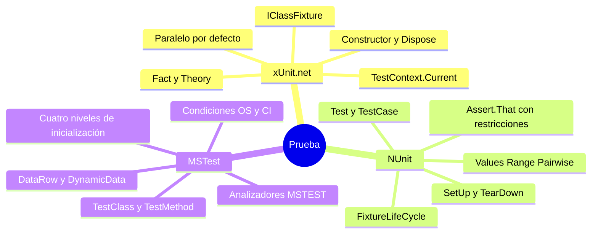
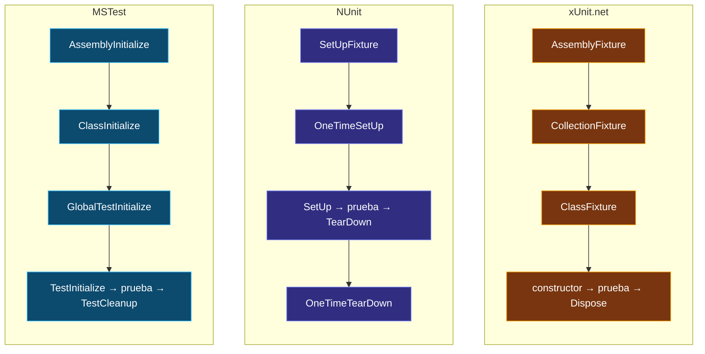

<div align="center">

# 07 · Piedra Rosetta

**Las mismas ideas en tres lenguas: equivalencias, filosofías comparadas y las diferencias que muerden al cambiar de framework**

[⬅ 06 · MSTest](06-mstest.md) · [🏠 Índice](../README.md) · [08 · Aserciones ➡](08-aserciones.md)

</div>

> La Piedra de Rosetta permitió descifrar los jeroglíficos porque decía lo mismo en tres escrituras. Este capítulo hace lo mismo con xUnit.net, NUnit y MSTest: si sabes uno,
> aquí aprendes los otros dos. El catálogo exhaustivo, con 121 conceptos, está en [17 · Catálogo A–Z](17-catalogo-a-z.md).

---

## Contenido

1. [Tres filosofías en una tabla](#1-tres-filosofías-en-una-tabla)
2. [Una clase completa, tres veces](#2-una-clase-completa-tres-veces)
3. [Definir pruebas](#3-definir-pruebas)
4. [Ciclo de vida](#4-ciclo-de-vida)
5. [Datos](#5-datos)
6. [Aserciones esenciales](#6-aserciones-esenciales)
7. [Control y metadatos](#7-control-y-metadatos)
8. [Paralelismo y tiempo](#8-paralelismo-y-tiempo)
9. [Salida y contexto](#9-salida-y-contexto)
10. [Diferencias que muerden](#10-diferencias-que-muerden)
11. [Resultados posibles de una prueba](#11-resultados-posibles-de-una-prueba)
12. [Puntuación por dimensiones](#12-puntuación-por-dimensiones)

---

## 1. Tres filosofías en una tabla

| | xUnit.net v3 | NUnit 5 | MSTest 4 |
|---|---|---|---|
| **Lema implícito** | "Menos es más" | "Un atributo para cada necesidad" | "Baterías y analizadores incluidos" |
| **Instancia de la clase** | Una por prueba | **Una por fixture** (opcional por prueba) | Una por prueba |
| **Preparación** | Constructor | `[SetUp]` | `[TestInitialize]` o constructor |
| **Estado compartido** | Fixtures inyectadas | `[OneTimeSetUp]` y campos | `[ClassInitialize]` y campos estáticos |
| **Paralelismo por defecto** | ✅ Entre clases | ❌ | ❌ |
| **Estilo de aserción** | `Assert.Método(esperado, real)` | `Assert.That(real, restricción)` | `Assert.Método(esperado, real)` + `Assert.That(() => …)` |
| **Atributo de clase** | No | Opcional | Obligatorio |
| **Contexto ambiental** | `TestContext.Current` | `TestContext.CurrentContext` | `TestContext` inyectado (`Current` experimental) |
| **Plataforma por defecto** | MTP | VSTest (MTP con una propiedad) | MTP con `MSTest.Sdk` |
| **Gobierno** | .NET Foundation, mantenedor principal | .NET Foundation, equipo voluntario | Microsoft |



---

## 2. Una clase completa, tres veces

Preparación por prueba, un caso simple, un caso parametrizado y una excepción. Lee en paralelo las tres versiones: **las líneas se corresponden una a una.**

**xUnit.net v3**

```csharp xunit
public class CarritoRosettaTests
{
    private readonly Carrito _carrito = new();                       // preparar: campo + constructor

    [Fact]
    public void Un_cupon_descuenta_sobre_el_subtotal()
    {
        _carrito.Agregar(Catalogo.Libro, 2);
        _carrito.AplicarCupon(new Cupon("ATLAS10", 10m));

        Assert.Equal(new Dinero(810m), _carrito.Total);
    }

    [Theory]
    [InlineData(1)]
    [InlineData(10)]
    public void Acepta_cantidades_validas(int cantidad)
    {
        _carrito.Agregar(Catalogo.Taza, cantidad);

        Assert.Equal(cantidad, _carrito.Unidades);
    }

    [Fact]
    public void Rechaza_superar_el_maximo()
    {
        var ex = Assert.Throws<InvalidOperationException>(() => _carrito.Agregar(Catalogo.Taza, 11));

        Assert.Contains("Máximo", ex.Message);
    }
}
```

**NUnit 5**

```csharp nunit
public class CarritoRosettaTests
{
    private Carrito _carrito = null!;

    [SetUp]
    public void Preparar() => _carrito = new Carrito();                // preparar: [SetUp]

    [Test]
    public void Un_cupon_descuenta_sobre_el_subtotal()
    {
        _carrito.Agregar(Catalogo.Libro, 2);
        _carrito.AplicarCupon(new Cupon("ATLAS10", 10m));

        Assert.That(_carrito.Total, Is.EqualTo(new Dinero(810m)));
    }

    [TestCase(1)]
    [TestCase(10)]
    public void Acepta_cantidades_validas(int cantidad)
    {
        _carrito.Agregar(Catalogo.Taza, cantidad);

        Assert.That(_carrito.Unidades, Is.EqualTo(cantidad));
    }

    [Test]
    public void Rechaza_superar_el_maximo()
    {
        var ex = Assert.Throws<InvalidOperationException>(() => _carrito.Agregar(Catalogo.Taza, 11));

        Assert.That(ex.Message, Does.Contain("Máximo"));
    }
}
```

**MSTest 4**

```csharp mstest
[TestClass]
public sealed class CarritoRosettaTests
{
    private readonly Carrito _carrito = new();                       // preparar: campo + constructor

    [TestMethod]
    public void Un_cupon_descuenta_sobre_el_subtotal()
    {
        _carrito.Agregar(Catalogo.Libro, 2);
        _carrito.AplicarCupon(new Cupon("ATLAS10", 10m));

        Assert.AreEqual(new Dinero(810m), _carrito.Total);
    }

    [TestMethod]
    [DataRow(1)]
    [DataRow(10)]
    public void Acepta_cantidades_validas(int cantidad)
    {
        _carrito.Agregar(Catalogo.Taza, cantidad);

        Assert.AreEqual(cantidad, _carrito.Unidades);
    }

    [TestMethod]
    public void Rechaza_superar_el_maximo()
    {
        var ex = Assert.ThrowsExactly<InvalidOperationException>(() => _carrito.Agregar(Catalogo.Taza, 11));

        Assert.Contains("Máximo", ex.Message);
    }
}
```

> [!NOTE]
> En NUnit el campo **no** se inicializa en la declaración: como la instancia se comparte entre pruebas, el estado se reinicia en `[SetUp]`. Es la diferencia de diseño más
> importante entre NUnit y los otros dos ([sección 10](#10-diferencias-que-muerden)).

---

## 3. Definir pruebas

| Concepto | xUnit.net v3 | NUnit 5 | MSTest 4 |
|---|---|---|---|
| Clase | (ninguno) | `[TestFixture]` (opcional) | `[TestClass]` |
| Prueba | `[Fact]` | `[Test]` | `[TestMethod]` |
| Parametrizada | `[Theory]` | `[TestCase]` · `[TestCaseSource]` | `[TestMethod]` + `[DataRow]` |
| Asíncrona | `async Task` · `async ValueTask` | `async Task` | `async Task` |
| Nombre visible | `[Fact(DisplayName = "…")]` | `[TestCase(…, TestName = "…")]` · `.SetName()` | `[TestMethod(DisplayName = "…")]` |
| Explícita | `[Fact(Explicit = true)]` | `[Explicit]` | — |
| Clase parametrizada | — | `[TestFixture(arg)]` | — |
| Clase genérica | — | `[TestFixture(typeof(T))]` | — |

---

## 4. Ciclo de vida

| Momento | xUnit.net v3 | NUnit 5 | MSTest 4 |
|---|---|---|---|
| Una vez por ensamblado (inicio) | `[assembly: AssemblyFixture(typeof(T))]` | `[SetUpFixture]` sin namespace + `[OneTimeSetUp]` | `[AssemblyInitialize]` |
| Una vez por grupo de clases | `ICollectionFixture<T>` | `[SetUpFixture]` en un namespace | — |
| Una vez por clase | `IClassFixture<T>` | `[OneTimeSetUp]` | `[ClassInitialize]` |
| Antes de cada prueba (global) | `BeforeAfterTestAttribute` | `ITestAction` de ensamblado | `[GlobalTestInitialize]` |
| Antes de cada prueba | Constructor · `IAsyncLifetime.InitializeAsync` | `[SetUp]` | Constructor · `[TestInitialize]` |
| Después de cada prueba | `Dispose` · `DisposeAsync` | `[TearDown]` | `[TestCleanup]` · `Dispose` · `DisposeAsync` |
| Una vez por clase (fin) | `Dispose` de la fixture | `[OneTimeTearDown]` | `[ClassCleanup]` |
| Una vez por ensamblado (fin) | `Dispose` de la fixture de ensamblado | `[OneTimeTearDown]` del `[SetUpFixture]` | `[AssemblyCleanup]` |



---

## 5. Datos

| Necesidad | xUnit.net v3 | NUnit 5 | MSTest 4 |
|---|---|---|---|
| Constantes en línea | `[InlineData(1, "a")]` | `[TestCase(1, "a")]` | `[DataRow(1, "a")]` |
| Desde un miembro | `[MemberData(nameof(X))]` | `[TestCaseSource(nameof(X))]` | `[DynamicData(nameof(X))]` |
| Desde otra clase | `[ClassData(typeof(T))]` | `[TestCaseSource(typeof(T), nameof(X))]` | `[DynamicData(nameof(X), typeof(T))]` |
| Tipado fuerte | `TheoryData<T1, T2>` | `TestCaseData<T1, T2>` | `TestDataRow<T>` · tuplas |
| Fila con metadatos | `TheoryDataRow<T>` { `Skip`, `Label`, `Traits` } | `TestCaseData.SetName()`, `.Ignore()`, `.SetCategory()` | `TestDataRow<T>` { `DisplayName`, `IgnoreMessage` } |
| Resultado esperado | — | `ExpectedResult = …` · `.Returns(…)` | — |
| Producto cartesiano | `MatrixTheoryData<T1, T2>` | `[Combinatorial]` + `[Values]` | — |
| Por pares | — | `[Pairwise]` | — |
| Rango y aleatorios | — | `[Range]`, `[Random]` | — |
| Fuente propia | `DataAttribute` | `ITestBuilder` · `ITestCaseSource` | `ITestDataSource` |

---

## 6. Aserciones esenciales

| Intención | xUnit.net v3 | NUnit 5 | MSTest 4 |
|---|---|---|---|
| Igual | `Assert.Equal(e, r)` | `Assert.That(r, Is.EqualTo(e))` | `Assert.AreEqual(e, r)` |
| Distinto | `Assert.NotEqual(e, r)` | `Is.Not.EqualTo(e)` | `Assert.AreNotEqual(e, r)` |
| Verdadero | `Assert.True(c)` | `Assert.That(c)` · `Is.True` | `Assert.IsTrue(c)` |
| Nulo | `Assert.Null(x)` | `Is.Null` | `Assert.IsNull(x)` |
| Misma referencia | `Assert.Same(e, r)` | `Is.SameAs(e)` | `Assert.AreSame(e, r)` |
| Tolerancia | `Assert.Equal(e, r, 0.001)` | `Is.EqualTo(e).Within(0.001)` | `Assert.AreEqual(e, r, 0.001)` |
| Rango | `Assert.InRange(r, a, b)` | `Is.InRange(a, b)` | `Assert.IsInRange(a, b, r)` |
| Tipo exacto | `Assert.IsType<T>(x)` | `Is.TypeOf<T>()` | `Assert.IsExactInstanceOfType<T>(x)` |
| Tipo compatible | `Assert.IsAssignableFrom<T>(x)` | `Is.InstanceOf<T>()` | `Assert.IsInstanceOfType<T>(x)` |
| Colección vacía | `Assert.Empty(c)` | `Is.Empty` | `Assert.IsEmpty(c)` |
| Un elemento | `Assert.Single(c)` | `Has.Exactly(1).Items` | `Assert.ContainsSingle(c)` |
| Contiene | `Assert.Contains(x, c)` | `Does.Contain(x)` · `Has.Member(x)` | `Assert.Contains(x, c)` |
| Equivalencia | `Assert.Equivalent(e, r)` | `Is.EqualTo(e).UsingPropertiesComparer()` | `Assert.AreEquivalent(e, r)` |
| Texto empieza | `Assert.StartsWith(p, s)` | `Does.StartWith(p)` | `Assert.StartsWith(p, s)` |
| Regex | `Assert.Matches(rx, s)` | `Does.Match(rx)` | `Assert.MatchesRegex(rx, s)` |
| Excepción exacta | `Assert.Throws<T>(…)` | `Assert.Throws<T>(…)` · `Throws.TypeOf<T>()` | `Assert.ThrowsExactly<T>(…)` |
| Excepción o derivada | `Assert.ThrowsAny<T>(…)` | `Assert.Catch<T>(…)` · `Throws.InstanceOf<T>()` | `Assert.Throws<T>(…)` |
| Asíncrona | `await Assert.ThrowsAsync<T>(…)` | `await Assert.ThrowsAsync<T>(…)` | `await Assert.ThrowsExactlyAsync<T>(…)` |
| Varias a la vez | `Assert.Multiple(…)` | `using (Assert.EnterMultipleScope())` | — |
| Fallar | `Assert.Fail(m)` | `Assert.Fail(m)` | `Assert.Fail(m)` |

---

## 7. Control y metadatos

| Necesidad | xUnit.net v3 | NUnit 5 | MSTest 4 |
|---|---|---|---|
| Omitir | `[Fact(Skip = "…")]` | `[Ignore("…")]` | `[Ignore("…")]` |
| Omitir hasta una fecha | — | `[Ignore("…", Until = "2027-01-31")]` | — |
| Omitir en ejecución | `Assert.Skip("…")` · `SkipUnless` | `Assert.Ignore("…")` | `Assert.Inconclusive("…")` |
| Categoría | `[Trait("Category", "X")]` | `[Category("X")]` | `[TestCategory("X")]` |
| Propiedad | `[Trait("k", "v")]` | `[Property("k", "v")]` | `[TestProperty("k", "v")]` |
| Sistema operativo | `SkipUnless` + `OperatingSystem.IsLinux()` | `[Platform("Linux")]` | `[OSCondition(OperatingSystems.Linux)]` |
| Solo en local | — | — | `[CICondition(ConditionMode.Exclude)]` |
| Cultura | `--culture` · `xunit.runner.json` | `[SetCulture("es-MX")]` | — |
| Reintentos | — (extensión de MTP) | `[Retry(n)]` | `[Retry(n)]` |
| Repetición | — | `[Repeat(n)]` | — |
| Hilo STA | — | `[Apartment(ApartmentState.STA)]` | `[STATestMethod]` |
| Autor | — | `[Author]` | `[Owner]` |

---

## 8. Paralelismo y tiempo

| | xUnit.net v3 | NUnit 5 | MSTest 4 |
|---|---|---|---|
| **Por defecto** | Colecciones (clases) en paralelo | Todo en serie | Todo en serie |
| **Activar** | Ya activo · `--parallel all` (4.0) | `[Parallelizable(ParallelScope.All)]` | `[assembly: Parallelize]` · MSBuild · `testconfig.json` |
| **Desactivar** | `[CollectionDefinition(DisableParallelization = true)]` | `[NonParallelizable]` | `[DoNotParallelize]` |
| **Hilos** | `maxParallelThreads` · `--max-threads` | `[assembly: LevelOfParallelism(n)]` | `Workers = n` |
| **Exclusión por recurso** | Misma `[Collection]` | — | `[ResourceLock]` |
| **Tiempo máximo** | `[Fact(Timeout = ms)]` | `[CancelAfter(ms)]` | `[Timeout(ms)]` |
| **Token** | `TestContext.Current.CancellationToken` | Parámetro `CancellationToken` | `TestContext.CancellationToken` |
| **Medir sin interrumpir** | — | `[MaxTime(ms)]` | — |

---

## 9. Salida y contexto

| Necesidad | xUnit.net v3 | NUnit 5 | MSTest 4 |
|---|---|---|---|
| Escribir en la salida de la prueba | `ITestOutputHelper.WriteLine` · `TestContext.Current.TestOutputHelper` | `TestContext.Out.WriteLine` | `TestContext.WriteLine` |
| ¿Se captura `Console`? | Solo con `[assembly: CaptureConsole]` | Sí | Sí |
| Salida inmediata | `SendDiagnosticMessage` | `TestContext.Progress` | `TestOutputCaptureMode` (4.4) |
| Nombre de la prueba | `TestContext.Current.Test!.TestDisplayName` | `TestContext.CurrentContext.Test.Name` | `TestContext.TestName` |
| Resultado en la limpieza | `TestContext.Current.TestState` | `TestContext.CurrentContext.Result.Outcome` | `TestContext.CurrentTestOutcome` |
| Adjuntar | `TestContext.Current.AddAttachment` | `TestContext.AddTestAttachment` | `TestContext.AddResultFile` |
| Parámetros externos | Variables de entorno · `xunit.runner.json` | `TestContext.Parameters` | `TestContext.Properties` |

```csharp xunit aislado
// En xUnit.net v3, Console.WriteLine no llega a la salida de la prueba salvo que se pida
[assembly: CaptureConsole]

public class SalidaTests
{
    [Fact]
    public void Console_se_captura_con_el_atributo()
    {
        Console.WriteLine("Esto aparece en la salida de la prueba gracias a [assembly: CaptureConsole]");
        Assert.True(true);
    }
}
```

---

## 10. Diferencias que muerden

Las equivalencias anteriores son el mapa; esta sección es la lista de **trampas** que cuestan horas al cambiar de framework.

| # | Trampa | Detalle | Cómo evitarla |
|---:|---|---|---|
| 1 | **`Assert.Throws<T>` no significa lo mismo** | xUnit.net y NUnit: tipo **exacto**. MSTest: tipo **o derivado** (el exacto es `ThrowsExactly`) | Al migrar a MSTest, `Assert.Throws` → `Assert.ThrowsExactly` |
| 2 | **Orden de argumentos de NUnit** | `Assert.That(real, Is.EqualTo(esperado))`: el real va **primero** | Analizadores `NUnit2005`/`NUnit2007` |
| 3 | **Instancia compartida en NUnit** | Un campo inicializado en la declaración se comparte entre pruebas | `[SetUp]` o `[FixtureLifeCycle(InstancePerTestCase)]` |
| 4 | **xUnit.net es paralelo por defecto** | Código con estado estático que "funcionaba" en NUnit falla al azar | Colección con `DisableParallelization` o eliminar el estado global |
| 5 | **`[Theory]` de NUnit ≠ `[Theory]` de xUnit.net** | NUnit: teoría con *datapoints* y supuestos. xUnit.net: prueba parametrizada | En NUnit, usar `[TestCase]` para casos explícitos |
| 6 | **`decimal` en atributos** | Ningún atributo de C# acepta `decimal`; se pasa `double` y se convierte | `TheoryData`, `TestCaseData` o `DynamicData` para importes |
| 7 | **`Assert.AreEqual` sobre colecciones en MSTest** | Compara **referencias** de la colección, no sus elementos | `Assert.AreSequenceEqual` o `CollectionAssert.AreEqual`; analizador `MSTEST0065` |
| 8 | **"Equivalente" no significa lo mismo** | `Assert.AreEquivalent` de MSTest es estructural y respeta el orden; `CollectionAssert.AreEquivalent` lo ignora | Elegir según la intención; ver [08 · Aserciones](08-aserciones.md#4-equivalencia-y-colecciones) |
| 9 | **`[ClassInitialize]` es estático** | El estado compartido vive en campos `static` | Reiniciarlo explícitamente o usar `[TestInitialize]` |
| 10 | **`Console` en xUnit.net** | Sin `[assembly: CaptureConsole]`, la salida no aparece en el resultado | Usar `ITestOutputHelper` o el atributo |
| 11 | **Aserciones asíncronas de NUnit 5** | `Assert.ThrowsAsync` sin `await` no evalúa nada | `NUnit.Analyzers` 4.14+ |
| 12 | **MSTest exige `[TestClass]` pública** | Una clase sin el atributo, o `internal`, no se descubre | Analizadores `MSTEST0004`, `MSTEST0030` |
| 13 | **Omitida, ignorada, inconclusa** | Cada framework informa el "no ejecutado" con un nombre distinto | Ver la [sección 11](#11-resultados-posibles-de-una-prueba) |
| 14 | **Tiempos máximos cooperativos** | En .NET moderno ningún framework puede abortar un hilo: si no observas el token, la prueba sigue corriendo | Pasar siempre el `CancellationToken` del contexto |

---

## 11. Resultados posibles de una prueba

| Resultado | xUnit.net v3 | NUnit 5 | MSTest 4 | ¿Rompe el CI? |
|---|---|---|---|---|
| Pasó | Passed | Passed | Passed | No |
| Falló una aserción | Failed | Failed | Failed | **Sí** |
| Excepción no esperada | Failed | Failed (*Error*) | Failed | **Sí** |
| Omitida por diseño | Skipped | Ignored / Skipped | Ignored / Skipped | No (salvo `--fail-skips`) |
| No concluyente | — | Inconclusive | Inconclusive | No |
| Pasó con advertencia | Warning (con `--fail-warns` falla) | Warning | — | Configurable |
| Explícita, no seleccionada | Not run | Skipped | — | No |
| Tiempo excedido | Failed | Failed | Timeout | **Sí** |

---

## 12. Puntuación por dimensiones

Valoración editorial del atlas, de ★ a ★★★★★, con criterios explicados. No es una medición objetiva: es una síntesis de los capítulos anteriores.

| Dimensión | xUnit.net v3 | NUnit 5 | MSTest 4 | Criterio |
|---|:---:|:---:|:---:|---|
| Aislamiento por defecto | ★★★★★ | ★★★ | ★★★★ | Instancia por prueba y paralelismo seguros sin configurar |
| Riqueza de parametrización | ★★★★ | ★★★★★ | ★★★ | Atributos de datos, combinatoria, tipado |
| Expresividad de aserciones | ★★★★ | ★★★★★ | ★★★★ | Mensajes, composición, cobertura de casos |
| Analizadores | ★★★★ | ★★★★ | ★★★★★ | Número y profundidad de reglas, correcciones automáticas |
| Integración con la plataforma | ★★★★★ | ★★★★ | ★★★★★ | MTP, informes, IDE, AOT |
| Informes sin paquetes extra | ★★★★★ | ★★★ | ★★★★ | Formatos de salida disponibles de serie |
| Extensibilidad | ★★★★★ | ★★★★ | ★★★★ | Puntos de extensión documentados |
| Curva de aprendizaje | ★★★★ | ★★★ | ★★★★★ | Conceptos necesarios para empezar |
| Estabilidad de la API | ★★★★ | ★★★ | ★★★ | Cambios incompatibles en los últimos tres años |
| Novedades en 2026 | ★★★★ | ★★★ | ★★★★★ | Volumen e impacto de funciones nuevas |

La elección no se decide por puntos: depende del equipo, del código existente y del ecosistema. El [capítulo 15](15-guias-de-decision.md) lo convierte en árboles de decisión.

---

<div align="center">

[⬅ 06 · MSTest](06-mstest.md) · [🏠 Índice](../README.md) · [08 · Aserciones ➡](08-aserciones.md)

</div>
