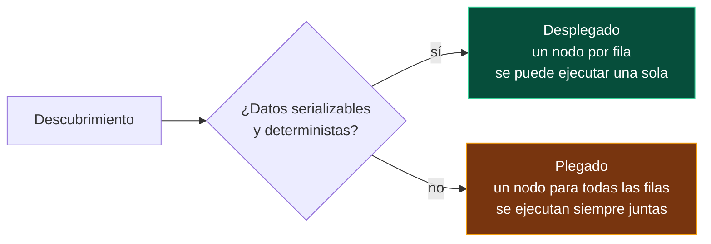

<div align="center">

# 09 · Pruebas parametrizadas

**Una prueba, muchos casos: cómo descubre cada framework sus datos, cómo se nombran, tablas compartidas, combinatoria y pruebas basadas en propiedades**

[⬅ 08 · Aserciones](08-aserciones.md) · [🏠 Índice](../README.md) · [10 · Ciclo de vida y fixtures ➡](10-ciclo-de-vida-y-fixtures.md)

</div>

---

## Contenido

1. [Cuándo parametrizar](#1-cuándo-parametrizar)
2. [Descubrimiento: cuándo se evalúan los datos](#2-descubrimiento-cuándo-se-evalúan-los-datos)
3. [Nombres de los casos](#3-nombres-de-los-casos)
4. [Una tabla, tres frameworks](#4-una-tabla-tres-frameworks)
5. [Combinatoria](#5-combinatoria)
6. [Pruebas basadas en propiedades](#6-pruebas-basadas-en-propiedades)
7. [Antipatrones](#7-antipatrones)

---

## 1. Cuándo parametrizar

| Situación | ¿Parametrizar? | Por qué |
|---|---|---|
| Misma lógica, distintas entradas y salidas (tarifas, validaciones, conversiones) | ✅ | Cada fila documenta una regla de negocio |
| Valores límite: 0, 1, máximo, máximo + 1 | ✅ | Una tabla los hace visibles de un vistazo |
| Distinto *comportamiento* según la entrada (éxito frente a excepción) | ❌ | Dos pruebas con nombres que expliquen cada comportamiento |
| La prueba necesita un `if` según el caso | ❌ | Señal de que son pruebas distintas |
| Cientos de filas generadas | ⚠️ | Mejor una [prueba basada en propiedades](#6-pruebas-basadas-en-propiedades) |

---

## 2. Descubrimiento: cuándo se evalúan los datos

Un caso parametrizado puede **desplegarse** en el descubrimiento (aparece como prueba individual en el explorador antes de ejecutar) o **plegarse** en una sola prueba cuyos casos solo
se conocen al ejecutar.



| | xUnit.net v3 | NUnit 5 | MSTest 4 |
|---|---|---|---|
| **Por defecto** | Despliega si los datos son serializables | Siempre despliega: evalúa las fuentes al descubrir | Despliega si los datos son serializables |
| **Forzar plegado** | `DisableDiscoveryEnumeration = true` en `[MemberData]` · `--pre-enumerate-theories` | — | `[TestMethod(UnfoldingStrategy = TestDataSourceUnfoldingStrategy.Fold)]` |
| **Tipos propios serializables** | `IXunitSerializable` | No aplica | Serialización de datos de MSTest |

> [!WARNING]
> **Datos no deterministas en el descubrimiento** (por ejemplo `Guid.NewGuid()` o `DateTime.Now` en una fuente) cambian el identificador del caso en cada descubrimiento. El
> explorador de pruebas "pierde" el caso entre descubrir y ejecutar, y aparecen pruebas fantasma que nunca terminan. Genera los valores aleatorios **dentro** de la prueba, o
> pliega la fuente.

---

## 3. Nombres de los casos

| | Nombre por defecto | Personalizar |
|---|---|---|
| **xUnit.net** | `Clase.Metodo(peso: 0.5, zona: Local, …)` | `DisplayName` en el atributo · `TheoryDataRow { TestDisplayName, Label }` · `methodDisplayOptions` |
| **NUnit** | `Metodo(0.5m,Local,…)` | `TestName` en `[TestCase]` · `.SetName("…")` · plantillas `{m}`, `{a}`, `{0}` |
| **MSTest** | `Metodo (0.5,Local,…)` | `DisplayName` en `[DataRow]` · `ArgumentsDisplayName` (4.5) · `TestDataRow<T>.DisplayName` · `GetDisplayName` en `ITestDataSource` |

Un nombre bien elegido convierte la tabla en **documentación ejecutable**:

```csharp nunit
public class NombresTests
{
    [TestCase(999, ExpectedResult = 0, TestName = "Envío gratis justo en el umbral de {0} MXN")]
    [TestCase(998.99, ExpectedResult = 99, TestName = "Un centavo bajo el umbral paga envío")]
    public decimal Umbral_de_envio_gratis(decimal subtotal) =>
        CalculadoraDeEnvio.Calcular(1m, Zona.Nacional, new Dinero(subtotal)).Monto;
}
```

---

## 4. Una tabla, tres frameworks

Un patrón frecuente: los casos viven en un **archivo** (JSON, CSV) que también mantiene alguien de negocio. El ejemplo usa un literal JSON para poder compilarse; en un proyecto
real sería un archivo con `CopyToOutputDirectory`.

```csharp dominio
using System.Text.Json;

public sealed record CasoDeEnvio(decimal Peso, Zona Zona, decimal Subtotal, decimal Esperado, string Regla);

public static class TablaDeEnvios
{
    // En un proyecto real: File.ReadAllText(Path.Combine(AppContext.BaseDirectory, "casos-envio.json"))
    private const string Json = """
        [
          { "Peso": 0.5, "Zona": "Local",         "Subtotal": 100,  "Esperado": 49,  "Regla": "tarifa base local" },
          { "Peso": 1.1, "Zona": "Nacional",      "Subtotal": 100,  "Esperado": 124, "Regla": "kilo extra redondeado" },
          { "Peso": 2.0, "Zona": "Nacional",      "Subtotal": 999,  "Esperado": 0,   "Regla": "envío gratis" },
          { "Peso": 2.0, "Zona": "Internacional", "Subtotal": 5000, "Esperado": 374, "Regla": "internacional nunca gratis" }
        ]
        """;

    private static readonly JsonSerializerOptions s_opciones = new()
    {
        Converters = { new System.Text.Json.Serialization.JsonStringEnumConverter() },
    };

    public static IReadOnlyList<CasoDeEnvio> Casos { get; } = JsonSerializer.Deserialize<List<CasoDeEnvio>>(Json, s_opciones)!;
}
```

Y la misma tabla consumida por cada framework:

```csharp xunit
public class TablaXunitTests
{
    public static TheoryData<CasoDeEnvio> Casos => new(TablaDeEnvios.Casos);

    [Theory]
    [MemberData(nameof(Casos))]
    public void Cumple_la_tabla(CasoDeEnvio caso) =>
        Assert.Equal(caso.Esperado, CalculadoraDeEnvio.Calcular(caso.Peso, caso.Zona, new Dinero(caso.Subtotal)).Monto);
}
```

```csharp nunit
public class TablaNunitTests
{
    private static IEnumerable<TestCaseData> Casos() =>
        TablaDeEnvios.Casos.Select(c => new TestCaseData(c).SetName($"Envío: {c.Regla}"));

    [TestCaseSource(nameof(Casos))]
    public void Cumple_la_tabla(CasoDeEnvio caso) =>
        Assert.That(CalculadoraDeEnvio.Calcular(caso.Peso, caso.Zona, new Dinero(caso.Subtotal)).Monto, Is.EqualTo(caso.Esperado));
}
```

```csharp mstest
[TestClass]
public sealed class TablaMstestTests
{
    public static IEnumerable<TestDataRow<CasoDeEnvio>> Casos =>
        TablaDeEnvios.Casos.Select(c => new TestDataRow<CasoDeEnvio>(c) { DisplayName = $"Envío: {c.Regla}" });

    [TestMethod]
    [DynamicData(nameof(Casos))]
    public void Cumple_la_tabla(CasoDeEnvio caso) =>
        Assert.AreEqual(caso.Esperado, CalculadoraDeEnvio.Calcular(caso.Peso, caso.Zona, new Dinero(caso.Subtotal)).Monto);
}
```

> [!TIP]
> Pasar **un objeto por caso** (`CasoDeEnvio`) en lugar de cuatro parámetros sueltos hace la tabla más fácil de ampliar: añadir una columna no obliga a cambiar la firma del método.
> Si el `record` redefine `ToString` (los `record` lo hacen automáticamente), el nombre del caso sigue siendo legible.

---

## 5. Combinatoria

Probar **todas las combinaciones** de varios parámetros crece de forma multiplicativa; probar **todos los pares** crece mucho más despacio y detecta la mayoría de los defectos de
interacción, que suelen involucrar solo dos factores.

| Parámetros | Valores por parámetro | Producto cartesiano | Por pares (aprox.) |
|---:|---:|---:|---:|
| 2 | 3 | 9 | 9 |
| 3 | 3 | 27 | 9–10 |
| 4 | 3 | 81 | 9–11 |
| 5 | 4 | 1 024 | 16–20 |
| 10 | 3 | 59 049 | 15–20 |

| | xUnit.net v3 | NUnit 5 | MSTest 4 |
|---|---|---|---|
| Producto cartesiano | `MatrixTheoryData<T1, T2…>` | `[Combinatorial]` (por defecto) + `[Values]` | `[DynamicData]` + LINQ |
| Por pares | — | `[Pairwise]` | — |
| Secuencial | `TheoryData` normal | `[Sequential]` | `[DynamicData]` |
| Todos los valores de un `enum` | Manual | `[Values]` sin argumentos | Manual |

En MSTest, el producto cartesiano se construye con LINQ:

```csharp mstest
[TestClass]
public sealed class CombinatoriaTests
{
    private static readonly Zona[] Zonas = Enum.GetValues<Zona>();
    private static readonly decimal[] Pesos = [0.5m, 1m, 2.5m, 10m];

    public static IEnumerable<(Zona, decimal)> Combinaciones =>
        from zona in Zonas
        from peso in Pesos
        select (zona, peso);   // 3 × 4 = 12 casos

    [TestMethod]
    [DynamicData(nameof(Combinaciones))]
    public void El_envio_nunca_es_negativo(Zona zona, decimal peso) =>
        Assert.IsGreaterThanOrEqualTo(0m, CalculadoraDeEnvio.Calcular(peso, zona, new Dinero(10m)).Monto);
}
```

---

## 6. Pruebas basadas en propiedades

Las pruebas parametrizadas comprueban **ejemplos**; las basadas en propiedades comprueban **leyes** sobre cientos de entradas generadas. En lugar de "el envío de 2 kg nacional
cuesta 124", afirman "el envío **nunca** es negativo" o "aplicar un descuento **nunca** sube el precio".

Las bibliotecas especializadas (**FsCheck**, **CsCheck**) generan entradas y, cuando encuentran un fallo, lo **reducen** al contraejemplo mínimo. Sin dependencias, la idea se puede
practicar con una semilla fija, que hace la prueba **repetible**:

```csharp xunit
public class PropiedadesTests
{
    [Theory]
    [InlineData(20261108)]   // semilla fija: el mismo fallo se reproduce siempre
    public void Un_descuento_nunca_aumenta_el_precio(int semilla)
    {
        var azar = new Random(semilla);

        for (var i = 0; i < 1_000; i++)
        {
            var precio = new Dinero(azar.Next(0, 100_000) / 100m);
            var porcentaje = azar.Next(0, 101);

            var conDescuento = precio.DescontarPorcentaje(porcentaje);

            Assert.True(conDescuento.Monto <= precio.Monto, $"Contraejemplo: {precio} con {porcentaje} %");
        }
    }

    [Theory]
    [InlineData(42)]
    public void Sumar_es_conmutativo(int semilla)
    {
        var azar = new Random(semilla);
        for (var i = 0; i < 1_000; i++)
        {
            var a = new Dinero(azar.Next(0, 1_000_000) / 100m);
            var b = new Dinero(azar.Next(0, 1_000_000) / 100m);

            Assert.Equal(a + b, b + a);
        }
    }
}
```

| Propiedad clásica | Ejemplo en el dominio |
|---|---|
| **Invariante** | El total nunca es negativo |
| **Ida y vuelta** | Serializar y deserializar un `Pedido` devuelve el mismo pedido |
| **Conmutatividad / asociatividad** | `a + b == b + a` para `Dinero` |
| **Idempotencia** | Aplicar `Order()` dos veces da lo mismo que una |
| **Oráculo de prueba** | Comparar con una implementación lenta pero obviamente correcta |
| **Metamórfica** | Añadir un producto nunca reduce el subtotal |

---

## 7. Antipatrones

| Antipatrón | Síntoma | Remedio |
|---|---|---|
| **La tabla oculta dos comportamientos** | Una columna `debeLanzar` y un `if` en la prueba | Dos pruebas |
| **Datos sin significado** | `[InlineData(1, 2, 3)]` sin contexto | Nombres de caso o un objeto con propiedad `Regla` |
| **Esperado calculado con la misma fórmula** | `esperado = peso * 25 + base` repite el código de producción | Valores literales calculados a mano |
| **Tabla gigante** | 300 filas que nadie revisa | Propiedades + unos pocos ejemplos representativos |
| **Aleatorio en el descubrimiento** | Casos fantasma en el explorador | Semilla fija o generar dentro de la prueba |
| **`double` para dinero en `[InlineData]`** | `2.355` no es representable exactamente | `decimal` mediante `TheoryData`, `TestCaseData` o `DynamicData` |

---

<div align="center">

[⬅ 08 · Aserciones](08-aserciones.md) · [🏠 Índice](../README.md) · [10 · Ciclo de vida y fixtures ➡](10-ciclo-de-vida-y-fixtures.md)

</div>
