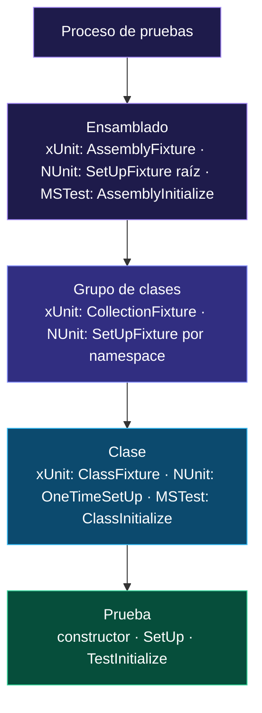

<div align="center">

# 10 · Ciclo de vida y fixtures

**Quién crea qué, cuándo y cuántas veces: instancias, fixtures compartidas, herencia, fallos en la preparación y recursos caros como bases de datos**

[⬅ 09 · Pruebas parametrizadas](09-pruebas-parametrizadas.md) · [🏠 Índice](../README.md) · [11 · Paralelismo y aislamiento ➡](11-paralelismo-y-aislamiento.md)

</div>

---

## Contenido

1. [La pregunta central: ¿cuántas instancias?](#1-la-pregunta-central-cuántas-instancias)
2. [El orden, demostrado con pruebas](#2-el-orden-demostrado-con-pruebas)
3. [Alcances de una fixture](#3-alcances-de-una-fixture)
4. [Herencia de la preparación](#4-herencia-de-la-preparación)
5. [Cuando la preparación falla](#5-cuando-la-preparación-falla)
6. [Recursos caros: bases de datos y contenedores](#6-recursos-caros-bases-de-datos-y-contenedores)
7. [Inyección de dependencias en pruebas](#7-inyección-de-dependencias-en-pruebas)
8. [Patrones de construcción de datos](#8-patrones-de-construcción-de-datos)
9. [Lista de comprobación](#9-lista-de-comprobación)

---

## 1. La pregunta central: ¿cuántas instancias?

| | xUnit.net v3 | NUnit 5 | MSTest 4 |
|---|---|---|---|
| Instancias de la clase de pruebas | **Una por prueba** | **Una por fixture** | **Una por prueba** |
| ¿Se puede cambiar? | No | Sí: `[FixtureLifeCycle(LifeCycle.InstancePerTestCase)]` | No |
| Dónde vive el estado compartido | Fixture inyectada | Campos de instancia | Campos `static` |
| Consecuencia | Aislamiento total por defecto | Hay que reiniciar el estado en `[SetUp]` | Aislamiento por defecto; lo compartido es explícitamente estático |

La diferencia no es cosmética. Con una instancia compartida, **cualquier campo es estado compartido** salvo que se reinicie; con una instancia por prueba, **ningún campo lo es**
salvo que se declare estático o se inyecte.

---

## 2. El orden, demostrado con pruebas

Las siguientes pruebas **registran cada evento del ciclo de vida** en una lista y afirman el orden. Son ejecutables: si un framework cambiara su comportamiento, fallarían.

### xUnit.net: fixture, constructor, prueba, `Dispose`

```csharp xunit
public sealed class FixtureRegistradora : IAsyncLifetime
{
    public List<string> Eventos { get; } = ["fixture: constructor"];
    public ValueTask InitializeAsync() { Eventos.Add("fixture: InitializeAsync"); return ValueTask.CompletedTask; }
    public ValueTask DisposeAsync() => ValueTask.CompletedTask;
}

public sealed class OrdenXunitTests : IClassFixture<FixtureRegistradora>, IDisposable
{
    private static int s_instancias;
    private readonly FixtureRegistradora _fixture;

    public OrdenXunitTests(FixtureRegistradora fixture)
    {
        _fixture = fixture;
        s_instancias++;
        _fixture.Eventos.Add("clase: constructor");
    }

    [Fact]
    public void Primera() => ComprobarOrden();

    [Fact]
    public void Segunda() => ComprobarOrden();

    private void ComprobarOrden()
    {
        Assert.Equal("fixture: constructor", _fixture.Eventos[0]);         // la fixture nace primero
        Assert.Equal("fixture: InitializeAsync", _fixture.Eventos[1]);     // y se inicializa una sola vez
        Assert.Equal("clase: constructor", _fixture.Eventos[^1]);          // cada prueba estrena instancia
        Assert.Equal(s_instancias, _fixture.Eventos.Count(e => e == "clase: constructor"));
    }

    public void Dispose() => _fixture.Eventos.Add("clase: Dispose");
}
```

### NUnit: una sola instancia, `[SetUp]` por prueba

```csharp nunit
public class OrdenNunitTests
{
    private readonly List<string> _eventos = [];

    public OrdenNunitTests() => _eventos.Add("constructor");

    [OneTimeSetUp]
    public void UnaVez() => _eventos.Add("OneTimeSetUp");

    [SetUp]
    public void AntesDeCada() => _eventos.Add("SetUp");

    [Test]
    public void Primera() => ComprobarOrden();

    [Test]
    public void Segunda() => ComprobarOrden();

    private void ComprobarOrden()
    {
        Assert.That(_eventos[0], Is.EqualTo("constructor"));
        Assert.That(_eventos[1], Is.EqualTo("OneTimeSetUp"));
        Assert.That(_eventos[^1], Is.EqualTo("SetUp"));
        // La prueba clave: el constructor se ejecutó UNA vez para toda la fixture
        Assert.That(_eventos.Count(e => e == "constructor"), Is.EqualTo(1));
    }

    [TearDown]
    public void DespuesDeCada() => _eventos.Add("TearDown");
}
```

### MSTest: `[ClassInitialize]` estático, instancia por prueba

```csharp mstest
[TestClass]
public sealed class OrdenMstestTests
{
    private static readonly List<string> s_eventos = [];

    [ClassInitialize]
    public static void UnaVez(TestContext _) => s_eventos.Add("ClassInitialize");

    public OrdenMstestTests() => s_eventos.Add("constructor");

    [TestInitialize]
    public void AntesDeCada() => s_eventos.Add("TestInitialize");

    [TestMethod]
    public void Primera() => ComprobarOrden();

    [TestMethod]
    public void Segunda() => ComprobarOrden();

    private static void ComprobarOrden()
    {
        Assert.AreEqual("ClassInitialize", s_eventos[0]);
        Assert.AreEqual("constructor", s_eventos[^2]);           // cada prueba: constructor…
        Assert.AreEqual("TestInitialize", s_eventos[^1]);        // …y luego [TestInitialize]
        Assert.AreEqual(1, s_eventos.Count(e => e == "ClassInitialize"));
        Assert.AreEqual(s_eventos.Count(e => e == "constructor"), s_eventos.Count(e => e == "TestInitialize"));
    }

    [TestCleanup]
    public void DespuesDeCada() => s_eventos.Add("TestCleanup");
}
```

---

## 3. Alcances de una fixture



| Alcance | Úsalo para | Riesgo |
|---|---|---|
| **Prueba** | Objetos baratos: el sistema bajo prueba, dobles | Ninguno: es el ideal |
| **Clase** | Un recurso caro que solo usa esa clase | Las pruebas de la clase comparten estado: deben ser independientes del orden |
| **Grupo de clases** | Un contenedor de base de datos para todas las pruebas de repositorios | En xUnit.net, las clases de la colección dejan de correr en paralelo entre sí |
| **Ensamblado** | Configuración global, un servidor de pruebas, telemetría | Estado global de facto: documentarlo bien |

> [!TIP]
> Regla práctica: **comparte infraestructura, nunca datos**. Una fixture puede compartir una conexión o un contenedor; los *datos* que cada prueba lee o escribe deben crearse
> dentro de cada prueba (o reiniciarse antes de cada una).

---

## 4. Herencia de la preparación

| | Orden con una clase base |
|---|---|
| **xUnit.net** | El de C#: constructor base → constructor derivado; `Dispose` derivado → base (si se encadena) |
| **NUnit** | `[SetUp]` de la base antes que el de la derivada; `[TearDown]` al revés |
| **MSTest** | `[TestInitialize]` de la base antes que el de la derivada; `[TestCleanup]` al revés. `[ClassInitialize]` heredable con `InheritanceBehavior.BeforeEachDerivedClass` |

```csharp nunit
public abstract class BaseConCarrito
{
    protected Carrito Carrito { get; private set; } = null!;
    protected List<string> Orden { get; } = [];

    [SetUp]
    public void PrepararBase()
    {
        Carrito = new Carrito();
        Orden.Add("base");
    }
}

public class HerenciaTests : BaseConCarrito
{
    [SetUp]
    public void PrepararDerivada() => Orden.Add("derivada");

    [Test]
    public void La_base_se_prepara_primero()
    {
        Assert.That(Orden.TakeLast(2), Is.EqualTo(new[] { "base", "derivada" }));
        Assert.That(Carrito.EstaVacio);
    }
}
```

> [!CAUTION]
> Las jerarquías profundas de clases base de prueba ("`BaseTest` → `BaseIntegrationTest` → `BaseApiTest`…") son una fuente clásica de preparación oculta. Prefiere composición:
> fixtures y métodos auxiliares que la prueba invoca explícitamente.

---

## 5. Cuando la preparación falla

| Fallo en… | xUnit.net v3 | NUnit 5 | MSTest 4 |
|---|---|---|---|
| Preparación por prueba | Falla esa prueba | Falla esa prueba; `[TearDown]` se ejecuta igualmente | Falla esa prueba; `[TestCleanup]` se ejecuta |
| Fixture de clase | Fallan **todas** las pruebas de la clase, con el error de la fixture | `OneTimeSetUp` fallido: todas las pruebas de la fixture se marcan como fallidas | `ClassInitialize` fallido: todas las pruebas de la clase fallan |
| Limpieza de clase | Se informa como error de la ejecución | Se informa en la fixture | Desde 4.2, **resultado propio** asociado a la última prueba |
| Preparación de ensamblado | Fallan todas | Fallan todas las fixtures afectadas | Fallan todas |

---

## 6. Recursos caros: bases de datos y contenedores

El caso más común de fixture compartida es una base de datos real en un contenedor con **Testcontainers**. El patrón es idéntico en los tres frameworks: crear el contenedor
una vez, compartir la cadena de conexión y aislar los datos por prueba.

```csharp omitir
// xUnit.net: fixture de colección asíncrona
public sealed class PostgresFixture : IAsyncLifetime
{
    private readonly PostgreSqlContainer _contenedor = new PostgreSqlBuilder().WithImage("postgres:17").Build();
    public string CadenaDeConexion => _contenedor.GetConnectionString();
    public async ValueTask InitializeAsync() => await _contenedor.StartAsync();
    public async ValueTask DisposeAsync() => await _contenedor.DisposeAsync();
}

[CollectionDefinition("Postgres")]
public sealed class ColeccionPostgres : ICollectionFixture<PostgresFixture>;

// NUnit: [SetUpFixture] por espacio de nombres
[SetUpFixture]
public class Postgres
{
    public static PostgreSqlContainer Contenedor { get; } = new PostgreSqlBuilder().WithImage("postgres:17").Build();
    [OneTimeSetUp] public Task Iniciar() => Contenedor.StartAsync();
    [OneTimeTearDown] public ValueTask Detener() => Contenedor.DisposeAsync();
}

// MSTest: [AssemblyInitialize]
[TestClass]
public static class Postgres
{
    public static PostgreSqlContainer Contenedor { get; } = new PostgreSqlBuilder().WithImage("postgres:17").Build();
    [AssemblyInitialize] public static Task Iniciar(TestContext _) => Contenedor.StartAsync();
    [AssemblyCleanup] public static ValueTask Detener() => Contenedor.DisposeAsync();
}
```

Estrategias para aislar los datos entre pruebas que comparten la base de datos:

| Estrategia | Cómo | Costo |
|---|---|---|
| **Transacción revertida** | Abrir una transacción en la preparación y revertirla en la limpieza | Muy bajo; no sirve si el código bajo prueba confirma transacciones |
| **Respawn** | Borrar todas las tablas (salvo catálogos) antes de cada prueba | Bajo |
| **Datos únicos** | Cada prueba usa identificadores propios (`Guid`) y no consulta "todo" | Nulo; exige disciplina |
| **Base por prueba** | Plantilla clonada por prueba | Alto; aislamiento total |
| **Fixture notificada** (xUnit.net 4.0) | La fixture de colección se limpia sola antes de cada prueba | Bajo; centralizado |

---

## 7. Inyección de dependencias en pruebas

| | Integrado | Bibliotecas comunes |
|---|---|---|
| **xUnit.net** | Fixtures, `ITestOutputHelper`, `ITestContextAccessor` en el constructor; `ITypeActivator` para un contenedor propio (en 4.0 también crea fixtures) | `Xunit.DependencyInjection` |
| **NUnit** | Argumentos de `[TestFixture]` | Contenedor creado en `[OneTimeSetUp]` |
| **MSTest** | `TestContext` en el constructor | Contenedor creado en `[AssemblyInitialize]` |

En pruebas de **integración** de ASP.NET Core, el contenedor lo aporta la propia aplicación mediante `WebApplicationFactory<TProgram>`, que funciona igual con los tres
frameworks ([capítulo 13](13-dobles-de-prueba-y-ecosistema.md#7-pruebas-de-integración)).

---

## 8. Patrones de construcción de datos

Cuando la preparación crece, la prueba deja de leerse. Tres patrones de *xUnit Test Patterns* que funcionan igual en los tres frameworks:

```csharp dominio
// Object Mother: objetos con nombre y significado de negocio
public static class Carritos
{
    public static Carrito Vacio() => new();

    public static Carrito ConLibros(int cantidad)
    {
        var carrito = new Carrito();
        carrito.Agregar(new Producto("LIB-0001", "C# Atlas", new Dinero(450m)), cantidad);
        return carrito;
    }
}

// Test Data Builder: valores por defecto razonables y solo se cambia lo relevante
public sealed class ProductoBuilder
{
    private string _sku = "LIB-0001";
    private decimal _precio = 100m;
    private string _moneda = "MXN";

    public ProductoBuilder ConSku(string sku) { _sku = sku; return this; }
    public ProductoBuilder ConPrecio(decimal precio) { _precio = precio; return this; }
    public ProductoBuilder EnDolares() { _moneda = "USD"; return this; }

    public Producto Construir() => new(_sku, "Producto de prueba", new Dinero(_precio, _moneda));
}
```

```csharp xunit
public class ConstructoresTests
{
    [Fact]
    public void Un_producto_en_otra_moneda_no_entra_al_carrito()
    {
        var producto = new ProductoBuilder().EnDolares().Construir();   // lo relevante, y nada más

        Assert.Throws<MonedaIncompatibleException>(() => Carritos.Vacio().Agregar(producto));
    }

    [Fact]
    public void Diez_libros_es_el_maximo()
    {
        var carrito = Carritos.ConLibros(Carrito.MaximoPorProducto);

        Assert.Throws<InvalidOperationException>(() => carrito.Agregar(new ProductoBuilder().Construir()));
    }
}
```

---

## 9. Lista de comprobación

- [ ] ¿Cada prueba puede ejecutarse **sola** y en **cualquier orden**?
- [ ] ¿El estado compartido es **infraestructura** (conexión, contenedor) y no **datos**?
- [ ] En NUnit, ¿todos los campos mutables se reinician en `[SetUp]` o usas `InstancePerTestCase`?
- [ ] En MSTest, ¿los campos `static` llenados en `[ClassInitialize]` son de solo lectura para las pruebas?
- [ ] ¿La limpieza se ejecuta aunque la prueba falle? (`Dispose`, `[TearDown]`, `[TestCleanup]` lo garantizan; el código al final de la prueba, no)
- [ ] ¿Las fixtures asíncronas usan `IAsyncLifetime`, `async [SetUp]` o `async [ClassInitialize]` en lugar de `.Result`?
- [ ] ¿La preparación de una prueba cabe en una pantalla? Si no, *Object Mother* o *Builder*.

---

<div align="center">

[⬅ 09 · Pruebas parametrizadas](09-pruebas-parametrizadas.md) · [🏠 Índice](../README.md) · [11 · Paralelismo y aislamiento ➡](11-paralelismo-y-aislamiento.md)

</div>
