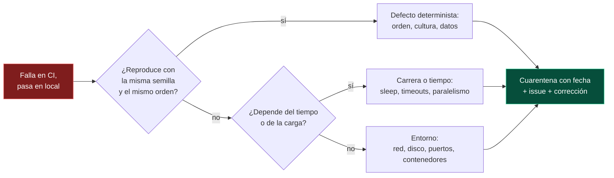

<div align="center">

# 11 · Paralelismo y aislamiento

**Tres modelos de ejecución en paralelo, las siete fuentes de no determinismo y cómo cazar pruebas inestables**

[⬅ 10 · Ciclo de vida y fixtures](10-ciclo-de-vida-y-fixtures.md) · [🏠 Índice](../README.md) · [12 · Asincronía, tiempo y cancelación ➡](12-asincronia-tiempo-y-cancelacion.md)

</div>

---

## Contenido

1. [Por qué importa](#1-por-qué-importa)
2. [Tres modelos de paralelismo](#2-tres-modelos-de-paralelismo)
3. [Configuración comparada](#3-configuración-comparada)
4. [Las siete fuentes de no determinismo](#4-las-siete-fuentes-de-no-determinismo)
5. [Técnicas de aislamiento](#5-técnicas-de-aislamiento)
6. [Pruebas inestables (*flaky*)](#6-pruebas-inestables-flaky)
7. [Paralelismo entre proyectos y en CI](#7-paralelismo-entre-proyectos-y-en-ci)

---

## 1. Por qué importa

Una suite de 5 000 pruebas de 20 ms tarda 100 segundos en serie y unos 13 en una máquina de 8 núcleos. Pero el paralelismo es un **detector de estado compartido**: las pruebas
que comparten algo mutable empiezan a fallar al azar. Por eso cada framework hace una apuesta distinta:

| Framework | Apuesta por defecto | Filosofía |
|---|---|---|
| **xUnit.net** | Paralelo entre clases | "Si tus pruebas no aguantan el paralelismo, el problema está en las pruebas" |
| **NUnit** | Secuencial | "Actívalo donde sepas que es seguro" |
| **MSTest** | Secuencial | "Actívalo a nivel de ensamblado y excluye lo necesario" |

---

## 2. Tres modelos de paralelismo


| Unidad de paralelismo | xUnit.net v3 | NUnit 5 | MSTest 4 |
|---|---|---|---|
| Entre clases | ✅ por defecto | `ParallelScope.Fixtures` / `Self` | `ExecutionScope.ClassLevel` |
| Entre métodos de una clase | `--parallel all` (4.0) | `ParallelScope.Children` | `ExecutionScope.MethodLevel` |
| Entre filas de datos | `--parallel all` (4.0) | `ParallelScope.Children` | `ExecutionScope.MethodLevel` |
| Agrupar para serializar | `[Collection("nombre")]` | `[NonParallelizable]` | `[DoNotParallelize]` · `[ResourceLock]` |

> [!IMPORTANT]
> En NUnit, ejecutar en paralelo **métodos de la misma fixture** con la instancia compartida es peligroso: dos pruebas escriben los mismos campos a la vez. Combínalo siempre con
> `[FixtureLifeCycle(LifeCycle.InstancePerTestCase)]`.

---

## 3. Configuración comparada

| Ajuste | xUnit.net v3 | NUnit 5 | MSTest 4 |
|---|---|---|---|
| Activar | (activo) | `[assembly: Parallelizable(ParallelScope.Fixtures)]` | `[assembly: Parallelize]` |
| Modo total | `"parallelMode": "all"` · `--parallel all` | `ParallelScope.All` | `Scope = ExecutionScope.MethodLevel` |
| Número de hilos | `"maxParallelThreads": 4` · `"2.0x"` | `[assembly: LevelOfParallelism(4)]` | `Workers = 4` · `0` = núcleos |
| Algoritmo | `"parallelAlgorithm": "conservative"` · `"aggressive"` | — | — |
| Desactivar todo | `"parallelizeTestCollections": false` | (es el defecto) | quitar el atributo |
| Desde MSBuild | — | — | `MSTestParallelizeScope`, `MSTestParallelizeWorkers` (4.3) |
| Desde JSON | `xunit.runner.json` | `.runsettings` (`NumberOfTestWorkers`) | `testconfig.json` |

---

## 4. Las siete fuentes de no determinismo

| # | Fuente | Ejemplo de fallo | Remedio |
|---:|---|---|---|
| 1 | **Reloj** | "El pedido se puede cancelar" falla a las 23:59 | `TimeProvider` + `FakeTimeProvider` ([capítulo 12](12-asincronia-tiempo-y-cancelacion.md)) |
| 2 | **Azar** | `Random.Shared` produce un caso límite una vez de cada mil | Semilla fija; registrar la semilla en el mensaje |
| 3 | **Cultura** | `1.5m.ToString()` devuelve `1,5` en `es-ES` | `CultureInfo.InvariantCulture` en el código; `[SetCulture]` o `--culture` en la prueba |
| 4 | **Estado estático** | Una caché estática conserva datos de otra prueba | Inyectar dependencias; reiniciar en la preparación |
| 5 | **Entorno del proceso** | Variables de entorno, directorio actual | Serializar esas pruebas; restaurar en la limpieza; `MSTEST0074`–`MSTEST0077` |
| 6 | **Sistema de archivos y red** | Dos pruebas escriben `salida.json`; puerto 5000 ocupado | Carpeta por prueba; puerto 0 (asignado por el sistema) |
| 7 | **Orden** | La prueba B solo pasa si A se ejecutó antes | Ejecutar en orden aleatorio para detectarlo |

Un ejemplo real de la fuente número 3:

```csharp xunit
using System.Globalization;

public class CulturaTests
{
    [Fact]
    public void El_formato_depende_de_la_cultura()
    {
        var importe = 1234.5m;

        Assert.Equal("1,234.50", importe.ToString("N2", CultureInfo.GetCultureInfo("es-MX")));
        Assert.Equal("1.234,50", importe.ToString("N2", CultureInfo.GetCultureInfo("es-ES")));
        Assert.Equal("1,234.50", importe.ToString("N2", CultureInfo.InvariantCulture));
    }

    [Fact]
    public void Dinero_no_depende_de_la_cultura_del_hilo()
    {
        var anterior = CultureInfo.CurrentCulture;
        try
        {
            CultureInfo.CurrentCulture = CultureInfo.GetCultureInfo("es-ES");

            // Dinero.ToString usa el formato de la cultura actual: este es un defecto real que la prueba revela
            Assert.Equal("1234,50 MXN", new Dinero(1234.5m).ToString());
        }
        finally
        {
            CultureInfo.CurrentCulture = anterior;
        }
    }
}
```

> [!NOTE]
> La segunda prueba **documenta un defecto** del dominio del laboratorio: `Dinero.ToString()` usa la cultura del hilo. En una aplicación real, la corrección sería formatear con
> `CultureInfo.InvariantCulture` o con una cultura explícita. `CurrentCulture` es por hilo de ejecución (fluye con `async`), así que cambiarla dentro de una prueba no afecta a las
> que corren en paralelo.

---

## 5. Técnicas de aislamiento

| Técnica | xUnit.net | NUnit | MSTest |
|---|---|---|---|
| Carpeta temporal por prueba | `Path.Combine(Path.GetTempPath(), Guid.NewGuid().ToString())` + `Dispose` | `TestContext.CurrentContext.WorkDirectory` + subcarpeta propia | `TestContext.TestTempDirectory` (4.4) |
| Serializar un grupo de pruebas | `[Collection("Recurso")]` | `[NonParallelizable]` | `[ResourceLock("Recurso")]` |
| Restaurar estado global | `IDisposable` | `[TearDown]` | `[TestCleanup]` |
| Cultura fija | `--culture`, `xunit.runner.json` | `[SetCulture]`, `[SetUICulture]` | Código en `[TestInitialize]` |
| Reloj controlado | `FakeTimeProvider` | `FakeTimeProvider` | `FakeTimeProvider` |

```csharp mstest
[TestClass]
public sealed class AislamientoDeArchivosTests
{
    public TestContext TestContext { get; set; } = null!;

    [TestMethod]
    [DataRow("LIB-0001")]
    [DataRow("TAZ-0007")]
    public async Task Cada_caso_tiene_su_propia_carpeta(string sku)
    {
        var carpeta = TestContext.TestTempDirectory;
        Assert.IsNotNull(carpeta);
        var ruta = Path.Combine(carpeta, "ultimo-sku.txt");    // mismo nombre de archivo, sin colisiones

        await File.WriteAllTextAsync(ruta, sku, TestContext.CancellationToken);

        Assert.AreEqual(sku, await File.ReadAllTextAsync(ruta, TestContext.CancellationToken));
    }
}
```

---

## 6. Pruebas inestables (*flaky*)

Una prueba inestable pasa y falla sin cambios en el código. Es el problema de calidad más costoso de una suite grande, porque **erosiona la confianza** en el rojo.



| Herramienta | Qué aporta |
|---|---|
| `--show-flaky-tests` (MTP) | Lista las pruebas que fallaron al menos una vez y luego pasaron en un reintento |
| `Microsoft.Testing.Extensions.Retry` | `--retry-failed-tests 2`: reintenta en CI y **marca** la inestabilidad en lugar de ocultarla |
| `[Retry(n)]` (NUnit, MSTest) | Reintento declarativo por prueba |
| `[Repeat(n)]` (NUnit) | Ejecuta muchas veces para **reproducir** una inestabilidad en local |
| Orden aleatorio (MSTest 4.3, semilla de xUnit.net `--seed`) | Revela dependencias de orden |
| `[Ignore(…, Until = "fecha")]` (NUnit) | Cuarentena con caducidad: la prueba vuelve sola |
| `--hangdump` / `--crashdump` | Volcado de memoria cuando una prueba se cuelga o el proceso cae |

> [!WARNING]
> Un reintento automático **sin registro** convierte un defecto real en ruido invisible. Usa los reintentos para mantener el CI verde mientras arreglas, nunca como solución.

---

## 7. Paralelismo entre proyectos y en CI

Hay tres niveles de paralelismo, y se multiplican:

| Nivel | Control |
|---|---|
| Entre **proyectos** de pruebas | `dotnet test --max-parallel-test-modules N` (modo MTP) · `-m:N` de MSBuild |
| Dentro de un proyecto | La configuración del framework ([sección 3](#3-configuración-comparada)) |
| Entre **agentes** de CI | Matriz por proyecto, filtros por categoría, `--partition` de MSTest 5 |

Con `N` proyectos en paralelo y `W` hilos por proyecto puedes tener `N × W` pruebas simultáneas compitiendo por la misma base de datos o el mismo puerto. Si tus pruebas de
integración comparten infraestructura externa, limita uno de los dos factores.

---

<div align="center">

[⬅ 10 · Ciclo de vida y fixtures](10-ciclo-de-vida-y-fixtures.md) · [🏠 Índice](../README.md) · [12 · Asincronía, tiempo y cancelación ➡](12-asincronia-tiempo-y-cancelacion.md)

</div>
