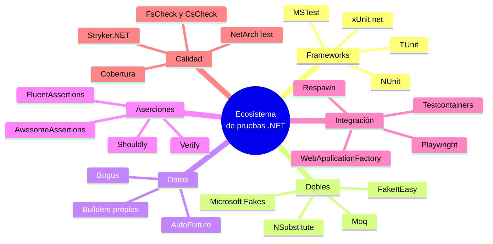

<div align="center">

# 13 · Dobles de prueba y ecosistema

**Bibliotecas de *mocks*, generadores de datos, *snapshots*, integración con contenedores y ASP.NET Core, pruebas de mutación, de arquitectura y el recién llegado TUnit**

[⬅ 12 · Asincronía, tiempo y cancelación](12-asincronia-tiempo-y-cancelacion.md) · [🏠 Índice](../README.md) · [14 · CI, cobertura y reportes ➡](14-ci-cobertura-y-reportes.md)

</div>

> [!NOTE]
> Las bibliotecas de este capítulo son **independientes del framework**: funcionan igual con xUnit.net, NUnit y MSTest. Los bloques que dependen de paquetes externos no se
> compilan en el verificador (están marcados como ilustrativos); los dobles escritos a mano, sí. Versiones consultadas en NuGet el 8 de noviembre de 2026.

---

## Contenido

1. [El mapa del ecosistema](#1-el-mapa-del-ecosistema)
2. [Dobles escritos a mano](#2-dobles-escritos-a-mano)
3. [Bibliotecas de *mocks*](#3-bibliotecas-de-mocks)
4. [Generar datos de prueba](#4-generar-datos-de-prueba)
5. [*Snapshot testing* con Verify](#5-snapshot-testing-con-verify)
6. [Pruebas de arquitectura](#6-pruebas-de-arquitectura)
7. [Pruebas de integración](#7-pruebas-de-integración)
8. [Pruebas de mutación](#8-pruebas-de-mutación)
9. [Pruebas basadas en propiedades](#9-pruebas-basadas-en-propiedades)
10. [TUnit: el cuarto framework](#10-tunit-el-cuarto-framework)
11. [Tabla de versiones](#11-tabla-de-versiones)

---

## 1. El mapa del ecosistema



---

## 2. Dobles escritos a mano

Antes de añadir una biblioteca, recuerda que un doble escrito a mano es **código normal**: se depura, se refactoriza y no tiene magia. El laboratorio usa dos:
`NotificadorEspia` (un *spy*) y `RepositorioEnMemoria` (un *fake*). Para interfaces pequeñas suelen bastar:

```csharp mstest
[TestClass]
public sealed class DoblesAManoTests
{
    // Stub: devuelve una respuesta preparada
    private sealed class RepositorioQueSiempreEncuentra(Pedido pedido) : IRepositorioDePedidos
    {
        public Task GuardarAsync(Pedido p, CancellationToken ct = default) => Task.CompletedTask;
        public Task<Pedido?> BuscarAsync(Guid id, CancellationToken ct = default) => Task.FromResult<Pedido?>(pedido);
    }

    // Doble que falla: simula un servicio externo caído
    private sealed class NotificadorCaido : INotificador
    {
        public Task EnviarAsync(string d, string m, CancellationToken ct = default) =>
            throw new HttpRequestException("SMTP no disponible");
    }

    [TestMethod]
    public async Task Si_el_correo_falla_el_pedido_ya_quedo_guardado()
    {
        var repositorio = new RepositorioEnMemoria();
        var servicio = new ServicioDePedidos(repositorio, new NotificadorCaido(), TimeProvider.System);
        var carrito = new Carrito();
        carrito.Agregar(Catalogo.Libro);

        await Assert.ThrowsExactlyAsync<HttpRequestException>(() => servicio.ConfirmarAsync(carrito, "x@y.z"));

        Assert.AreEqual(1, repositorio.Cantidad);   // la prueba documenta un comportamiento de diseño discutible
    }

    [TestMethod]
    public async Task Cancelar_usa_el_pedido_encontrado()
    {
        var pedido = new Pedido(Guid.NewGuid(), [], new Dinero(10m), DateTimeOffset.UtcNow);
        var servicio = new ServicioDePedidos(new RepositorioQueSiempreEncuentra(pedido), new NotificadorEspia(), TimeProvider.System);

        var cancelado = await servicio.CancelarAsync(pedido.Id);

        Assert.AreEqual(EstadoDePedido.Cancelado, cancelado.Estado);
    }
}
```

> [!TIP]
> La primera prueba es un buen ejemplo de **prueba como documentación de diseño**: revela que, si el correo falla, el pedido queda guardado pero el cliente nunca recibe la
> confirmación. Quizá sea lo deseado, quizá no; pero ahora es una decisión visible.

---

## 3. Bibliotecas de *mocks*

| | Moq | NSubstitute | FakeItEasy |
|---|---|---|---|
| **Versión** | 4.21.0 | 6.2.0 | 9.0.1 |
| **Estilo** | `mock.Setup(x => …).Returns(…)` · `mock.Object` | `sub.Metodo().Returns(…)`: el doble *es* la interfaz | `A.CallTo(() => …).Returns(…)` |
| **Verificación** | `mock.Verify(x => …, Times.Once)` | `sub.Received(1).Metodo(…)` | `A.CallTo(() => …).MustHaveHappenedOnceExactly()` |
| **Curva** | Media | Baja | Baja |
| **Analizadores** | `Moq.Analyzers` | `NSubstitute.Analyzers` | `FakeItEasy.Analyzer` |
| **Licencia** | BSD-3 | BSD-3 | MIT |

```csharp omitir
// Moq
var notificador = new Mock<INotificador>();
var servicio = new ServicioDePedidos(new RepositorioEnMemoria(), notificador.Object, TimeProvider.System);
await servicio.ConfirmarAsync(carrito, "ana@ejemplo.mx");
notificador.Verify(n => n.EnviarAsync("ana@ejemplo.mx", It.IsAny<string>(), It.IsAny<CancellationToken>()), Times.Once);

// NSubstitute
var notificador = Substitute.For<INotificador>();
var servicio = new ServicioDePedidos(new RepositorioEnMemoria(), notificador, TimeProvider.System);
await servicio.ConfirmarAsync(carrito, "ana@ejemplo.mx");
await notificador.Received(1).EnviarAsync("ana@ejemplo.mx", Arg.Any<string>(), Arg.Any<CancellationToken>());

// FakeItEasy
var notificador = A.Fake<INotificador>();
var servicio = new ServicioDePedidos(new RepositorioEnMemoria(), notificador, TimeProvider.System);
await servicio.ConfirmarAsync(carrito, "ana@ejemplo.mx");
A.CallTo(() => notificador.EnviarAsync("ana@ejemplo.mx", A<string>._, A<CancellationToken>._)).MustHaveHappenedOnceExactly();
```

> [!WARNING]
> **El episodio SponsorLink (agosto de 2023).** La versión 4.20.0 de Moq incluyó un componente que, durante la compilación, leía el correo de Git del desarrollador y enviaba un
> *hash* a un servicio externo para comprobar si patrocinaba el proyecto. La reacción de la comunidad fue inmediata y el componente se retiró días después, pero muchos equipos
> migraron a NSubstitute. La lección es general: **las dependencias de pruebas también son cadena de suministro**, y conviene fijar versiones y revisar los cambios antes de
> actualizar.

**Microsoft Fakes** (Visual Studio Enterprise) es otra categoría: genera *shims* que reemplazan en tiempo de ejecución métodos **estáticos y no virtuales**, como `DateTime.Now`.
También funciona sobre Microsoft.Testing.Platform. Es útil para código heredado que no se puede refactorizar; para código nuevo, inyectar `TimeProvider` es mejor diseño.

---

## 4. Generar datos de prueba

| Biblioteca | Versión | Para qué | Ejemplo |
|---|---|---|---|
| **Bogus** | 35.6.5 | Datos realistas: nombres, correos, direcciones, en muchos idiomas | `new Faker("es_MX").Person.Email` |
| **AutoFixture** | 4.18.1 | Rellenar objetos complejos con valores anónimos; integra con los tres frameworks (`[AutoData]`) | `fixture.Create<Pedido>()` |
| **Builders propios** | — | Valores por defecto con significado de negocio | `new ProductoBuilder().EnDolares().Construir()` ([capítulo 10](10-ciclo-de-vida-y-fixtures.md#8-patrones-de-construcción-de-datos)) |

```csharp omitir
var faker = new Faker<Producto>("es_MX")
    .CustomInstantiator(f => new Producto(
        $"{f.Random.String2(3, "ABCDEFGHIJKLMNOPQRSTUVWXYZ")}-{f.Random.Number(0, 9999):0000}",
        f.Commerce.ProductName(),
        new Dinero(f.Random.Decimal(1, 5_000))));

var productos = faker.UseSeed(2026).Generate(100);   // UseSeed: el mismo lote en cada ejecución
```

---

## 5. *Snapshot testing* con Verify

**Verify** (33.3.4, paquetes `Verify.XunitV3`, `Verify.NUnit`, `Verify.MSTest`) serializa el resultado y lo compara con un archivo `*.verified.txt` aprobado. La primera ejecución
crea un `*.received.txt`; si es correcto, se aprueba y se versiona junto al código.

```csharp omitir
[Fact]
public Task El_pedido_se_serializa_como_se_espera()
{
    var pedido = new Pedido(Guid.Parse("…"), lineas, new Dinero(810m), new DateTimeOffset(2026, 11, 8, 12, 0, 0, TimeSpan.Zero));
    return Verify(pedido);   // compara con El_pedido_se_serializa_como_se_espera.verified.txt
}
```

| Úsalo para | Evítalo para |
|---|---|
| Objetos grandes, JSON, HTML, mensajes, SQL generado | Valores simples (usa `Assert.Equal`) |
| Detectar **cualquier** cambio de una salida compleja | Resultados no deterministas sin depurar (`Guid`, fechas) |
| API públicas: el diff del *snapshot* aparece en la revisión de código | Sustituir el razonamiento sobre qué debería ser correcto |

---

## 6. Pruebas de arquitectura

Una prueba también puede verificar **la estructura** del código. Con **NetArchTest.Rules** (1.3.2) o **ArchUnitNET**:

```csharp omitir
[Test]
public void El_dominio_no_depende_de_la_infraestructura()
{
    var resultado = Types.InAssembly(typeof(Carrito).Assembly)
        .That().ResideInNamespace("Tienda")
        .ShouldNot().HaveDependencyOn("Microsoft.EntityFrameworkCore")
        .GetResult();

    Assert.That(resultado.IsSuccessful, Is.True, string.Join(", ", resultado.FailingTypeNames ?? []));
}
```

Sin bibliotecas, la reflexión basta para reglas sencillas:

```csharp xunit
public class ArquitecturaTests
{
    [Fact]
    public void El_dominio_solo_depende_del_runtime()
    {
        var referencias = typeof(Carrito).Assembly.GetReferencedAssemblies().Select(a => a.Name!);

        Assert.All(referencias, nombre => Assert.True(
            nombre.StartsWith("System", StringComparison.Ordinal) || nombre == "netstandard",
            $"El dominio no debería depender de {nombre}"));
    }

    [Fact]
    public void Las_excepciones_del_dominio_estan_selladas()
    {
        var excepciones = typeof(Carrito).Assembly.GetTypes().Where(t => typeof(Exception).IsAssignableFrom(t));

        Assert.All(excepciones, t => Assert.True(t.IsSealed, $"{t.Name} debería ser sealed"));
    }
}
```

---

## 7. Pruebas de integración

| Herramienta | Versión | Qué resuelve |
|---|---|---|
| **`Microsoft.AspNetCore.Mvc.Testing`** | 10.0.14 | `WebApplicationFactory<TProgram>`: levanta la aplicación en memoria con un `HttpClient` y permite reemplazar servicios |
| **Testcontainers** | 4.16.0 | Contenedores Docker desechables: PostgreSQL, SQL Server, Redis, Kafka… |
| **Respawn** | 7.0.0 | Reinicia los datos de una base de datos entre pruebas |
| **Playwright** | 1.64.1 | Pruebas de navegador; paquetes para NUnit y MSTest, y `EnablePlaywright` en `MSTest.Sdk` |
| **.NET Aspire** | — | `DistributedApplicationTestingBuilder` para probar una aplicación distribuida completa; `EnableAspireTesting` en `MSTest.Sdk` |

```csharp omitir
// El mismo patrón con cualquiera de los tres frameworks
public class ApiDePedidosTests(WebApplicationFactory<Program> fabrica) : IClassFixture<WebApplicationFactory<Program>>
{
    [Fact]
    public async Task Confirmar_devuelve_201()
    {
        var cliente = fabrica.WithWebHostBuilder(b => b.ConfigureServices(s =>
            s.AddSingleton<TimeProvider>(new FakeTimeProvider()))).CreateClient();

        var respuesta = await cliente.PostAsJsonAsync("/pedidos", new { Sku = "LIB-0001", Cantidad = 1 });

        Assert.Equal(HttpStatusCode.Created, respuesta.StatusCode);
    }
}
```

---

## 8. Pruebas de mutación

La cobertura de código dice qué líneas **se ejecutaron**; no dice si alguna aserción **comprobó** su resultado. Las pruebas de mutación responden a esa pregunta: **Stryker.NET**
(`dotnet-stryker` 5.0.0) introduce pequeños cambios en el código (`<` por `<=`, `+` por `-`, quitar una llamada) y vuelve a ejecutar la suite. Si ninguna prueba falla, el
"mutante sobrevive": hay una laguna en las pruebas.

```bash
dotnet tool install -g dotnet-stryker
cd tests/Tienda.Tests.NUnit
dotnet stryker --project Tienda.Dominio.csproj
```

| Mutación | Ejemplo en el dominio | ¿La detectan las pruebas del atlas? |
|---|---|---|
| Límite | `actual + cantidad > MaximoPorProducto` → `>=` | Sí: `Acepta_cantidades_validas(10)` |
| Aritmética | `Subtotal * (1 - p/100)` → `(1 + p/100)` | Sí: `Un_cupon_descuenta_sobre_el_subtotal` |
| Lógica | `zona != Internacional &&` → `\|\|` | Sí: la fila de envío internacional de 5 000 MXN |
| Comparación de plazo | `> 24 h` → `>= 24 h` | Sí: la fila "justo en el límite" del [capítulo 12](12-asincronia-tiempo-y-cancelacion.md#3-faketimeprovider-en-acción) |

Stryker.NET funciona con los tres frameworks porque ejecuta la suite a través de la plataforma de pruebas.

---

## 9. Pruebas basadas en propiedades

| Biblioteca | Versión | Integración |
|---|---|---|
| **FsCheck** | 3.6.0 | Paquetes para xUnit.net y NUnit (`[Property]`); utilizable desde cualquier framework |
| **CsCheck** | 5.0.1 | API de C# sin atributos: `Gen.Int.Sample(x => …)`; funciona dentro de cualquier prueba |

```csharp omitir
// CsCheck: si encuentra un contraejemplo, lo reduce al mínimo y muestra la semilla para reproducirlo
Gen.Decimal[0m, 10_000m].Select(Gen.Int[0, 100]).Sample((monto, porcentaje) =>
    new Dinero(monto).DescontarPorcentaje(porcentaje).Monto <= new Dinero(monto).Monto);
```

---

## 10. TUnit: el cuarto framework

**TUnit** (1.0 en noviembre de 2025; 1.81.10 al cierre de esta edición, con publicaciones casi diarias) es un framework nuevo diseñado desde cero para la era de
Microsoft.Testing.Platform:

| Rasgo | Detalle |
|---|---|
| Descubrimiento | **Generación de código** en compilación, no reflexión: compatible con Native AOT de serie |
| Plataforma | Solo Microsoft.Testing.Platform |
| Paralelismo | Por defecto, a nivel de prueba; `[NotInParallel]` para excluir |
| Aserciones | Asíncronas y fluidas: `await Assert.That(total).IsEqualTo(810m)` |
| Ciclo de vida | `[Before(Test)]`, `[After(Class)]`, `[Before(Assembly)]`… |
| Datos | `[Arguments]`, `[MethodDataSource]`, `[ClassDataSource]`, `[Matrix]` |
| Dependencias | `[DependsOn]` entre pruebas |

```csharp omitir
public class CarritoTests
{
    [Test]
    [Arguments(1)]
    [Arguments(10)]
    public async Task Acepta_cantidades_validas(int cantidad)
    {
        var carrito = new Carrito();
        carrito.Agregar(Catalogo.Taza, cantidad);

        await Assert.That(carrito.Unidades).IsEqualTo(cantidad);
    }
}
```

> [!NOTE]
> TUnit es prometedor, sobre todo para proyectos con Native AOT o suites muy grandes, pero su ritmo de cambios es muy alto. Para la mayoría de los equipos, la recomendación de este
> atlas en noviembre de 2026 sigue siendo uno de los tres frameworks consolidados; xUnit.net 4.0 y MSTest con generación de código ya cubren el escenario AOT. Ver
> [15 · Guías de decisión](15-guias-de-decision.md).

---

## 11. Tabla de versiones

| Paquete | Versión al 8-nov-2026 | Categoría |
|---|---|---|
| `xunit.v3` | 4.0.2 (4.0.3 el 9-nov) | Framework |
| `NUnit` | 5.0.0 | Framework |
| `MSTest` · `MSTest.Sdk` | 4.5.2 | Framework |
| `TUnit` | 1.81.10 | Framework |
| `Microsoft.Testing.Platform` | 2.5.2 | Plataforma |
| `Microsoft.NET.Test.Sdk` | 18.11.0 | Plataforma (VSTest) |
| `NUnit3TestAdapter` | 6.3.1 | Adaptador |
| `xunit.runner.visualstudio` | 4.0.1 | Adaptador |
| `NUnit.Analyzers` | 4.15.0 | Analizadores |
| `Moq` | 4.21.0 | Dobles |
| `NSubstitute` | 6.2.0 | Dobles |
| `FakeItEasy` | 9.0.1 | Dobles |
| `AwesomeAssertions` | 9.6.0 | Aserciones |
| `FluentAssertions` | 8.11.0 (comercial) | Aserciones |
| `Shouldly` | 4.3.0 | Aserciones |
| `Verify.*` | 33.3.4 | *Snapshots* |
| `Bogus` | 35.6.5 | Datos |
| `AutoFixture` | 4.18.1 | Datos |
| `Testcontainers` | 4.16.0 | Integración |
| `Microsoft.AspNetCore.Mvc.Testing` | 10.0.14 | Integración |
| `Respawn` | 7.0.0 | Integración |
| `Microsoft.Playwright.*` | 1.64.1 | Navegador |
| `coverlet.collector` | 10.1.0 | Cobertura |
| `Microsoft.Testing.Extensions.CodeCoverage` | 18.12.0 | Cobertura |
| `ReportGenerator` | 5.5.12 | Informes de cobertura |
| `dotnet-stryker` | 5.0.0 | Mutación |
| `FsCheck` · `CsCheck` | 3.6.0 · 5.0.1 | Propiedades |
| `Microsoft.Extensions.TimeProvider.Testing` | 10.11.0 | Tiempo |

---

<div align="center">

[⬅ 12 · Asincronía, tiempo y cancelación](12-asincronia-tiempo-y-cancelacion.md) · [🏠 Índice](../README.md) · [14 · CI, cobertura y reportes ➡](14-ci-cobertura-y-reportes.md)

</div>
