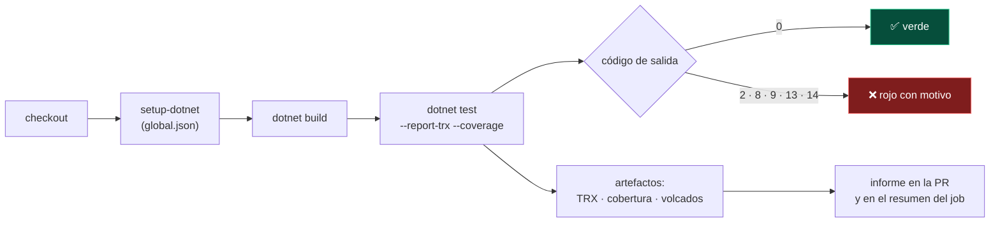
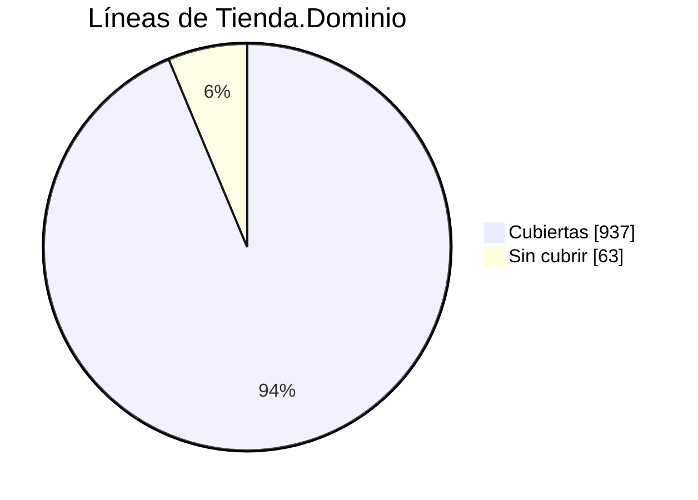

<div align="center">

# 14 · CI, cobertura y reportes

**Ejecutar las pruebas en integración continua, generar informes TRX, JUnit y CTRF, medir cobertura con un caso real y repartir la suite entre agentes**

[⬅ 13 · Dobles de prueba y ecosistema](13-dobles-de-prueba-y-ecosistema.md) · [🏠 Índice](../README.md) · [15 · Guías de decisión ➡](15-guias-de-decision.md)

</div>

---

## Contenido

1. [El flujo en CI](#1-el-flujo-en-ci)
2. [Informes de resultados](#2-informes-de-resultados)
3. [Una solución con tres frameworks: un caso real](#3-una-solución-con-tres-frameworks-un-caso-real)
4. [GitHub Actions](#4-github-actions)
5. [Azure Pipelines](#5-azure-pipelines)
6. [Cobertura de código](#6-cobertura-de-código)
7. [La cobertura del laboratorio](#7-la-cobertura-del-laboratorio)
8. [Filtrar y repartir la suite](#8-filtrar-y-repartir-la-suite)
9. [Diagnóstico de fallos en CI](#9-diagnóstico-de-fallos-en-ci)

---

## 1. El flujo en CI



Con Microsoft.Testing.Platform, el CI recibe un **código de salida con significado** ([capítulo 03](03-plataformas-de-ejecucion.md#8-códigos-de-salida)): no es lo mismo una prueba fallida
(2) que ninguna prueba ejecutada (8), menos pruebas de las esperadas (9) o una cobertura bajo el umbral (14).

---

## 2. Informes de resultados

| Formato | Quién lo entiende | xUnit.net v3 | NUnit 5 | MSTest 4 |
|---|---|---|---|---|
| **TRX** | Visual Studio, Azure DevOps | `--report-xunit-trx` · extensión TRX | Extensión TRX | `--report-trx` (incluido en `MSTest.Sdk`) |
| **JUnit XML** | GitHub, GitLab, Jenkins, CircleCI | `--report-xunit-junit` | — (convertir desde TRX o NUnit XML) | — (convertir desde TRX) |
| **CTRF** (JSON) | Herramientas modernas de informes | `--report-xunit-ctrf` | — | — |
| **HTML** · **Markdown** | Personas | `--report-xunit-html` · `--report-xunit-markdown` | — | — |
| **NUnit XML** (`TestResult.xml`) | Jenkins, herramientas de NUnit | `--report-xunit-nunit` | Consola de NUnit | — |
| **Resumen de GitHub Actions** | GitHub | Reportero automático | Extensión de MTP | Extensión de MTP |

> [!TIP]
> xUnit.net es el único que genera **siete formatos sin paquetes adicionales**. Si tu CI espera JUnit XML, xUnit.net lo produce directamente; con NUnit o MSTest, lo habitual
> es publicar el TRX o convertirlo.

---

## 3. Una solución con tres frameworks: un caso real

Este repositorio es, en sí mismo, el caso difícil: **una solución con xUnit.net, NUnit y MSTest**, todos sobre MTP. El primer intento de generar un TRX para toda la solución
falló, y la forma en que falló es instructiva.

**Problema 1: cada framework acepta opciones distintas.** `dotnet test --report-trx` funciona en el proyecto MSTest (la extensión viene en `MSTest.Sdk`), pero los proyectos de
xUnit.net y NUnit no la conocen. La solución: añadirles la extensión `Microsoft.Testing.Extensions.TrxReport`, que es independiente del framework.

**Problema 2: `MSTest.Sdk` y la gestión central de paquetes.** Al declarar la versión de la extensión en `Directory.Packages.props` apareció este error real:

```text
error NU1506: Se han encontrado "PackageVersion" elementos duplicados. […]
Los "PackageVersion" elementos duplicados son los siguientes:
Microsoft.Testing.Extensions.TrxReport 2.5.2, Microsoft.Testing.Extensions.TrxReport 2.5.2.
```

`MSTest.Sdk` ya declara su propia `PackageVersion` de esa extensión. La corrección, en [`Directory.Packages.props`](../Directory.Packages.props), usa la propiedad que define el SDK:

```xml
<!-- MSTest.Sdk ya declara su propia versión de la extensión TRX -->
<PackageVersion Include="Microsoft.Testing.Extensions.TrxReport" Version="2.5.2"
                Condition="'$(UsingMSTestSdk)' != 'true'" />
```

Resultado: un solo comando, tres informes.

```text
$ dotnet test --report-trx --results-directory artefactos
  total: 99
  error: 0
  correcto: 99

$ ls artefactos
Tienda.Tests.MSTest_net10.0_arm64.trx
Tienda.Tests.NUnit_net10.0_arm64.trx
Tienda.Tests.XUnit_net10.0_arm64.trx
```

---

## 4. GitHub Actions

El repositorio incluye [`.github/workflows/atlas.yml`](../.github/workflows/atlas.yml), con dos trabajos:

| Trabajo | Qué hace |
|---|---|
| **Laboratorio** | Ejecuta las 99 pruebas en Linux, Windows y macOS y publica los TRX como artefactos |
| **Documentación** | Compila y ejecuta **cada bloque de código** de los capítulos con `tools/verificar_ejemplos.py`, y comprueba que el catálogo y los SVG coinciden con los CSV |

```yaml
- uses: actions/setup-dotnet@v4
  with:
    global-json-file: global.json          # misma versión de SDK y modo MTP que en local
- name: Ejecutar las 99 pruebas (modo MTP de dotnet test)
  run: dotnet test --report-trx --results-directory artefactos/pruebas
- name: Publicar resultados TRX
  if: always()                             # también cuando hay fallos: ahí es cuando más importan
  uses: actions/upload-artifact@v4
  with:
    name: resultados-${{ matrix.os }}
    path: artefactos/pruebas
```

> [!IMPORTANT]
> `global-json-file: global.json` hace que el CI use la misma sección `"test": { "runner": "Microsoft.Testing.Platform" }` que tu máquina. Sin ella, `dotnet test` correría en
> modo VSTest y fallaría con proyectos solo MTP.

---

## 5. Azure Pipelines

```yaml
steps:
  - task: UseDotNet@2
    inputs:
      useGlobalJson: true

  - script: dotnet test --report-trx --coverage --coverage-output-format cobertura --results-directory $(Agent.TempDirectory)/pruebas
    displayName: Pruebas (MTP)

  - task: PublishTestResults@2
    condition: always()
    inputs:
      testResultsFormat: VSTest            # el formato TRX se publica como "VSTest"
      testResultsFiles: $(Agent.TempDirectory)/pruebas/**/*.trx

  - task: PublishCodeCoverageResults@2
    inputs:
      summaryFileLocation: $(Agent.TempDirectory)/pruebas/**/*.cobertura.xml
```

La extensión `Microsoft.Testing.Extensions.AzureDevOpsReport` añade además anotaciones de error en línea en la interfaz de Azure Pipelines.

---

## 6. Cobertura de código

| Herramienta | Versión | Plataforma | Uso |
|---|---|---|---|
| **Microsoft.Testing.Extensions.CodeCoverage** | 18.12.0 | MTP | `--coverage --coverage-output-format cobertura` (incluida en `MSTest.Sdk`) |
| **coverlet.MTP** | 10.1.0 | MTP | Extensión de coverlet para la nueva plataforma |
| **coverlet.collector** | 10.1.0 | VSTest | `--collect "XPlat Code Coverage"` |
| **coverlet.msbuild** | 10.1.0 | MSBuild | `/p:CollectCoverage=true` |
| **ReportGenerator** | 5.5.12 | — | Convierte Cobertura, OpenCover y otros a HTML, Markdown o insignias |

```bash
# Cobertura con la extensión de Microsoft (MSTest.Sdk la trae de serie)
dotnet test --project tests/Tienda.Tests.MSTest --coverage --coverage-output-format cobertura --coverage-output cobertura.xml

# Informe HTML y resumen en Markdown
dotnet tool install -g dotnet-reportgenerator-globaltool
reportgenerator -reports:"**/cobertura.xml" -targetdir:informe -reporttypes:"Html;MarkdownSummaryGithub"
```

| Métrica | Mide | Cuidado con |
|---|---|---|
| **Líneas** | Qué líneas se ejecutaron | Una línea ejecutada no significa una línea verificada |
| **Ramas** | Qué caminos de cada `if`, `switch` y `?:` se tomaron | Más honesta que las líneas |
| **Mutación** | Qué cambios en el código detectan las pruebas | Lenta, pero la única que mide la calidad de las aserciones ([capítulo 13](13-dobles-de-prueba-y-ecosistema.md#8-pruebas-de-mutación)) |

---

## 7. La cobertura del laboratorio

Resultado **real** de ejecutar la suite de MSTest del laboratorio con `--coverage` (la de xUnit.net y NUnit cubre exactamente los mismos escenarios):

| Clase | Líneas | Ramas | Lo que falta |
|---|---:|---:|---|
| `Dinero` | 100 % | 100 % | — |
| `Producto` · `Catalogo` | 100 % | 100 % | — |
| `ServicioDePedidos` | 100 % | 100 % | — |
| `RepositorioEnMemoria` | 100 % | 100 % | — |
| `CalculadoraDeEnvio` | 91,7 % | 100 % | El brazo `_ => throw` del `switch` (una `Zona` fuera del `enum`) |
| `Carrito` | 87,5 % | 78,6 % | `Quitar(sku)` nunca se prueba; tampoco agregar un producto en otra moneda |
| **Total `Tienda.Dominio`** | **93,7 %** | **85,9 %** | |



La cobertura señala exactamente lo que una revisión humana podría pasar por alto: `Carrito.Quitar` es una función pública **sin una sola prueba**. El [capítulo 10](10-ciclo-de-vida-y-fixtures.md#8-patrones-de-construcción-de-datos)
sí prueba la moneda distinta con un *builder*, pero esa prueba vive en los ejemplos del atlas, no en el laboratorio. La cobertura, al final, es una **linterna**, no una meta:
apunta a lo que falta, pero un 100 % no garantiza nada.

> [!WARNING]
> Exigir un porcentaje mínimo de cobertura en CI produce pruebas escritas para el número, no para el comportamiento: pruebas sin aserciones que "cubren" líneas. Si usas un umbral,
> combínalo con revisión de código y, si es posible, con pruebas de mutación.

---

## 8. Filtrar y repartir la suite

| Necesidad | Cómo |
|---|---|
| Solo pruebas rápidas en cada *push* | Categorías: `[Trait("Category", "Lenta")]`, `[Category("Lenta")]`, `[TestCategory("Lenta")]` y un filtro que las excluya |
| Un proyecto por agente | Matriz de CI con `--project` |
| Repartir un proyecto grande | xUnit.net: filtros por clase o espacio de nombres · MSTest 5: `--partition índice/total` |
| Evitar falsos verdes | `--minimum-expected-tests N` (código 9) |
| Detenerse pronto | `--maximum-failed-tests N` (MSTest) · `--stop-on-fail` (xUnit.net) |

Filtros equivalentes para excluir las pruebas lentas:

```bash
# xUnit.net v3
dotnet test --project tests/Tienda.Tests.XUnit --filter-not-trait "Category=Lenta"

# NUnit 5 y MSTest 4 (sintaxis de filtros de VSTest)
dotnet test --project tests/Tienda.Tests.NUnit  --filter "TestCategory!=Lenta"
dotnet test --project tests/Tienda.Tests.MSTest --filter "TestCategory!=Lenta"
```

Y la red de seguridad del número mínimo de pruebas, con salida real: el proyecto de NUnit tiene 33 pruebas, así que exigir 50 falla con el código 9.

```text
$ dotnet test --project tests/Tienda.Tests.NUnit --minimum-expected-tests 50
  total: 33
Serie de pruebas completada con código de salida incorrecto: 9 (consulte: https://aka.ms/testingplatform/exitcodes)
```

---

## 9. Diagnóstico de fallos en CI

| Síntoma | Herramienta |
|---|---|
| El proceso de pruebas desaparece sin resultados (código 7) | `--crashdump` (extensión CrashDump) |
| El *job* se queda colgado hasta el límite del CI | `--hangdump --hangdump-timeout 10m` (extensión HangDump) · `--long-running` (xUnit.net) |
| Falla en CI y no en local | Comparar cultura, zona horaria, sistema operativo y paralelismo; `--diagnostic` |
| Una prueba falla de vez en cuando | `--retry-failed-tests` + `--show-flaky-tests` ([capítulo 11](11-paralelismo-y-aislamiento.md#6-pruebas-inestables-flaky)) |
| Necesito más contexto del fallo | Adjuntos (`AddAttachment`, `AddTestAttachment`, `AddResultFile`) y diagnóstico de aserciones de MSTest 4.5 |
| ¿Qué pruebas son las lentas? | `--show-slowest-tests 10` |

---

<div align="center">

[⬅ 13 · Dobles de prueba y ecosistema](13-dobles-de-prueba-y-ecosistema.md) · [🏠 Índice](../README.md) · [15 · Guías de decisión ➡](15-guias-de-decision.md)

</div>
