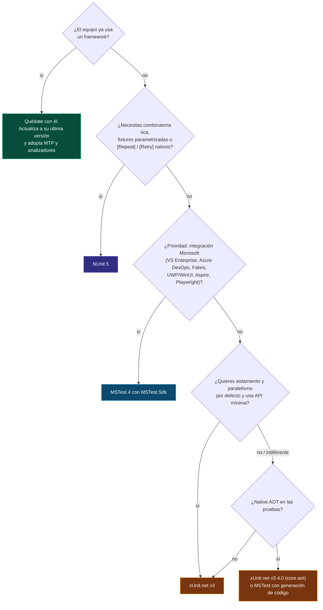
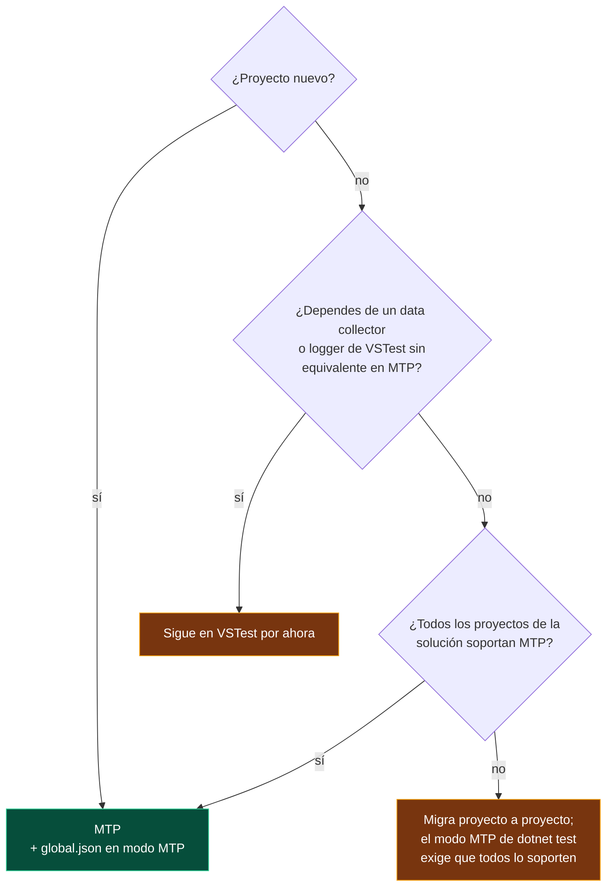
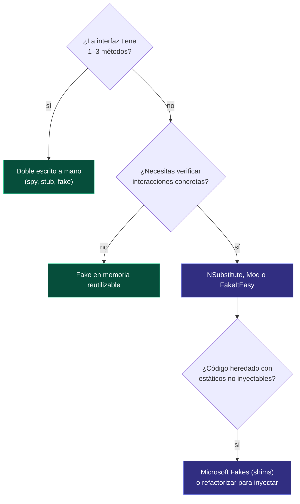

# 15 · Guías de decisión

**Árboles de decisión y escenarios para elegir framework, plataforma, bibliotecas y estrategia, con la recomendación del atlas a noviembre de 2026**

[⬅ 14 · CI, cobertura y reportes](14-ci-cobertura-y-reportes.md) · [🏠 Índice](../README.md) · [16 · Migración ➡](16-migracion.md)

> [!IMPORTANT]
> **La conclusión más importante del atlas:** en 2026 los tres frameworks son excelentes, están mantenidos activamente y cubren el 95 % de las necesidades de cualquier equipo.
> La mejor elección suele ser **la que ya usa tu equipo**. Cambiar de framework rara vez se paga solo; adoptar Microsoft.Testing.Platform, los analizadores y buenas prácticas, casi
> siempre.

---

## Contenido

1. [¿Qué framework?](#1-qué-framework)
2. [Escenarios](#2-escenarios)
3. [¿VSTest o Microsoft.Testing.Platform?](#3-vstest-o-microsofttestingplatform)
4. [¿Qué biblioteca de aserciones?](#4-qué-biblioteca-de-aserciones)
5. [¿Escribo el doble o uso una biblioteca?](#5-escribo-el-doble-o-uso-una-biblioteca)
6. [¿Dónde vive el estado compartido?](#6-dónde-vive-el-estado-compartido)
7. [¿Qué tipo de prueba escribo?](#7-qué-tipo-de-prueba-escribo)
8. [¿Migrar de framework?](#8-migrar-de-framework)

---

## 1. ¿Qué framework?

| Si valoras sobre todo… | Elige | Por qué |
|---|---|---|
| Aislamiento por defecto, API pequeña, comunidad .NET Core | **xUnit.net v3** | Instancia por prueba, paralelo por defecto, `TestContext`, usado por el propio equipo de .NET |
| Expresividad, parametrización y atributos para todo | **NUnit 5** | Restricciones componibles, `[Values]`/`[Pairwise]`, fixtures parametrizadas, `[Repeat]` |
| Integración con herramientas Microsoft y analizadores | **MSTest 4** | `MSTest.Sdk`, más de 80 analizadores, condiciones, `[ResourceLock]`, UWP/WinUI |
| Generación de código y AOT desde el diseño | **TUnit** (con cautela) | Joven, rápido, cambia mucho |

---

## 2. Escenarios

| Escenario | Recomendación | Notas |
|---|---|---|
| API nueva de ASP.NET Core en .NET 10 | xUnit.net v3 o MSTest 4 | `WebApplicationFactory` + Testcontainers; MTP en `global.json` |
| Biblioteca de código abierto multiplataforma | xUnit.net v3 | Es el estándar de facto en el ecosistema abierto de .NET |
| Empresa con Visual Studio Enterprise y Azure DevOps | MSTest 4 | Microsoft Fakes, TRX y cobertura sin configuración |
| Aplicación .NET Framework 4.6.2 heredada | NUnit 5 o MSTest 4 | xUnit.net v3 exige .NET Framework 4.7.2 |
| Cálculos con muchas combinaciones de entrada | NUnit 5 | `[Combinatorial]`, `[Pairwise]`, `[Range]`, `[Theory]` con *datapoints* |
| Aplicación publicada con Native AOT | xUnit.net v3 4.0 (`xunit.v3.core.aot`) | O MSTest con su generador de código |
| UI de escritorio WPF o WinForms | NUnit 5 o MSTest 4 | STA nativo; MSTest 4.5 añade `MSTest.Windows.UIAutomation` (vista previa) |
| UWP o WinUI | MSTest 4 | Único con soporte de primera clase |
| Pruebas de LLM o sistemas no deterministas | NUnit 5 | `[Repeat(n, RequiredPassPercentage = 90)]` |
| Equipo que empieza a escribir pruebas | MSTest 4 o xUnit.net v3 | Menos conceptos; analizadores que enseñan |
| Monorrepositorio con varios frameworks | Mantenerlos, unificar en MTP | Enrutar argumentos con `TestingPlatformCommandLineArguments` ([capítulo 03](03-plataformas-de-ejecucion.md#soluciones-con-frameworks-mezclados)) |

---

## 3. ¿VSTest o Microsoft.Testing.Platform?

---

## 4. ¿Qué biblioteca de aserciones?

| Situación | Recomendación |
|---|---|
| Proyecto nuevo | Las aserciones del framework: en 2026 son completas y sus mensajes incluyen el código fuente (NUnit, MSTest) |
| Ya usas FluentAssertions 7.x | Quédate en 7.x o migra a **AwesomeAssertions**; la 8.x requiere licencia comercial |
| Quieres estilo fluido con licencia libre | AwesomeAssertions o Shouldly |
| Comparas objetos grandes o salidas de texto | **Verify** (*snapshots*) además de las aserciones normales |
| Equipo que alterna frameworks | Una biblioteca externa da el mismo vocabulario en los tres |

---

## 5. ¿Escribo el doble o uso una biblioteca?

---

## 6. ¿Dónde vive el estado compartido?

| Lo que compartes | xUnit.net v3 | NUnit 5 | MSTest 4 |
|---|---|---|---|
| Nada (lo ideal) | Campos de instancia | `[SetUp]` o `InstancePerTestCase` | Campos de instancia |
| Recurso caro de una clase | `IClassFixture<T>` | `[OneTimeSetUp]` | `[ClassInitialize]` + `static` |
| Recurso caro de varias clases | `ICollectionFixture<T>` | `[SetUpFixture]` en el namespace | `[AssemblyInitialize]` + `static` |
| Recurso de todo el ensamblado | `[assembly: AssemblyFixture]` | `[SetUpFixture]` raíz | `[AssemblyInitialize]` |
| Recurso que no admite concurrencia | `[Collection]` con `DisableParallelization` | `[NonParallelizable]` | `[ResourceLock]` · `[DoNotParallelize]` |

---

## 7. ¿Qué tipo de prueba escribo?

| Quiero comprobar… | Tipo de prueba | Herramientas |
|---|---|---|
| Una regla de negocio con varios ejemplos | Unitaria parametrizada | `[Theory]`, `[TestCase]`, `[DataRow]` |
| Una ley que vale para cualquier entrada | Basada en propiedades | FsCheck, CsCheck o semilla fija |
| Que el código funciona con la base de datos real | Integración | Testcontainers, Respawn |
| Que la API HTTP responde como debe | Integración en memoria | `WebApplicationFactory` |
| Que una salida compleja no cambia sin querer | *Snapshot* | Verify |
| Que la arquitectura respeta sus capas | Arquitectura | NetArchTest, reflexión |
| Que mis pruebas detectan errores de verdad | Mutación | Stryker.NET |
| Que el flujo completo funciona en el navegador | Extremo a extremo | Playwright |

---

## 8. ¿Migrar de framework?

| Motivo para migrar | ¿Lo justifica? |
|---|---|
| "El otro framework es más moderno" | ❌ Los tres lo son en 2026 |
| Unificar varios frameworks en un monorrepositorio | ⚠️ Solo si el mantenimiento duplicado es un costo real; MTP ya unifica la ejecución |
| Necesitas una capacidad que el tuyo no tiene (UWP, combinatoria, AOT) | ✅ Para los proyectos que la necesitan |
| El framework actual está abandonado (MSTest v1, xUnit.net v1) | ✅ Migra a su versión moderna, no necesariamente a otro framework |
| Licencias de una biblioteca externa (FluentAssertions 8) | ✅ Migrar la biblioteca, no el framework |

Si decides migrar, el [capítulo 16](16-migracion.md) tiene las guías paso a paso, tanto de versiones como entre frameworks.

---

[⬅ 14 · CI, cobertura y reportes](14-ci-cobertura-y-reportes.md) · [🏠 Índice](../README.md) · [16 · Migración ➡](16-migracion.md)

