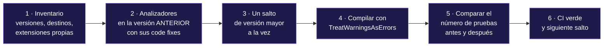

<div align="center">

# 16 · Migración

**Actualizar cada framework a su versión de 2026, pasar de uno a otro, adoptar Microsoft.Testing.Platform y no perder el soporte de .NET por el camino**

[⬅ 15 · Guías de decisión](15-guias-de-decision.md) · [🏠 Índice](../README.md) · [17 · Catálogo A–Z ➡](17-catalogo-a-z.md)

</div>

---

## Contenido

1. [Método general](#1-método-general)
2. [Plazos de .NET que condicionan la migración](#2-plazos-de-net-que-condicionan-la-migración)
3. [NUnit 3 → 4 → 5](#3-nunit-3--4--5)
4. [xUnit.net v2 → v3](#4-xunitnet-v2--v3)
5. [xUnit.net v3 3.x → 4.0](#5-xunitnet-v3-3x--40)
6. [MSTest v1 → v2 → 3 → 4](#6-mstest-v1--v2--3--4)
7. [De VSTest a Microsoft.Testing.Platform](#7-de-vstest-a-microsofttestingplatform)
8. [Entre frameworks](#8-entre-frameworks)
9. [De FluentAssertions 8 a AwesomeAssertions](#9-de-fluentassertions-8-a-awesomeassertions)

---

## 1. Método general



> [!TIP]
> El paso 5 es el que más se olvida. Una migración puede "pasar" porque **dejó de descubrir** pruebas. Guarda el total antes de migrar y exige el mismo número después con
> `--minimum-expected-tests` ([capítulo 03](03-plataformas-de-ejecucion.md#8-códigos-de-salida)).

---

## 2. Plazos de .NET que condicionan la migración

| Fecha | Qué ocurre | Impacto en las pruebas |
|---|---|---|
| **10-nov-2026** | Fin de soporte de **.NET 8** y **.NET 9** | MSTest 5 ya no los admitirá; migra los proyectos de prueba a `net10.0` |
| **nov-2026** | Disponibilidad general prevista de **.NET 11** | `DOTNET_TEST_RUNNER` para el modo MTP sin `global.json` |
| **14-nov-2028** | Fin de soporte de **.NET 10** (LTS) | Planificar el siguiente LTS |

| Framework | .NET moderno mínimo | .NET Framework mínimo |
|---|---|---|
| xUnit.net v3 4.0 | .NET 8 | 4.7.2 |
| NUnit 5 | .NET 8 (compilación específica para .NET 10) | 4.6.2 |
| MSTest 4.5 | .NET 8 | 4.6.2 |
| MSTest 5 (en desarrollo) | **.NET 10** | 4.6.2 |

---

## 3. NUnit 3 → 4 → 5

### NUnit 3 → 4 (noviembre de 2023)

| Cambio | NUnit 3 | NUnit 4 |
|---|---|---|
| Aserciones clásicas | `Assert.AreEqual(e, r)` | `ClassicAssert.AreEqual(e, r)` (`using NUnit.Framework.Legacy;`) |
| Mensajes con formato | `Assert.That(x, Is.True, "Falló {0}", y)` | `Assert.That(x, Is.True, $"Falló {y}")` |
| `Assert.That(bool, string, params object[])` | Existía | Eliminado: interpolación |
| Destinos | .NET Framework 3.5+ | .NET Framework 4.6.2 · .NET 6 |
| Mensajes de fallo | Sin expresión | Con la expresión (`CallerArgumentExpression`) |

```csharp omitir
// NUnit 3
Assert.AreEqual(3, carrito.Unidades, "Unidades de {0}", carrito.Moneda);
CollectionAssert.IsEmpty(lineas);
```

```csharp nunit
// NUnit 4 y 5, estilo recomendado: modelo de restricciones e interpolación
public class MigracionNunit4Tests
{
    [Test]
    public void Estilo_moderno()
    {
        var carrito = new Carrito();
        carrito.Agregar(Catalogo.Taza, 3);

        Assert.That(carrito.Unidades, Is.EqualTo(3), $"Unidades en {carrito.Moneda}");
        Assert.That(new Carrito().Lineas, Is.Empty);
    }
}
```

La vía rápida: `NUnit.Analyzers` incluye correcciones automáticas (`NUnit2001`–`NUnit2049`) que convierten `ClassicAssert` al modelo de restricciones en toda la solución.

### NUnit 4 → 5 (septiembre de 2026)

| Paso | Acción |
|---|---|
| 1 | Actualizar **`NUnit.Analyzers` a 4.14 o posterior** antes que el framework |
| 2 | Añadir `await` a `Assert.ThrowsAsync`, `Assert.CatchAsync` y `Assert.DoesNotThrowAsync` (el analizador lo corrige) |
| 3 | Sustituir `TestDelegate` → `Action`, `AsyncTestDelegate` → `Func<Task>`, `ActualValueDelegate<T>` → `Func<T>` |
| 4 | Revisar `Assert.That(func, …)` cuando `func` es un delegado: NUnit 5 lo **evalúa** |
| 5 | Cambiar `Is.SameAs` con tipos por valor por `Is.EqualTo` |
| 6 | Revisar `[Platform("NET")]` y `[Platform("DotNET")]`: ahora significan .NET moderno |
| 7 | Quitar `using NUnit.Framework.Legacy;` si solo era para `StringAssert` o `CollectionAssert` |
| 8 | Llevar los proyectos de `net6.0`/`net7.0` a `net8.0` o posterior |
| 9 | Sustituir `[Order]` (obsoleto) por `[DependsOnTest]` o eliminar la dependencia |

```csharp omitir
// Alias de compatibilidad para código con muchos TestDelegate explícitos (C# 10+)
global using TestDelegate = System.Action;
global using AsyncTestDelegate = System.Func<System.Threading.Tasks.Task>;
```

---

## 4. xUnit.net v2 → v3

| Cambio | v2 (`xunit` 2.9.3) | v3 (`xunit.v3` 4.0) |
|---|---|---|
| Paquete | `xunit` | `xunit.v3` |
| Tipo de proyecto | Biblioteca | **Ejecutable** (`<OutputType>Exe</OutputType>`) |
| Destinos | .NET Standard / .NET Framework 4.5.2 | .NET 8 · .NET Framework 4.7.2 |
| `IAsyncLifetime` | Métodos que devuelven `Task` | `ValueTask`; hereda de `IAsyncDisposable` |
| `ITestOutputHelper` | `Xunit.Abstractions` | `Xunit` |
| Omitir en ejecución | Paquete `Xunit.SkippableFact` | `Assert.Skip`, `SkipWhen`, `SkipUnless` |
| Contexto | — | `TestContext.Current` |
| Pruebas explícitas | — | `[Fact(Explicit = true)]` |
| Fixtures de ensamblado | — | `[assembly: AssemblyFixture]` |
| `Console` | No se captura | No se captura salvo `[assembly: CaptureConsole]` |
| Extensibilidad | `Xunit.Abstractions`, `Xunit.Sdk` | `Xunit.v3`; la mayoría de las extensiones de v2 deben reescribirse |

```xml
<!-- Antes -->
<PackageReference Include="xunit" Version="2.9.3" />
<PackageReference Include="Microsoft.NET.Test.Sdk" Version="17.14.1" />

<!-- Después -->
<PropertyGroup>
  <OutputType>Exe</OutputType>
</PropertyGroup>
<PackageReference Include="xunit.v3" Version="4.0.2" />
```

```csharp omitir
// v2
public class MiFixture : IAsyncLifetime
{
    public Task InitializeAsync() => …;
    public Task DisposeAsync() => …;
}
```

```csharp xunit
// v3
public sealed class MiFixtureV3 : IAsyncLifetime
{
    public ValueTask InitializeAsync() => ValueTask.CompletedTask;
    public ValueTask DisposeAsync() => ValueTask.CompletedTask;
}

public class MigracionXunitTests(ITestOutputHelper salida) : IClassFixture<MiFixtureV3>
{
    [Fact]
    public void Skip_dinamico_sin_paquetes_extra()
    {
        Assert.SkipWhen(Environment.GetEnvironmentVariable("SIN_RED") == "1", "Sin red en este entorno");
        salida.WriteLine("ITestOutputHelper vive ahora en el espacio de nombres Xunit");
    }
}
```

---

## 5. xUnit.net v3 3.x → 4.0

| Si tu proyecto… | Qué hacer |
|---|---|
| Solo usa `[Fact]`, `[Theory]`, fixtures y aserciones | Cambiar la versión del paquete; normalmente basta |
| Usa MTP v1 (`xunit.v3` < 3.2 con extensiones v1) | Pasar a MTP v2: es el único soportado oficialmente en 4.0 |
| Ejecuta con VSTest en el SDK de .NET 10 | Usar `xunit.v3.mtp-off` o configurar el modo MTP en `global.json` |
| Tiene *orderers* propios | Revisar: el orden ahora tiene niveles (colección → clase → método → caso) |
| Tiene extensiones de bajo nivel | Revisar las notas de la 4.0: la mayoría de cambios incompatibles están en esas API |
| Ejecuta en Mono | Sin soporte oficial desde la 4.0 |

---

## 6. MSTest v1 → v2 → 3 → 4

### Desde MSTest v1 (Visual Studio 2005–2015)

| v1 | Moderno |
|---|---|
| Referencia a `Microsoft.VisualStudio.QualityTools.UnitTestFramework.dll` | Paquete `MSTest` o `MSTest.Sdk` |
| Proyecto de pruebas con `ProjectTypeGuids` | Proyecto SDK |
| `.testsettings`, `.vsmdi` | `.runsettings` o `testconfig.json` |
| `mstest.exe` | `dotnet test` |

### MSTest 3 → 4 (octubre de 2025)

| Cambio | Antes | Después |
|---|---|---|
| Excepciones por atributo | `[ExpectedException(typeof(X))]` | `Assert.ThrowsExactly<X>(…)` (`MSTEST0006` con corrección) |
| API antigua de excepciones | `Assert.ThrowsException<X>` | `Assert.ThrowsExactly<X>` |
| Mensajes con formato | `Assert.AreEqual(e, r, "{0}", x)` | `Assert.AreEqual(e, r, $"{x}")` |
| `IsInstanceOfType` con `out` | `Assert.IsInstanceOfType<T>(x, out var t)` | `var t = Assert.IsInstanceOfType<T>(x)` |
| `TestContext.Properties` | `IDictionary` | `IDictionary<string, object>` |
| Atributos de ejecución propios | `TestMethodAttribute.Execute` | `ExecuteAsync` |
| `ClassCleanupBehavior`, `TestTimeout` | Enumeraciones | Eliminadas |
| `ConditionBaseAttribute.ShouldRun` | — | `IsConditionMet` |
| Estrategia de despliegue de datos | En cada fuente | En `[TestMethod]` |
| Destinos | .NET Core 3.1+ | **.NET 8+** · .NET Framework 4.6.2 |
| Con MTP | `DisableAppDomain = false` | `true` por defecto |
| Avisos de descubrimiento | Advertencias | `TreatDiscoveryWarningsAsErrors = true` |
| `MSTest.Sdk` con MTP | Añadía `Microsoft.NET.Test.Sdk` | Ya no lo añade |

```csharp omitir
// MSTest 3
[TestMethod]
[ExpectedException(typeof(InvalidOperationException))]
public void No_se_aplican_dos_cupones()
{
    _carrito.AplicarCupon(new Cupon("A", 5m));
    _carrito.AplicarCupon(new Cupon("B", 5m));
}
```

```csharp mstest
// MSTest 4: la excepción se espera en una línea concreta
[TestClass]
public sealed class MigracionMstest4Tests
{
    [TestMethod]
    public void No_se_aplican_dos_cupones()
    {
        var carrito = new Carrito();
        carrito.AplicarCupon(new Cupon("A", 5m));          // si ESTA línea lanzara, la prueba fallaría

        Assert.ThrowsExactly<InvalidOperationException>(() => carrito.AplicarCupon(new Cupon("B", 5m)));
    }
}
```

### MSTest 4 → 5 (en desarrollo)

Preparación recomendada desde ya: llevar los proyectos a `net10.0`, sustituir `[DataTestMethod]` por `[TestMethod]`, no heredar de los atributos que se sellarán y usar Visual Studio
2022 17.14 / SDK 9.0.300 o posteriores para los analizadores ([capítulo 06](06-mstest.md#12-mstest-5-en-el-horizonte)).

---

## 7. De VSTest a Microsoft.Testing.Platform

- [ ] Activar MTP en cada proyecto: `xunit.v3` (ya activo) · `EnableNUnitRunner` · `MSTest.Sdk` o `EnableMSTestRunner`.
- [ ] Añadir `"test": { "runner": "Microsoft.Testing.Platform" }` a `global.json` (SDK de .NET 10 o posterior).
- [ ] Quitar `TestingPlatformDotnetTestSupport`, `TestingPlatformCaptureOutput` y `TestingPlatformShowTestsFailure`.
- [ ] `dotnet test X.sln` → `dotnet test --solution X.sln`; `dotnet test X.csproj` → `--project X.csproj`; `dotnet test X.dll` → `--test-modules X.dll`.
- [ ] `--logger trx` → `--report-trx` (extensión TRX); `--collect "Code Coverage"` → `--coverage`; `--blame-hang` → `--hangdump`.
- [ ] Revisar el `.runsettings`: MTP lo admite para compatibilidad, pero la configuración nativa es `testconfig.json`.
- [ ] En soluciones mixtas, enrutar argumentos específicos con `TestingPlatformCommandLineArguments`.
- [ ] Añadir `--minimum-expected-tests` en CI para detectar pérdidas de descubrimiento.

---

## 8. Entre frameworks

La tabla de equivalencias completa está en la [Piedra Rosetta](07-piedra-rosetta.md) y en el [catálogo](17-catalogo-a-z.md). Los reemplazos mecánicos más frecuentes:

| De NUnit a xUnit.net | De MSTest a xUnit.net | De xUnit.net a MSTest |
|---|---|---|
| `[TestFixture]` → (quitar) | `[TestClass]` → (quitar) | (añadir) → `[TestClass]` |
| `[Test]` → `[Fact]` | `[TestMethod]` → `[Fact]` | `[Fact]` → `[TestMethod]` |
| `[TestCase]` → `[InlineData]` + `[Theory]` | `[DataRow]` → `[InlineData]` + `[Theory]` | `[InlineData]` → `[DataRow]` |
| `[SetUp]` → constructor | `[TestInitialize]` → constructor | constructor → (igual) |
| `[TearDown]` → `Dispose` | `[TestCleanup]` → `Dispose` | `Dispose` → (igual) |
| `[OneTimeSetUp]` → `IClassFixture<T>` | `[ClassInitialize]` → `IClassFixture<T>` | `IClassFixture<T>` → `[ClassInitialize]` |
| `Assert.That(r, Is.EqualTo(e))` → `Assert.Equal(e, r)` | `Assert.AreEqual(e, r)` → `Assert.Equal(e, r)` | `Assert.Equal` → `Assert.AreEqual` |
| `Assert.Throws<T>` → `Assert.Throws<T>` | `Assert.ThrowsExactly<T>` → `Assert.Throws<T>` | `Assert.Throws<T>` → **`Assert.ThrowsExactly<T>`** |
| `[Category]` → `[Trait("Category", …)]` | `[TestCategory]` → `[Trait("Category", …)]` | `[Trait("Category", …)]` → `[TestCategory]` |

> [!CAUTION]
> Tres riesgos de comportamiento que un buscar y reemplazar **no** detecta:
>
> 1. **De NUnit a cualquiera:** el estado que NUnit compartía entre pruebas (instancia única) ahora se reinicia; las pruebas que dependían de ello sin saberlo cambian de resultado.
> 2. **De NUnit o MSTest a xUnit.net:** el paralelismo pasa a estar activo; el estado estático empieza a producir fallos intermitentes.
> 3. **De xUnit.net a MSTest:** `Assert.Throws<T>` empieza a aceptar derivados; usa `ThrowsExactly<T>` para conservar la semántica.

---

## 9. De FluentAssertions 8 a AwesomeAssertions

AwesomeAssertions es un *fork* de FluentAssertions 7 con licencia Apache 2.0. La migración es casi mecánica:

```xml
<!-- Antes -->
<PackageReference Include="FluentAssertions" Version="8.11.0" />
<!-- Después -->
<PackageReference Include="AwesomeAssertions" Version="9.6.0" />
```

```csharp omitir
// Antes
using FluentAssertions;
// Después
using AwesomeAssertions;

carrito.Total.Should().Be(new Dinero(810m));   // la API de .Should() se conserva
```

Revisa las notas de versión de AwesomeAssertions 8 y 9: algunos métodos se renombraron respecto a FluentAssertions 7, y la API divergió de la 8 comercial.

---

<div align="center">

[⬅ 15 · Guías de decisión](15-guias-de-decision.md) · [🏠 Índice](../README.md) · [17 · Catálogo A–Z ➡](17-catalogo-a-z.md)

</div>
