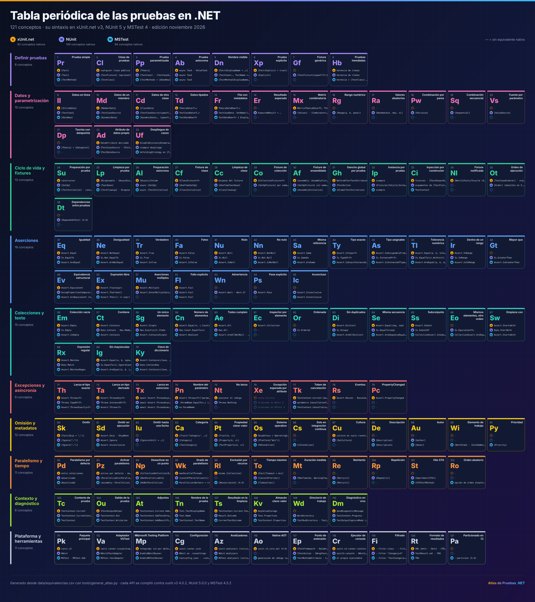

# 17 · Catálogo A–Z de equivalencias

**121 conceptos con su sintaxis en xUnit.net, NUnit y MSTest · edición noviembre 2026**

[⬅ 16 · Migración](16-migracion.md) · [🏠 Índice](../README.md) · [18 · Referencia rápida ➡](18-referencia-rapida-y-glosario.md)

> [!NOTE]
> Este archivo se **genera automáticamente** desde [`data/equivalencias.csv`](../data/equivalencias.csv) con
> `python3 tools/generar_atlas.py`. Para corregir o añadir un concepto, edita el CSV y ejecuta el script.

## Cobertura por framework

Cuántos de los conceptos del catálogo tienen una forma **nativa** en cada framework. Una cifra menor no significa un framework peor:
xUnit.net omite a propósito varias capacidades (orden, reintentos, `[SetUp]`) por diseño. Consulta [07 · Piedra Rosetta](07-piedra-rosetta.md).

| Framework | Conceptos nativos | Cobertura |
|---|---:|---|
| **xUnit.net** | 92 de 121 | `███████████████░░░░░` 76 % |
| **NUnit** | 109 de 121 | `██████████████████░░` 90 % |
| **MSTest** | 94 de 121 | `████████████████░░░░` 78 % |

## Resumen por familia

| Familia | Conceptos | xUnit.net | NUnit | MSTest |
|---|---:|---:|---:|---:|
| [Definir pruebas](#definir-pruebas) | 8 | 7 | 8 | 6 |
| [Datos y parametrización](#datos-y-parametrización) | 15 | 8 | 15 | 7 |
| [Ciclo de vida y fixtures](#ciclo-de-vida-y-fixtures) | 13 | 12 | 12 | 9 |
| [Aserciones](#aserciones) | 19 | 15 | 19 | 16 |
| [Colecciones y texto](#colecciones-y-texto) | 15 | 13 | 14 | 13 |
| [Excepciones y asincronía](#excepciones-y-asincronía) | 9 | 8 | 6 | 5 |
| [Omisión y metadatos](#omisión-y-metadatos) | 12 | 6 | 9 | 10 |
| [Paralelismo y tiempo](#paralelismo-y-tiempo) | 11 | 6 | 9 | 9 |
| [Contexto y diagnóstico](#contexto-y-diagnóstico) | 8 | 7 | 8 | 8 |
| [Plataforma y herramientas](#plataforma-y-herramientas) | 11 | 10 | 9 | 11 |

## Índice alfabético

[A](#a) · [C](#c) · [D](#d) · [E](#e) · [F](#f) · [G](#g) · [H](#h) · [I](#i) · [L](#l) · [M](#m) · [N](#n) · [O](#o) · [P](#p) · [R](#r) · [S](#s) · [T](#t) · [U](#u) · [V](#v)

### A

| № | Símbolo | Concepto | xUnit.net | NUnit | MSTest |
|---:|:---:|---|---|---|---|
| 93 | **Pz** | Activar paralelismo | activo por defecto · `modo total (4.0)` | `[Parallelizable(ParallelScope.All)]` | `[assembly: Parallelize]` |
| 112 | **Va** | Adaptador VSTest | `xunit.runner.visualstudio` | NUnit3TestAdapter | `MSTest.TestAdapter` |
| 105 | **At** | Adjuntos | `TestContext.Current.AddAttachment` | `TestContext.AddTestAttachment` | `TestContext.AddResultFile` |
| 53 | **Wn** | Advertencia | — | `Assert.Warn` · `Warn.If` | — |
| 108 | **Kv** | Almacén clave-valor | KeyValueStorage | `Test.Properties` | `TestContext.Properties` |
| 115 | **Az** | Analizadores | `xunit.analyzers (incluido)` | `NUnit.Analyzers` | `MSTest.Analyzers (incluido)` |
| 51 | **Mu** | Aserciones múltiples | `Assert.Multiple` | `Assert.EnterMultipleScope` | — |
| 22 | **Ad** | Atributo de datos propio | DataAttribute derivado | `ITestCaseSource` · `ITestBuilder` | `ITestDataSource` |
| 89 | **Au** | Autor | — | `[Author]` | `[Owner]` |

### C

| № | Símbolo | Concepto | xUnit.net | NUnit | MSTest |
|---:|:---:|---|---|---|---|
| 83 | **Ca** | Categoría | `[Trait("Category", …)]` | `[Category]` | `[TestCategory]` |
| 2 | **Cl** | Clase de pruebas | cualquier clase pública | `[TestFixture] (opcional)` | `[TestClass]` |
| 70 | **Ky** | Clave de diccionario | `Assert.Contains(clave, dic)` | `Does.ContainKey` | `Assert.Contains(clave, dic.Keys)` |
| 56 | **Em** | Colección vacía | `Assert.Empty` | `Is.Empty` | `Assert.IsEmpty` |
| 18 | **Pw** | Combinación por pares | — | `[Pairwise]` | — |
| 19 | **Sq** | Combinación secuencial | — | `[Sequential]` | — |
| 114 | **Cg** | Configuración | `xunit.runner.json` | `NUnit en .runsettings` | `testconfig.json` · `.runsettings` |
| 103 | **Tc** | Contexto de prueba | `TestContext.Current` | `TestContext.CurrentContext` | `TestContext` |
| 57 | **Ct** | Contiene | `Assert.Contains` | `Does.Contain` · `Has.Member` | `Assert.Contains` |
| 87 | **Cu** | Cultura | `culture en xunit.runner.json` | `[SetCulture]` | — |

### D

| № | Símbolo | Concepto | xUnit.net | NUnit | MSTest |
|---:|:---:|---|---|---|---|
| 11 | **Cd** | Datos de otra clase | `[ClassData]` | `[TestCaseSource(typeof(T))]` | `[DynamicData(…, typeof(T))]` |
| 10 | **Md** | Datos de un miembro | `[MemberData]` | `[TestCaseSource]` | `[DynamicData]` |
| 9 | **Il** | Datos en línea | `[InlineData]` | `[TestCase]` | `[DataRow]` |
| 12 | **Td** | Datos tipados | `TheoryData<T…>` | `TestCaseData<T…>` | `TestDataRow<T>` |
| 47 | **Ir** | Dentro de un rango | `Assert.InRange` | `Is.InRange` | `Assert.IsInRange` |
| 36 | **Dt** | Dependencias entre pruebas | — | `[DependsOnTest] (5.0)` | — |
| 94 | **Np** | Desactivar en un punto | `[CollectionDefinition(DisableParallelization = true)]` | `[NonParallelizable]` | `[DoNotParallelize]` |
| 88 | **De** | Descripción | — | `[Description]` | `[Description]` |
| 38 | **Ne** | Desigualdad | `Assert.NotEqual` | `Is.Not.EqualTo` | `Assert.AreNotEqual` |
| 23 | **Uf** | Despliegue de casos | DisableDiscoveryEnumeration | siempre despliega | `UnfoldingStrategy en [TestMethod]` |
| 110 | **Dm** | Diagnóstico en vivo | SendDiagnosticMessage | `TestContext.Progress` | `TestOutputCaptureMode (4.4)` |
| 109 | **Wd** | Directorio de trabajo | — | WorkDirectory | `TestRunDirectory` · `TestTempDirectory (4.4)` |
| 98 | **Mt** | Duración medida | — | `[MaxTime(ms, WarningTime = …)]` | — |

### E

| № | Símbolo | Concepto | xUnit.net | NUnit | MSTest |
|---:|:---:|---|---|---|---|
| 118 | **Cr** | Ejecutor de consola | `xunit.v3.runner.console` | nunit3-console · NUnitLite | el propio ejecutable |
| 90 | **Wi** | Elemento de trabajo | — | — | `[WorkItem]` · `[GitHubWorkItem]` |
| 67 | **Sw** | Empieza con | `Assert.StartsWith` | `Does.StartWith` | `Assert.StartsWith` |
| 49 | **Ev** | Equivalencia estructural | `Assert.Equivalent` | `UsingPropertiesComparer() (mismo tipo)` | `Assert.AreEquivalent (4.3)` |
| 78 | **Rs** | Eventos | `Assert.Raises` · `RaisesAsync` | — | — |
| 76 | **Xe** | Excepción esperada por atributo | nunca existió | eliminado en NUnit 3 | eliminado en MSTest 4 |
| 96 | **Rl** | Exclusión por recurso | `misma [Collection]` | — | `[ResourceLock] (4.4)` |
| 50 | **Ex** | Expresión libre | `Assert.True(expr)` | `Assert.That(bool)` | `Assert.That(() => expr)` |
| 68 | **Rx** | Expresión regular | `Assert.Matches` | `Does.Match` | `Assert.MatchesRegex` |

### F

| № | Símbolo | Concepto | xUnit.net | NUnit | MSTest |
|---:|:---:|---|---|---|---|
| 52 | **Fl** | Fallo explícito | `Assert.Fail` | `Assert.Fail` | `Assert.Fail` |
| 40 | **Fa** | Falso | `Assert.False` | `Is.False` | `Assert.IsFalse` |
| 13 | **Fr** | Fila con metadatos | `TheoryDataRow<T…>` | `TestCaseData .SetName()` · `.Ignore()` | `TestDataRow<T> { DisplayName }` |
| 119 | **Fi** | Filtrado | --filter-class · --filter-trait | `--filter "Category=X"` | `--filter "TestCategory=X"` |
| 27 | **Cf** | Fixture de clase | `IClassFixture<T>` | `[OneTimeSetUp]` | `[ClassInitialize]` |
| 29 | **Co** | Fixture de colección | `ICollectionFixture<T>` | `[SetUpFixture] por namespace` | — |
| 30 | **Af** | Fixture de ensamblado | `[assembly: AssemblyFixture]` | `[SetUpFixture] sin namespace` | `[AssemblyInitialize]` |
| 7 | **Gf** | Fixture genérica | — | `[TestFixture(typeof(T))]` | — |
| 34 | **Nl** | Fixture notificada | `INotifyTestLifecycle (4.0)` | — | — |
| 120 | **Rt** | Formato de resultados | XML xUnit · JUnit · CTRF · TRX | `TestResult.xml` · `TRX` | TRX |
| 20 | **Vs** | Fuente por parámetro | — | `[ValueSource]` | — |

### G

| № | Símbolo | Concepto | xUnit.net | NUnit | MSTest |
|---:|:---:|---|---|---|---|
| 31 | **Gh** | Gancho global por prueba | BeforeAfterTestAttribute | `ITestAction` | `[GlobalTestInitialize]` |
| 95 | **Wk** | Grado de paralelismo | maxParallelThreads | `[LevelOfParallelism(n)]` | `Parallelize(Workers = n)` |

### H

| № | Símbolo | Concepto | xUnit.net | NUnit | MSTest |
|---:|:---:|---|---|---|---|
| 101 | **St** | Hilo STA | — | `[Apartment(STA)]` | `[STATestMethod]` |

### I

| № | Símbolo | Concepto | xUnit.net | NUnit | MSTest |
|---:|:---:|---|---|---|---|
| 37 | **Eq** | Igualdad | `Assert.Equal` | `Is.EqualTo` | `Assert.AreEqual` |
| 55 | **Ic** | Inconcluso | — | `Assert.Inconclusive` | `Assert.Inconclusive` |
| 61 | **Ec** | Inspector por elemento | `Assert.Collection` | — | — |
| 32 | **Ip** | Instancia por prueba | siempre | `[FixtureLifeCycle(InstancePerTestCase)]` | siempre |
| 33 | **Ci** | Inyección por constructor | fixtures · ITestOutputHelper | `argumentos de [TestFixture]` | `TestContext` |

### L

| № | Símbolo | Concepto | xUnit.net | NUnit | MSTest |
|---:|:---:|---|---|---|---|
| 71 | **Th** | Lanza el tipo exacto | `Assert.Throws<T>` | `Throws.TypeOf<T>` | `Assert.ThrowsExactly<T>` |
| 73 | **Tx** | Lanza en asíncrono | `await Assert.ThrowsAsync<T>` | `await Assert.ThrowsAsync<T>` | `await Assert.ThrowsExactlyAsync<T>` |
| 72 | **Ta** | Lanza un tipo derivado | `Assert.ThrowsAny<T>` | `Throws.InstanceOf<T>` | `Assert.Throws<T>` |
| 28 | **Cc** | Limpieza de clase | Dispose del fixture | `[OneTimeTearDown]` | `[ClassCleanup]` |
| 25 | **Lp** | Limpieza por prueba | `IDisposable` · `IAsyncDisposable` | `[TearDown]` | `[TestCleanup]` · `Dispose` |

### M

| № | Símbolo | Concepto | xUnit.net | NUnit | MSTest |
|---:|:---:|---|---|---|---|
| 15 | **Mx** | Matriz combinatoria | `MatrixTheoryData<T1, T2>` | `[Values]` · `[Combinatorial]` | — |
| 48 | **Gt** | Mayor que | — | `Is.GreaterThan` | `Assert.IsGreaterThan` |
| 113 | **Mp** | Microsoft.Testing.Platform | `integrado (v2 por defecto)` | EnableNUnitRunner | EnableMSTestRunner |
| 43 | **Sa** | Misma referencia | `Assert.Same` | `Is.SameAs` | `Assert.AreSame` |
| 64 | **Se** | Misma secuencia | `Assert.Equal(seq, seq)` | `Is.EqualTo(seq)` | `Assert.AreSequenceEqual (4.3)` |
| 66 | **Eo** | Mismos elementos, otro orden | — | `Is.EquivalentTo` | `CollectionAssert.AreEquivalent` |

### N

| № | Símbolo | Concepto | xUnit.net | NUnit | MSTest |
|---:|:---:|---|---|---|---|
| 116 | **Ao** | Native AOT | `xunit.v3.core.aot (4.0)` | — | `generación de código (experimental)` |
| 75 | **Nt** | No lanza | ejecutar el código | `Throws.Nothing` | — |
| 42 | **Nn** | No nulo | `Assert.NotNull` | `Is.Not.Null` | `Assert.IsNotNull` |
| 106 | **Tn** | Nombre de la prueba | `Test.TestDisplayName` | `Test.Name` | `TestContext.TestName` |
| 74 | **Pn** | Nombre del parámetro | `Assert.Throws<T>("param", …)` | `.ParamName.EqualTo(…) (5.0)` | `ex.ParamName` |
| 5 | **Dn** | Nombre visible | `[Fact(DisplayName = …)]` | `[TestCase(…, TestName = …)]` | `[TestMethod(DisplayName = …)]` |
| 41 | **Nu** | Nulo | `Assert.Null` | `Is.Null` | `Assert.IsNull` |
| 59 | **Cn** | Número de elementos | `Assert.Equal(n, c.Count)` | `Has.Count.EqualTo(n)` | `Assert.HasCount` |

### O

| № | Símbolo | Concepto | xUnit.net | NUnit | MSTest |
|---:|:---:|---|---|---|---|
| 80 | **Sk** | Omitir | `[Fact(Skip = "…")]` | `[Ignore("…")]` | `[Ignore("…")]` |
| 81 | **Sd** | Omitir en ejecución | `Assert.Skip` · `SkipWhen` | `Assert.Ignore` | `Assert.Inconclusive` |
| 82 | **Iu** | Omitir hasta una fecha | — | `[Ignore(Until = …)]` | — |
| 102 | **Ro** | Orden aleatorio | — | — | `opción de orden aleatorio (4.3)` |
| 35 | **Ot** | Orden de ejecución | `[TestCaseOrderer]` · `orderers (4.0)` | `[Order] (obsoleto en 5.0)` | — |
| 62 | **Or** | Ordenada | — | `Is.Ordered` | — |

### P

| № | Símbolo | Concepto | xUnit.net | NUnit | MSTest |
|---:|:---:|---|---|---|---|
| 111 | **Pk** | Paquete principal | `xunit.v3` | NUnit | `MSTest` · `MSTest.Sdk` |
| 92 | **Pd** | Paralelismo por defecto | entre colecciones | desactivado | desactivado |
| 121 | **Pa** | Particionado en CI | — | — | `--partition (5.0)` |
| 54 | **Ps** | Pase explícito | — | `Assert.Pass` | — |
| 26 | **Al** | Preparación asíncrona | `IAsyncLifetime` | `async [SetUp]` | `async [TestInitialize]` |
| 24 | **Su** | Preparación por prueba | constructor | `[SetUp]` | `[TestInitialize]` · constructor |
| 91 | **Py** | Prioridad | — | — | `[Priority]` |
| 79 | **Pc** | PropertyChanged | `Assert.PropertyChanged` | — | — |
| 84 | **Pt** | Propiedad clave-valor | `[Trait(k, v)]` | `[Property(k, v)]` | `[TestProperty(k, v)]` |
| 4 | **Ab** | Prueba asíncrona | async Task · ValueTask | async Task | async Task |
| 6 | **Xp** | Prueba explícita | `[Fact(Explicit = true)]` | `[Explicit]` | — |
| 3 | **Pp** | Prueba parametrizada | `[Theory]` | `[TestCase]` · `[TestCaseSource]` | `[TestMethod] + [DataRow]` |
| 1 | **Pr** | Prueba simple | `[Fact]` | `[Test]` | `[TestMethod]` |
| 8 | **Hb** | Pruebas heredadas | herencia de clases | herencia de clases | `herencia + [TestClass] en la derivada` |
| 117 | **Ep** | Punto de extensión | `ITestFramework` · `DataAttribute` | `ITestAction` · `IWrapTestMethod` | TestMethodAttribute · ConditionBaseAttribute |

### R

| № | Símbolo | Concepto | xUnit.net | NUnit | MSTest |
|---:|:---:|---|---|---|---|
| 16 | **Rg** | Rango numérico | — | `[Range(a, b, paso)]` | — |
| 99 | **Re** | Reintento | — | `[Retry(n)]` | `[Retry(n)]` |
| 100 | **Rp** | Repetición | — | `[Repeat(n)]` | — |
| 107 | **Ts** | Resultado en la limpieza | `TestContext.Current.TestState` | `Result.Outcome` | CurrentTestOutcome |
| 14 | **Er** | Resultado esperado | — | `ExpectedResult = …` | — |

### S

| № | Símbolo | Concepto | xUnit.net | NUnit | MSTest |
|---:|:---:|---|---|---|---|
| 104 | **Ou** | Salida de la prueba | `ITestOutputHelper` | `TestContext.Out` | `TestContext.WriteLine` |
| 63 | **Di** | Sin duplicados | `Assert.Distinct` | `Is.Unique` | `Assert.AreAllDistinct` |
| 69 | **Ig** | Sin mayúsculas | `Assert.Equal(a, b, ignoreCase: true)` | `Is.EqualTo(x).IgnoreCase` | `Assert.AreEqual(a, b, ignoreCase: true)` |
| 85 | **Os** | Sistema operativo | SkipUnless + OperatingSystem | `[Platform("Win")]` | `[OSCondition]` |
| 86 | **Cs** | Solo en integración continua | — | — | `[CICondition]` |
| 65 | **Ss** | Subconjunto | `Assert.Subset` | `Is.SubsetOf` | `CollectionAssert.IsSubsetOf` |

### T

| № | Símbolo | Concepto | xUnit.net | NUnit | MSTest |
|---:|:---:|---|---|---|---|
| 21 | **Dp** | Teorías con datapoints | — | `[Theory] + [Datapoint]` | — |
| 97 | **To** | Tiempo máximo | `[Fact(Timeout = ms)]` | `[CancelAfter(ms)]` | `[Timeout(ms)]` |
| 45 | **As** | Tipo asignable | `Assert.IsAssignableFrom<T>` | `Is.InstanceOf<T>` | `Assert.IsInstanceOfType<T>` |
| 44 | **Ty** | Tipo exacto | `Assert.IsType<T>` | `Is.TypeOf<T>` | `Assert.IsExactInstanceOfType<T>` |
| 60 | **Ae** | Todos cumplen | `Assert.All` | `Has.All` | `Assert.AreAllNotNull` · `AreAllOfType` |
| 77 | **Tk** | Token de cancelación | `TestContext.Current.CancellationToken` | parámetro CancellationToken | `TestContext.CancellationToken` |
| 46 | **Tl** | Tolerancia numérica | `Assert.Equal(a, b, tolerancia)` | `Is.EqualTo(x).Within(t)` | `Assert.AreEqual(a, b, delta)` |

### U

| № | Símbolo | Concepto | xUnit.net | NUnit | MSTest |
|---:|:---:|---|---|---|---|
| 58 | **Sg** | Un único elemento | `Assert.Single` | `Has.Exactly(1).Items` | `Assert.ContainsSingle` |

### V

| № | Símbolo | Concepto | xUnit.net | NUnit | MSTest |
|---:|:---:|---|---|---|---|
| 17 | **Ra** | Valores aleatorios | — | `[Random(min, max, n)]` | — |
| 39 | **Tr** | Verdadero | `Assert.True` | `Is.True` | `Assert.IsTrue` |

## Por familia

### Definir pruebas

| № | Concepto | xUnit.net | NUnit | MSTest | Nota |
|---:|---|---|---|---|---|
| 1 | Prueba simple | `[Fact]` | `[Test]` | `[TestMethod]` |  |
| 2 | Clase de pruebas | cualquier clase pública | `[TestFixture] (opcional)` | `[TestClass]` | MSTest exige el atributo; xUnit y NUnit descubren por métodos |
| 3 | Prueba parametrizada | `[Theory]` | `[TestCase]` · `[TestCaseSource]` | `[TestMethod] + [DataRow]` | [DataTestMethod] es redundante y se elimina en MSTest 5 |
| 4 | Prueba asíncrona | async Task · ValueTask | async Task | async Task | async void no está soportado en ninguno |
| 5 | Nombre visible | `[Fact(DisplayName = …)]` | `[TestCase(…, TestName = …)]` | `[TestMethod(DisplayName = …)]` |  |
| 6 | Prueba explícita | `[Fact(Explicit = true)]` | `[Explicit]` | — | Solo se ejecuta si se pide por nombre o filtro |
| 7 | Fixture genérica | — | `[TestFixture(typeof(T))]` | — | NUnit instancia la clase una vez por argumento de tipo |
| 8 | Pruebas heredadas | herencia de clases | herencia de clases | `herencia + [TestClass] en la derivada` | MSTEST0069 avisa si falta [TestClass] en la derivada |

### Datos y parametrización

| № | Concepto | xUnit.net | NUnit | MSTest | Nota |
|---:|---|---|---|---|---|
| 9 | Datos en línea | `[InlineData]` | `[TestCase]` | `[DataRow]` | Solo constantes: decimal no es válido en atributos |
| 10 | Datos de un miembro | `[MemberData]` | `[TestCaseSource]` | `[DynamicData]` | MSTest acepta tuplas y propiedades sin especificar el tipo de origen |
| 11 | Datos de otra clase | `[ClassData]` | `[TestCaseSource(typeof(T))]` | `[DynamicData(…, typeof(T))]` |  |
| 12 | Datos tipados | `TheoryData<T…>` | `TestCaseData<T…>` | `TestDataRow<T>` | TestCaseData genérico desde NUnit 4.1 |
| 13 | Fila con metadatos | `TheoryDataRow<T…>` | `TestCaseData .SetName()` · `.Ignore()` | `TestDataRow<T> { DisplayName }` | Permiten omitir o renombrar un caso concreto |
| 14 | Resultado esperado | — | `ExpectedResult = …` | — | En NUnit el método devuelve el valor y el framework compara |
| 15 | Matriz combinatoria | `MatrixTheoryData<T1, T2>` | `[Values]` · `[Combinatorial]` | — | Producto cartesiano de los valores |
| 16 | Rango numérico | — | `[Range(a, b, paso)]` | — |  |
| 17 | Valores aleatorios | — | `[Random(min, max, n)]` | — | La semilla se registra para reproducir el fallo |
| 18 | Combinación por pares | — | `[Pairwise]` | — | Cubre cada par de valores con menos casos |
| 19 | Combinación secuencial | — | `[Sequential]` | — |  |
| 20 | Fuente por parámetro | — | `[ValueSource]` | — |  |
| 21 | Teorías con datapoints | — | `[Theory] + [Datapoint]` | — | El [Theory] de NUnit es distinto del de xUnit |
| 22 | Atributo de datos propio | DataAttribute derivado | `ITestCaseSource` · `ITestBuilder` | `ITestDataSource` | Puerta de extensión para leer CSV, JSON o bases de datos |
| 23 | Despliegue de casos | DisableDiscoveryEnumeration | siempre despliega | `UnfoldingStrategy en [TestMethod]` | Decide si cada fila es un caso visible en el explorador |

### Ciclo de vida y fixtures

| № | Concepto | xUnit.net | NUnit | MSTest | Nota |
|---:|---|---|---|---|---|
| 24 | Preparación por prueba | constructor | `[SetUp]` | `[TestInitialize]` · constructor |  |
| 25 | Limpieza por prueba | `IDisposable` · `IAsyncDisposable` | `[TearDown]` | `[TestCleanup]` · `Dispose` |  |
| 26 | Preparación asíncrona | `IAsyncLifetime` | `async [SetUp]` | `async [TestInitialize]` |  |
| 27 | Fixture de clase | `IClassFixture<T>` | `[OneTimeSetUp]` | `[ClassInitialize]` | Se ejecuta una vez por clase |
| 28 | Limpieza de clase | Dispose del fixture | `[OneTimeTearDown]` | `[ClassCleanup]` |  |
| 29 | Fixture de colección | `ICollectionFixture<T>` | `[SetUpFixture] por namespace` | — | Comparte estado entre varias clases |
| 30 | Fixture de ensamblado | `[assembly: AssemblyFixture]` | `[SetUpFixture] sin namespace` | `[AssemblyInitialize]` |  |
| 31 | Gancho global por prueba | BeforeAfterTestAttribute | `ITestAction` | `[GlobalTestInitialize]` | Código que rodea a todas las pruebas |
| 32 | Instancia por prueba | siempre | `[FixtureLifeCycle(InstancePerTestCase)]` | siempre | NUnit comparte una instancia por defecto |
| 33 | Inyección por constructor | fixtures · ITestOutputHelper | `argumentos de [TestFixture]` | `TestContext` | MSTest admite TestContext en el constructor desde 3.6 |
| 34 | Fixture notificada | `INotifyTestLifecycle (4.0)` | — | — | Una fixture compartida reacciona a cada prueba |
| 35 | Orden de ejecución | `[TestCaseOrderer]` · `orderers (4.0)` | `[Order] (obsoleto en 5.0)` | — | Depender del orden es un olor de diseño |
| 36 | Dependencias entre pruebas | — | `[DependsOnTest] (5.0)` | — | Novedad de NUnit 5 |

### Aserciones

| № | Concepto | xUnit.net | NUnit | MSTest | Nota |
|---:|---|---|---|---|---|
| 37 | Igualdad | `Assert.Equal` | `Is.EqualTo` | `Assert.AreEqual` | Orden: esperado, real; NUnit: real, restricción |
| 38 | Desigualdad | `Assert.NotEqual` | `Is.Not.EqualTo` | `Assert.AreNotEqual` |  |
| 39 | Verdadero | `Assert.True` | `Is.True` | `Assert.IsTrue` |  |
| 40 | Falso | `Assert.False` | `Is.False` | `Assert.IsFalse` |  |
| 41 | Nulo | `Assert.Null` | `Is.Null` | `Assert.IsNull` |  |
| 42 | No nulo | `Assert.NotNull` | `Is.Not.Null` | `Assert.IsNotNull` | MSTest 5 devolverá el valor no nulo |
| 43 | Misma referencia | `Assert.Same` | `Is.SameAs` | `Assert.AreSame` | NUnit 5 lo restringe a tipos por referencia |
| 44 | Tipo exacto | `Assert.IsType<T>` | `Is.TypeOf<T>` | `Assert.IsExactInstanceOfType<T>` |  |
| 45 | Tipo asignable | `Assert.IsAssignableFrom<T>` | `Is.InstanceOf<T>` | `Assert.IsInstanceOfType<T>` | Todas devuelven el valor convertido |
| 46 | Tolerancia numérica | `Assert.Equal(a, b, tolerancia)` | `Is.EqualTo(x).Within(t)` | `Assert.AreEqual(a, b, delta)` |  |
| 47 | Dentro de un rango | `Assert.InRange` | `Is.InRange` | `Assert.IsInRange` |  |
| 48 | Mayor que | — | `Is.GreaterThan` | `Assert.IsGreaterThan` |  |
| 49 | Equivalencia estructural | `Assert.Equivalent` | `UsingPropertiesComparer() (mismo tipo)` | `Assert.AreEquivalent (4.3)` | xUnit ignora el orden de las colecciones; MSTest lo respeta |
| 50 | Expresión libre | `Assert.True(expr)` | `Assert.That(bool)` | `Assert.That(() => expr)` | MSTest 4 explica la expresión que falló |
| 51 | Aserciones múltiples | `Assert.Multiple` | `Assert.EnterMultipleScope` | — | Informa todos los fallos, no solo el primero |
| 52 | Fallo explícito | `Assert.Fail` | `Assert.Fail` | `Assert.Fail` |  |
| 53 | Advertencia | — | `Assert.Warn` · `Warn.If` | — | La prueba pasa con advertencia |
| 54 | Pase explícito | — | `Assert.Pass` | — |  |
| 55 | Inconcluso | — | `Assert.Inconclusive` | `Assert.Inconclusive` |  |

### Colecciones y texto

| № | Concepto | xUnit.net | NUnit | MSTest | Nota |
|---:|---|---|---|---|---|
| 56 | Colección vacía | `Assert.Empty` | `Is.Empty` | `Assert.IsEmpty` |  |
| 57 | Contiene | `Assert.Contains` | `Does.Contain` · `Has.Member` | `Assert.Contains` |  |
| 58 | Un único elemento | `Assert.Single` | `Has.Exactly(1).Items` | `Assert.ContainsSingle` | xUnit y MSTest devuelven el elemento |
| 59 | Número de elementos | `Assert.Equal(n, c.Count)` | `Has.Count.EqualTo(n)` | `Assert.HasCount` |  |
| 60 | Todos cumplen | `Assert.All` | `Has.All` | `Assert.AreAllNotNull` · `AreAllOfType` | MSTest 4.3 añadió la familia AreAll* |
| 61 | Inspector por elemento | `Assert.Collection` | — | — | Una lambda por posición |
| 62 | Ordenada | — | `Is.Ordered` | — |  |
| 63 | Sin duplicados | `Assert.Distinct` | `Is.Unique` | `Assert.AreAllDistinct` |  |
| 64 | Misma secuencia | `Assert.Equal(seq, seq)` | `Is.EqualTo(seq)` | `Assert.AreSequenceEqual (4.3)` | MSTEST0065 avisa de AreEqual sobre colecciones |
| 65 | Subconjunto | `Assert.Subset` | `Is.SubsetOf` | `CollectionAssert.IsSubsetOf` |  |
| 66 | Mismos elementos, otro orden | — | `Is.EquivalentTo` | `CollectionAssert.AreEquivalent` |  |
| 67 | Empieza con | `Assert.StartsWith` | `Does.StartWith` | `Assert.StartsWith` |  |
| 68 | Expresión regular | `Assert.Matches` | `Does.Match` | `Assert.MatchesRegex` |  |
| 69 | Sin mayúsculas | `Assert.Equal(a, b, ignoreCase: true)` | `Is.EqualTo(x).IgnoreCase` | `Assert.AreEqual(a, b, ignoreCase: true)` |  |
| 70 | Clave de diccionario | `Assert.Contains(clave, dic)` | `Does.ContainKey` | `Assert.Contains(clave, dic.Keys)` |  |

### Excepciones y asincronía

| № | Concepto | xUnit.net | NUnit | MSTest | Nota |
|---:|---|---|---|---|---|
| 71 | Lanza el tipo exacto | `Assert.Throws<T>` | `Throws.TypeOf<T>` | `Assert.ThrowsExactly<T>` | Las tres devuelven la excepción |
| 72 | Lanza un tipo derivado | `Assert.ThrowsAny<T>` | `Throws.InstanceOf<T>` | `Assert.Throws<T>` | Ojo: Throws significa cosas distintas en xUnit y MSTest |
| 73 | Lanza en asíncrono | `await Assert.ThrowsAsync<T>` | `await Assert.ThrowsAsync<T>` | `await Assert.ThrowsExactlyAsync<T>` | En NUnit 5 hay que esperar con await |
| 74 | Nombre del parámetro | `Assert.Throws<T>("param", …)` | `.ParamName.EqualTo(…) (5.0)` | `ex.ParamName` |  |
| 75 | No lanza | ejecutar el código | `Throws.Nothing` | — | Una prueba que no lanza ya pasa |
| 76 | Excepción esperada por atributo | nunca existió | eliminado en NUnit 3 | eliminado en MSTest 4 | Ocultaba en qué línea se lanzaba |
| 77 | Token de cancelación | `TestContext.Current.CancellationToken` | parámetro CancellationToken | `TestContext.CancellationToken` | Se cancela por tiempo máximo o por el usuario |
| 78 | Eventos | `Assert.Raises` · `RaisesAsync` | — | — |  |
| 79 | PropertyChanged | `Assert.PropertyChanged` | — | — | Útil en modelos MVVM |

### Omisión y metadatos

| № | Concepto | xUnit.net | NUnit | MSTest | Nota |
|---:|---|---|---|---|---|
| 80 | Omitir | `[Fact(Skip = "…")]` | `[Ignore("…")]` | `[Ignore("…")]` | MSTEST0066 exige justificar el [Ignore] |
| 81 | Omitir en ejecución | `Assert.Skip` · `SkipWhen` | `Assert.Ignore` | `Assert.Inconclusive` |  |
| 82 | Omitir hasta una fecha | — | `[Ignore(Until = …)]` | — | Al vencer la fecha la prueba vuelve a fallar |
| 83 | Categoría | `[Trait("Category", …)]` | `[Category]` | `[TestCategory]` |  |
| 84 | Propiedad clave-valor | `[Trait(k, v)]` | `[Property(k, v)]` | `[TestProperty(k, v)]` |  |
| 85 | Sistema operativo | SkipUnless + OperatingSystem | `[Platform("Win")]` | `[OSCondition]` | NUnit 5 cambió el significado de "NET" |
| 86 | Solo en integración continua | — | — | `[CICondition]` |  |
| 87 | Cultura | `culture en xunit.runner.json` | `[SetCulture]` | — |  |
| 88 | Descripción | — | `[Description]` | `[Description]` |  |
| 89 | Autor | — | `[Author]` | `[Owner]` |  |
| 90 | Elemento de trabajo | — | — | `[WorkItem]` · `[GitHubWorkItem]` | Se conservan en los informes TRX |
| 91 | Prioridad | — | — | `[Priority]` | Metadato: no cambia el orden |

### Paralelismo y tiempo

| № | Concepto | xUnit.net | NUnit | MSTest | Nota |
|---:|---|---|---|---|---|
| 92 | Paralelismo por defecto | entre colecciones | desactivado | desactivado | En xUnit cada clase es una colección |
| 93 | Activar paralelismo | activo por defecto · `modo total (4.0)` | `[Parallelizable(ParallelScope.All)]` | `[assembly: Parallelize]` |  |
| 94 | Desactivar en un punto | `[CollectionDefinition(DisableParallelization = true)]` | `[NonParallelizable]` | `[DoNotParallelize]` |  |
| 95 | Grado de paralelismo | maxParallelThreads | `[LevelOfParallelism(n)]` | `Parallelize(Workers = n)` |  |
| 96 | Exclusión por recurso | `misma [Collection]` | — | `[ResourceLock] (4.4)` | Serializa solo las pruebas que tocan el mismo recurso |
| 97 | Tiempo máximo | `[Fact(Timeout = ms)]` | `[CancelAfter(ms)]` | `[Timeout(ms)]` | Cooperativo: requiere observar el token |
| 98 | Duración medida | — | `[MaxTime(ms, WarningTime = …)]` | — | Falla si tarda más, pero no la interrumpe |
| 99 | Reintento | — | `[Retry(n)]` | `[Retry(n)]` | Esconder pruebas inestables tiene costo |
| 100 | Repetición | — | `[Repeat(n)]` | — | NUnit 5: RequiredPassPercentage |
| 101 | Hilo STA | — | `[Apartment(STA)]` | `[STATestMethod]` | Necesario para WPF y WinForms |
| 102 | Orden aleatorio | — | — | `opción de orden aleatorio (4.3)` | Detecta dependencias ocultas entre pruebas |

### Contexto y diagnóstico

| № | Concepto | xUnit.net | NUnit | MSTest | Nota |
|---:|---|---|---|---|---|
| 103 | Contexto de prueba | `TestContext.Current` | `TestContext.CurrentContext` | `TestContext` | xUnit lo incorporó en v3 |
| 104 | Salida de la prueba | `ITestOutputHelper` | `TestContext.Out` | `TestContext.WriteLine` |  |
| 105 | Adjuntos | `TestContext.Current.AddAttachment` | `TestContext.AddTestAttachment` | `TestContext.AddResultFile` |  |
| 106 | Nombre de la prueba | `Test.TestDisplayName` | `Test.Name` | `TestContext.TestName` |  |
| 107 | Resultado en la limpieza | `TestContext.Current.TestState` | `Result.Outcome` | CurrentTestOutcome | Para guardar evidencias solo si falló |
| 108 | Almacén clave-valor | KeyValueStorage | `Test.Properties` | `TestContext.Properties` |  |
| 109 | Directorio de trabajo | — | WorkDirectory | `TestRunDirectory` · `TestTempDirectory (4.4)` |  |
| 110 | Diagnóstico en vivo | SendDiagnosticMessage | `TestContext.Progress` | `TestOutputCaptureMode (4.4)` |  |

### Plataforma y herramientas

| № | Concepto | xUnit.net | NUnit | MSTest | Nota |
|---:|---|---|---|---|---|
| 111 | Paquete principal | `xunit.v3` | NUnit | `MSTest` · `MSTest.Sdk` |  |
| 112 | Adaptador VSTest | `xunit.runner.visualstudio` | NUnit3TestAdapter | `MSTest.TestAdapter` |  |
| 113 | Microsoft.Testing.Platform | `integrado (v2 por defecto)` | EnableNUnitRunner | EnableMSTestRunner | Las pruebas son un ejecutable |
| 114 | Configuración | `xunit.runner.json` | `NUnit en .runsettings` | `testconfig.json` · `.runsettings` |  |
| 115 | Analizadores | `xunit.analyzers (incluido)` | `NUnit.Analyzers` | `MSTest.Analyzers (incluido)` |  |
| 116 | Native AOT | `xunit.v3.core.aot (4.0)` | — | `generación de código (experimental)` |  |
| 117 | Punto de extensión | `ITestFramework` · `DataAttribute` | `ITestAction` · `IWrapTestMethod` | TestMethodAttribute · ConditionBaseAttribute |  |
| 118 | Ejecutor de consola | `xunit.v3.runner.console` | nunit3-console · NUnitLite | el propio ejecutable |  |
| 119 | Filtrado | --filter-class · --filter-trait | `--filter "Category=X"` | `--filter "TestCategory=X"` | Sintaxis de filtros distinta por framework |
| 120 | Formato de resultados | XML xUnit · JUnit · CTRF · TRX | `TestResult.xml` · `TRX` | TRX |  |
| 121 | Particionado en CI | — | — | `--partition (5.0)` | Repartir la suite entre agentes |

## Cómo leer las celdas

| Marca | Significado |
|---|---|
| `—` | Sin equivalente nativo: se resuelve con código propio, una biblioteca externa o no se recomienda |
| `(4.0)`, `(4.3)`, `(5.0)` | Versión del framework en que apareció o cambió la característica |
| `·` | Separa alternativas equivalentes |

Todas las API del catálogo se comprobaron compilando contra `xunit.v3` 4.0.2, `NUnit` 5.0.0 y `MSTest` 4.5.2,
salvo `--partition` de MSTest 5.0, que aún no se publica.

---

[⬅ 16 · Migración](16-migracion.md) · [🏠 Índice](../README.md) · [18 · Referencia rápida ➡](18-referencia-rapida-y-glosario.md)

