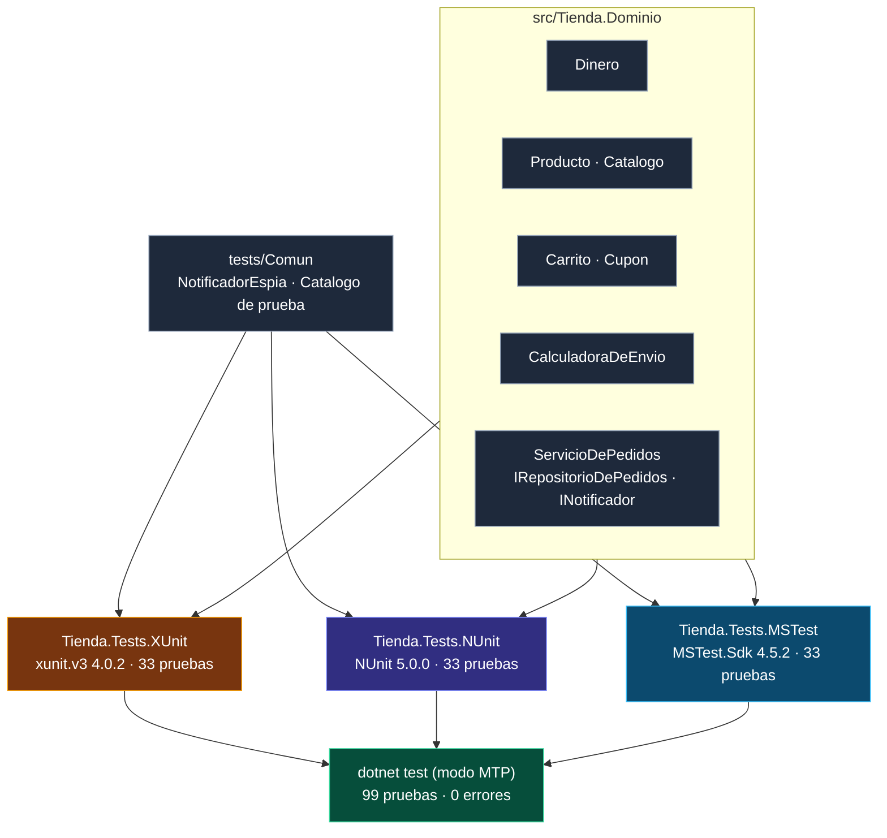
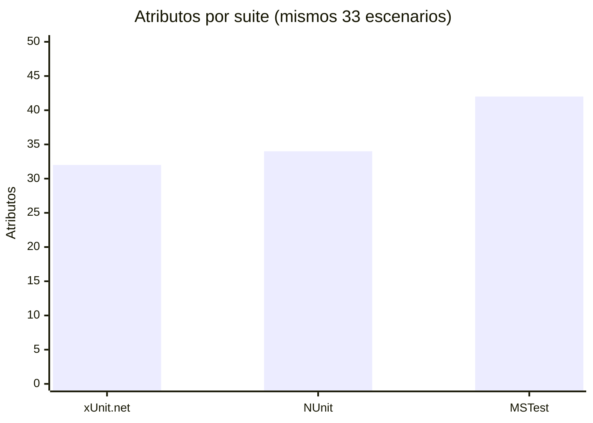

<div align="center">

# 19 · Laboratorio

**Una tienda, tres suites idénticas, 99 pruebas en verde: el código de este repositorio como Piedra Rosetta ejecutable, con métricas, recorrido guiado y ejercicios**

[⬅ 18 · Referencia rápida](18-referencia-rapida-y-glosario.md) · [🏠 Índice](../README.md)

</div>

---

## Contenido

1. [Qué es el laboratorio](#1-qué-es-el-laboratorio)
2. [Estructura](#2-estructura)
3. [El dominio: `Tienda.Dominio`](#3-el-dominio-tiendadominio)
4. [Las tres suites, escenario por escenario](#4-las-tres-suites-escenario-por-escenario)
5. [Métricas comparadas](#5-métricas-comparadas)
6. [Ejecutar](#6-ejecutar)
7. [Las herramientas del atlas](#7-las-herramientas-del-atlas)
8. [Hallazgos del laboratorio](#8-hallazgos-del-laboratorio)
9. [Ejercicios](#9-ejercicios)

---

## 1. Qué es el laboratorio

El laboratorio es una pequeña biblioteca de comercio electrónico (`Tienda.Dominio`) probada **tres veces**, con los mismos 33 escenarios, en xUnit.net v3, NUnit 5 y MSTest 4.
Las tres suites comparten los dobles de prueba (`tests/Comun`) y se ejecutan juntas con un solo `dotnet test` sobre Microsoft.Testing.Platform.



---

## 2. Estructura

```text
.
├── global.json                        ← SDK 10, modo MTP de dotnet test, versión de MSTest.Sdk
├── Directory.Build.props              ← net10.0, C# 14, nulabilidad, advertencias como errores
├── Directory.Packages.props           ← versiones centralizadas (verificadas el 8-nov-2026)
├── UnitTestingFrameworks.slnx         ← solución en formato XML
├── src/Tienda.Dominio/                ← el código bajo prueba (206 líneas)
└── tests/
    ├── Comun/Dobles.cs                ← dobles compartidos por las tres suites
    ├── Tienda.Tests.XUnit/            ← xunit.v3 · ejecutable · TestContext.Current
    ├── Tienda.Tests.NUnit/            ← NUnit + NUnit3TestAdapter (EnableNUnitRunner) + NUnit.Analyzers
    └── Tienda.Tests.MSTest/           ← MSTest.Sdk · paralelismo a nivel de método
```

| Decisión | Motivo |
|---|---|
| `TreatWarningsAsErrors` | Los analizadores de los tres frameworks actúan como revisores obligatorios |
| Gestión central de paquetes | Una sola fuente de versiones para el laboratorio y el verificador de ejemplos |
| `global.json` con `"test": { "runner": … }` | `dotnet test` en modo MTP para los tres proyectos |
| Dobles escritos a mano en `tests/Comun` | Las tres suites prueban exactamente lo mismo, sin bibliotecas de *mocks* |
| `TimeProvider` inyectado | Las reglas de tiempo se prueban de forma determinista |

---

## 3. El dominio: `Tienda.Dominio`

| Tipo | Responsabilidad | Reglas que se prueban |
|---|---|---|
| `Dinero` | Importe inmutable con moneda | No negativo; redondeo bancario a 2 decimales; no se suman monedas distintas; descuento entre 0 y 100 % |
| `Producto` · `Catalogo` | Producto con SKU validado | SKU con formato `AAA-0000` (expresión regular generada en compilación) |
| `Carrito` | Líneas, cupón y totales | Acumula unidades; máximo 10 por producto; un solo cupón; misma moneda |
| `CalculadoraDeEnvio` | Tarifa por zona y peso | Base por zona + 25 por kilo extra; envío gratis nacional desde 999 |
| `ServicioDePedidos` | Confirmar y cancelar pedidos | No confirma carritos vacíos; persiste y notifica; cancelación solo en 24 horas; respeta la cancelación |
| `RepositorioEnMemoria` | *Fake* de persistencia | Seguro para uso concurrente con `System.Threading.Lock` (C# 13) |

---

## 4. Las tres suites, escenario por escenario

| Escenario | xUnit.net v3 | NUnit 5 | MSTest 4 |
|---|---|---|---|
| Suma de importes | `[Fact]` + `Assert.Equal` | `[Test]` + `Is.EqualTo` | `[TestMethod]` + `Assert.AreEqual` |
| Monedas incompatibles | `Assert.Throws<T>` | `Assert.Throws<T>` | `Assert.ThrowsExactly<T>` |
| Redondeo (3 casos) | `[Theory]` + `[InlineData]` (double → decimal) | `[TestCase]` (double → decimal) | `[DataRow]` con `double` y conversión explícita |
| Porcentaje fuera de rango (2) | `[Theory]` + `[InlineData]` | `[TestCase]` + `Throws.TypeOf<T>()` | `[DataRow]` + `ThrowsExactly` |
| Formato de SKU (6) | `[Theory]` con `bool esperado` | `[TestCase(…, ExpectedResult = …)]` | `[DataRow]` con `bool esperado` |
| SKU inválido | `ex.ParamName` | `Throws.ArgumentException.ParamName` (NUnit 5) | `ex.ParamName` |
| Carrito (5 escenarios) | Campo + constructor | `[SetUp]` | `[TestInitialize]` |
| Cupón: subtotal y total | `Assert.Multiple` | `Assert.EnterMultipleScope()` | Dos `Assert.AreEqual` |
| Tarifas de envío (6) | `TheoryData<…>` + `[MemberData]` | `TestCaseData<…>.Returns()` + `[TestCaseSource]` | Tuplas + `[DynamicData]` |
| Servicio de pedidos (5) | `TestContext.Current.CancellationToken` | `[CancelAfter]` + parámetro `CancellationToken` | `TestContext` inyectado por constructor |
| Repositorio compartido (2) | `IClassFixture<T>` + `IAsyncLifetime` | `[OneTimeSetUp]` asíncrono | `[ClassInitialize]` asíncrono |
| **Total** | **33** | **33** | **33** |

---

## 5. Métricas comparadas

Medidas sobre el código real de las tres suites (archivos `.cs`, sin contar `tests/Comun`):

| Métrica | xUnit.net v3 | NUnit 5 | MSTest 4 |
|---|---:|---:|---:|
| Líneas totales | 252 | 241 | 265 |
| Líneas de código (sin vacías ni comentarios) | 204 | 197 | 214 |
| Atributos | 32 | 34 | 42 |
| Llamadas `Assert.*` | 32 | 27 | 32 |
| Métodos de aserción distintos | 12 | 6 | 11 |
| Líneas del `.csproj` | 19 | 21 | 13 |
| Tiempo de la suite (en una Mac M-series) | ~0,6 s | ~0,7 s | ~0,5 s |



Lectura de las cifras:

- **MSTest usa más atributos** porque exige `[TestClass]` y repite `[TestMethod]` junto a cada `[DataRow]`; a cambio, su `.csproj` es el más corto gracias a `MSTest.Sdk`.
- **NUnit tiene menos líneas y menos llamadas `Assert.*`**: `ExpectedResult` y `TestCaseData.Returns()` eliminan aserciones explícitas, y `Assert.That` concentra todo en un
  único método con 6 variantes frente a 11–12 métodos de los otros dos.
- Las diferencias son **pequeñas**: los tres frameworks expresan las mismas pruebas con un costo muy parecido. El factor decisivo no es la sintaxis.

---

## 6. Ejecutar

```bash
# Requisitos: SDK de .NET 10 (10.0.100 o posterior) y Python 3.9+ para las herramientas
dotnet test                                                   # 99 pruebas, los tres frameworks

dotnet test --project tests/Tienda.Tests.XUnit                 # una suite
dotnet run  --project tests/Tienda.Tests.NUnit                 # el ejecutable, sin dotnet test
dotnet test --report-trx --results-directory artefactos        # tres informes TRX
dotnet test --project tests/Tienda.Tests.MSTest --coverage     # cobertura (incluida en MSTest.Sdk)
```

Salida real de `dotnet test` en la raíz:

```text
  …/Tienda.Tests.MSTest.dll (net10.0|arm64) correcto (482ms)
  …/Tienda.Tests.NUnit.dll (net10.0|arm64) correcto (563ms)
  …/Tienda.Tests.XUnit.dll (net10.0|arm64) correcto (559ms)
  total: 99
  error: 0
  correcto: 99
  omitido: 0
  duración: 805ms
```

---

## 7. Las herramientas del atlas

| Herramienta | Qué hace |
|---|---|
| [`tools/verificar_ejemplos.py`](../tools/verificar_ejemplos.py) | Extrae **cada bloque `csharp`** de los capítulos, lo envuelve en un espacio de nombres único, lo compila en un proyecto por framework con los mismos paquetes del laboratorio y `TreatWarningsAsErrors`, y **ejecuta sus pruebas**: todas deben pasar |
| [`tools/generar_atlas.py`](../tools/generar_atlas.py) | Genera el [catálogo A–Z](17-catalogo-a-z.md), la tabla periódica, la línea de tiempo y el banner desde [`data/equivalencias.csv`](../data/equivalencias.csv) y [`data/hitos.csv`](../data/hitos.csv) |
| [`.github/workflows/atlas.yml`](../.github/workflows/atlas.yml) | Ejecuta ambas en CI, en Linux, Windows y macOS |

Marcas que entiende el verificador en un bloque de código:

| Marca | Significado |
|---|---|
| `xunit` · `nunit` · `mstest` | Framework del bloque (o la directiva `<!-- fw=… -->` para el resto del archivo) |
| `dominio` | C# sin framework, visible para los bloques de los tres |
| `aislado` | Se compila en un proyecto propio (por ejemplo, con atributos `[assembly: …]`) |
| `metodos` | Miembros sueltos que se envuelven en una clase de pruebas |
| `omitir` | No se compila: sintaxis histórica o paquetes externos |

```bash
python3 tools/verificar_ejemplos.py               # todos los capítulos
python3 tools/verificar_ejemplos.py --solo nunit  # solo un framework
python3 tools/verificar_ejemplos.py --lista       # inventario de bloques y marcas
python3 tools/generar_atlas.py                    # regenerar catálogo y SVG
```

---

## 8. Hallazgos del laboratorio

Construir y verificar el atlas contra los paquetes reales produjo hallazgos que no aparecen en la documentación de ningún framework. Están repartidos por los capítulos; aquí,
reunidos:

| # | Hallazgo | Capítulo |
|---:|---|---|
| 1 | `Assert.AreEquivalent` de MSTest 4.3 respeta el orden de las secuencias; `Assert.Equivalent` de xUnit.net lo ignora | [08](08-aserciones.md#4-equivalencia-y-colecciones) |
| 2 | `Assert.AreEqual` de MSTest sobre dos arreglos iguales falla mostrando `[1, 2, 3]` frente a `[1, 2, 3]` | [08](08-aserciones.md#la-trampa-de-assertareequal-con-colecciones-en-mstest) |
| 3 | `UsingPropertiesComparer()` de NUnit lanza `NotSupportedException` con tipos distintos | [08](08-aserciones.md#4-equivalencia-y-colecciones) |
| 4 | `MSTEST0056` prefiere `[TestMethod(DisplayName = …)]` al argumento de cadena | [06](06-mstest.md#3-clases-y-métodos-de-prueba) |
| 5 | `NUnit2007` rechaza constantes como valor real (`Assert.That(0.1 + 0.2, …)`) | [05](05-nunit.md#3-el-modelo-de-restricciones) |
| 6 | `MSTEST0025` considera "siempre falla" `Assert.AreEqual(0.3, 0.1 + 0.2, delta)` con constantes | [06](06-mstest.md#4-la-api-de-aserciones-de-mstest-4) |
| 7 | `MSTest.Sdk` y la gestión central de paquetes chocan (`NU1506`) al añadir la extensión TRX | [14](14-ci-cobertura-y-reportes.md#3-una-solución-con-tres-frameworks-un-caso-real) |
| 8 | `Dinero.ToString()` depende de la cultura del hilo: defecto real del dominio | [11](11-paralelismo-y-aislamiento.md#4-las-siete-fuentes-de-no-determinismo) |
| 9 | `Carrito.Quitar` no tiene ninguna prueba: la cobertura lo delata | [14](14-ci-cobertura-y-reportes.md#7-la-cobertura-del-laboratorio) |
| 10 | Un filtro sin coincidencias devuelve el código 8 con MTP, en lugar de un falso verde | [03](03-plataformas-de-ejecucion.md#8-códigos-de-salida) |

---

## 9. Ejercicios

| Nivel | Ejercicio | Pista |
|---|---|---|
| ⭐ | Escribe la prueba que falta para `Carrito.Quitar` en los tres frameworks | Devuelve `bool`; prueba quitar un SKU existente y uno inexistente |
| ⭐ | Añade a las tres suites el caso "agregar un producto en USD a un carrito en MXN" | `MonedaIncompatibleException` |
| ⭐⭐ | Corrige `Dinero.ToString()` para que no dependa de la cultura y actualiza la prueba del [capítulo 11](11-paralelismo-y-aislamiento.md) | `CultureInfo.InvariantCulture` |
| ⭐⭐ | Activa `--parallel all` en xUnit.net y comprueba si alguna prueba deja de ser segura | `xunit.runner.json` con `"parallelMode": "all"` |
| ⭐⭐ | Pon `[FixtureLifeCycle(LifeCycle.InstancePerTestCase)]` en la suite de NUnit y elimina los `[SetUp]` | Campos `readonly` inicializados en la declaración |
| ⭐⭐ | Ejecuta Stryker.NET contra el dominio y mata los mutantes supervivientes | `dotnet stryker` desde una suite |
| ⭐⭐⭐ | Compila la suite de xUnit.net con Native AOT | `xunit.v3.core.aot` y `PublishAot` ([capítulo 04](04-xunit.md#11-native-aot-40)) |
| ⭐⭐⭐ | Migra la suite de NUnit a TUnit y compara métricas | [Capítulo 13](13-dobles-de-prueba-y-ecosistema.md#10-tunit-el-cuarto-framework) |
| ⭐⭐⭐ | Añade una prueba de propiedades con CsCheck: "añadir un producto nunca reduce el subtotal" | [Capítulo 09](09-pruebas-parametrizadas.md#6-pruebas-basadas-en-propiedades) |

---

<div align="center">

[⬅ 18 · Referencia rápida](18-referencia-rapida-y-glosario.md) · [🏠 Índice](../README.md)

</div>
